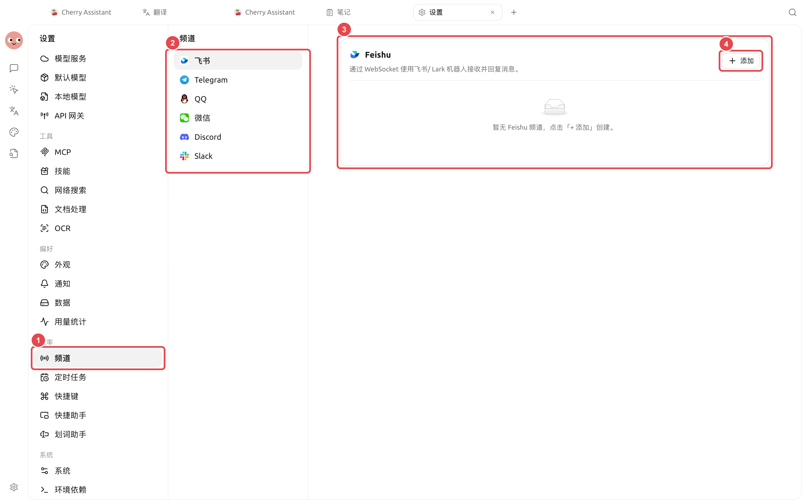
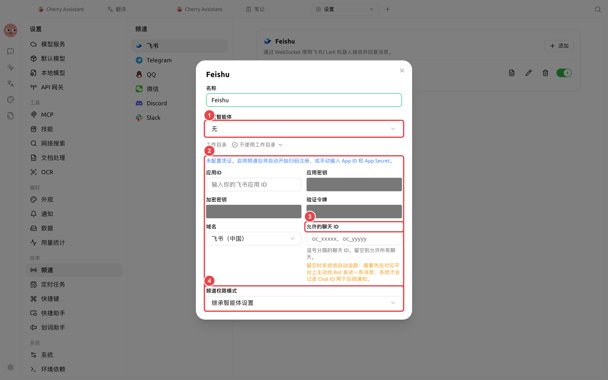

# 频道

频道把一个智能体连接到外部消息平台。当前可配置飞书、Telegram、QQ、微信、Discord 和 Slack；各平台需要的机器人凭据和会话标识不同。


推荐先在【工作】中告诉智能体：“为当前智能体配置飞书频道，用于接收群消息并发送任务结果。”智能体会按用途询问必要信息，比直接面对所有平台字段更快。需要精确修改时，再使用【设置】→【频道】。


<figure><figcaption>
先选择要接入的平台，再点击【添加】；不同平台需要准备的账号和凭据不同。
</figcaption></figure>

## 手动配置路径

【设置】→【频道】→选择平台→【添加】。



### 1. 准备平台账号

按照平台规则创建机器人或应用。飞书和微信支持扫码相关流程时，可在启用频道后按界面提示完成；其他平台填写对应 Token 或应用凭据。



<figure><figcaption>
先绑定经过测试的智能体，并限制允许的聊天范围；凭据和权限只开放完成任务所需的部分。
</figcaption></figure>

### 2. 绑定智能体和工作区

选择已经验证可用的智能体，并为频道消息指定工作区。外部消息会在这个上下文中执行，不要选择包含无关敏感文件的目录。



### 3. 限制消息来源

填写允许的 Chat ID、频道 ID 或用户 ID。留空可能表示允许所有，具体以当前平台字段说明为准。可以先向机器人发送 `/whoami` 获取正确格式的标识。



### 4. 选择权限模式并启用

默认使用【继承智能体设置】。公开群、多人群或不可信来源应使用更严格的模式。启用后先发送无副作用的测试消息。



## 推荐配置

| 配置项 | 产品默认值 | 建议起点 | 作用 | 适用场景 | 注意事项 |
| -------- | --------- | --------------- | ------------ | --------- | ---------------- |
| 绑定智能体 | 需要选择 | 为频道单独准备一个智能体 | 决定消息由谁处理 | 群聊、机器人私聊 | 不与高权限开发智能体混用 |
| 工作区 | 需要选择 | 使用不含私人资料的专用目录 | 限定可处理文件 | 群内收集、日报交付 | 不选择用户主目录 |
| 允许的消息来源 | 依平台字段而定 | 先只允许测试账号或测试群 | 限制谁能触发智能体 | 内测、团队群 | 留空前先阅读字段说明 |
| 权限模式 | 【继承智能体设置】 | 外部入口使用更严格的批准 | 控制工具操作 | 公开群、多人群 | 不建议使用【完全访问】 |

## 使用场景：团队值班群

创建一个只处理值班手册的智能体，绑定经过召回测试的知识库和专用工作区，只允许值班群触发。先测试“查一条制度”和“找不到答案”两类消息，再测试生成不含敏感信息的交接摘要。

### 完成标准

非允许来源不能触发任务；回答能回到指定群；知识库没有内容时明确说明；文件写入仍会请求批准。

## 平台配置重点

| 平台 | 主要凭据 | 会话范围重点 |
| --------- | ----------------------- | ------------------ |
| 飞书 / Lark | App ID、App Secret，或扫码流程 | 聊天 ID 与国内/国际域名 |
| Telegram | Bot Token | Chat ID |
| QQ | App ID、Client Secret | 私聊、群或频道标识格式 |
| 微信 | 扫码登录或凭据路径 | 允许的用户 ID |
| Discord | Bot Token | 频道或私聊 ID |
| Slack | Bot Token、App Token | Socket Mode 与频道 ID |


机器人 Token、App Secret 和验证令牌等同账号密码。不要写进智能体长期记忆、任务提示词、截图或公开 Issue；泄露后应立即在平台端撤销并重新生成。


定时任务选不到频道接收目标怎么办？

先在对应平台主动给机器人发送一条消息，让 Cherry Studio 记录可用的 Chat ID，再回到定时任务选择通知目标。

频道已连接但不回复怎么办？

检查允许的会话 ID、绑定智能体、工作区和权限模式，再查看频道日志。平台收到了消息但智能体未执行时，继续检查 API 网关和智能体任务状态。

