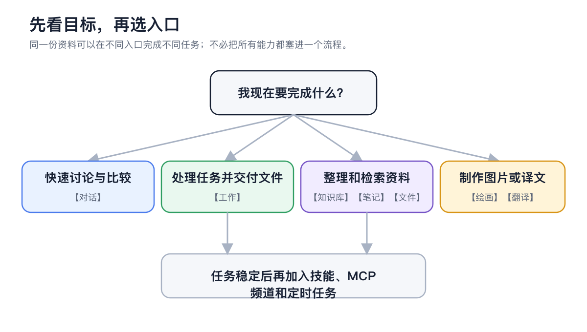
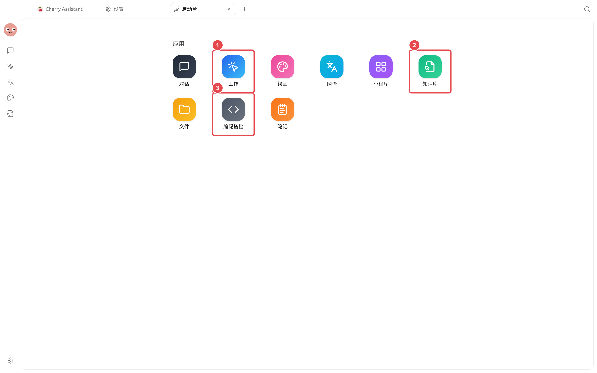

# 进阶能力地图

进阶教程不按设置菜单逐项罗列，而是从“想完成什么工作”出发。先选最接近的目标，再进入对应教程。

<figure><figcaption>
先选主入口完成最小任务；结果稳定后，再加入知识库、技能、MCP、频道或定时任务。
</figcaption></figure>


需要配置一套教程、频道、定时任务或扩展能力时，优先在【工作】中告诉智能体你的目标。智能体可以帮助判断缺少什么并带你完成常见配置；需要核对账号、密钥或精确参数时，再到【设置】手动调整。


<figure><figcaption>
左侧启动台提供九个主要入口，选择与任务最接近的一个开始。
</figcaption></figure>

图表说明：先按目标选择主要入口，流程稳定后再加入技能、MCP、频道或定时任务。

### 按目标选择入口

| 你想完成什么 | 推荐入口 | 会用到的能力 |
| ------------- | ----------------------- | --------------------- |
| 比较多个回答、整理长讨论 | 【对话】 | 多模型、消息分支、上下文、引用与产物 |
| 处理文件或完成多步骤任务 | 【工作】 | 智能体、工作目录、工具、权限与状态面板 |
| 用自己的资料稳定问答 | 【知识库】→召回测试，再绑定智能体 | 文件/网页/笔记、RAG、检索范围 |
| 从文章生成配图或编辑图片 | 【绘画】，或在智能体中启用【生成图片】 | 模板、参考图、局部编辑、增强 |
| 翻译文本、截图或长文档 | 【翻译】 | OCR、文档处理、历史和收藏 |
| 沉淀草稿并继续加工 | 【笔记】 | Markdown、搜索、导出、加入知识库 |
| 截取界面、标注并复制文字 | 【设置】→【截图】启用后使用全局快捷键 | 区域截图、标注、马赛克、OCR |
| 打开常用网页应用 | 【小程序】 | 内置网页工具和已添加的站点 |
| 浏览、预览和整理本地文件 | 【文件】 | 文件列表、预览和后续处理 |
| 连接外部工具或固定工作方法 | 先让智能体判断，再到【设置】核对 | 技能、MCP、内置工具 |
| 从外部平台使用智能体 | 先在【工作】中让智能体引导配置 | 频道、允许范围、权限模式 |
| 按计划生成日报或提醒 | 先跑通智能体，再创建【定时任务】 | 智能体、工作目录、频道、运行记录 |
| 同时查看资料与任务 | 标签页右键→【从新窗口打开】 | 多窗口、固定标签页、全局搜索 |
| 管理编程命令行 | 启动台【编码搭档】 | Code CLI、模型连接、目录与终端 |
| 让本机程序调用模型或排错 | 【设置】→【API 网关】/【通用】 | 兼容 API、调用链、开发者模式 |

### 推荐学习顺序




#### 1. 先掌握智能体工作区

学会创建智能体、选择工作目录、理解模型分工和权限。后面的扩展、自动化和项目案例都建立在这里。



#### 2. 再接入资料与能力

长期资料用知识库，重复方法用技能，外部系统用 MCP。每次只增加一种能力并用小任务验证。



#### 3. 最后自动运行或对外连接

手动结果稳定后再配置频道、定时任务、Code CLI 或外部 API。这样出现问题时更容易找到是哪一环。



### 按模块阅读

<table data-view="cards"><thead><tr><th></th><th></th><th data-hidden data-card-target data-type="content-ref"></th></tr></thead><tbody><tr><td><strong>对话进阶</strong></td><td>多模型、分支、上下文与产物</td><td><a href="chat/README.md">chat/README.md</a></td></tr><tr><td><strong>智能体工作区</strong></td><td>从配置、执行到文件交付</td><td><a href="agent-workspace/README.md">agent-workspace/README.md</a></td></tr><tr><td><strong>知识与内容工作流</strong></td><td>知识库、笔记、绘画和翻译</td><td><a href="knowledge-content/README.md">knowledge-content/README.md</a></td></tr><tr><td><strong>扩展智能体的能力</strong></td><td>技能与 MCP</td><td><a href="extensions/README.md">extensions/README.md</a></td></tr><tr><td><strong>自动化与外部触达</strong></td><td>频道、定时任务和心跳</td><td><a href="automation/README.md">automation/README.md</a></td></tr><tr><td><strong>高效工作台</strong></td><td>多窗口、效率工具与搜索</td><td><a href="workbench/README.md">workbench/README.md</a></td></tr><tr><td><strong>开发与诊断</strong></td><td>Code CLI、API 网关与调用链</td><td><a href="developer-tools/README.md">developer-tools/README.md</a></td></tr><tr><td><strong>应用案例</strong></td><td>九种完整工作流</td><td><a href="cases/README.md">cases/README.md</a></td></tr></tbody></table>


工作目录、MCP、频道和高权限模式都会扩大智能体可以接触的数据范围。只提供当前任务需要的目录、工具和账号，不把 API Key、机器人密钥或私人资料放进公开对话与截图。

