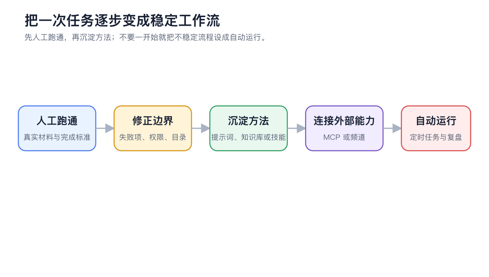

# 应用案例

这些案例展示怎样把对话、智能体、知识库、笔记、绘画、翻译、频道、定时任务和多窗口组合成真正能交付的流程。案例中的配置是起点，实际使用时仍要按资料敏感度、用量和团队规则调整。

<figure><figcaption>
先用真实材料人工跑通，再逐步加入知识库、技能、MCP、频道和定时任务。
</figcaption></figure>

## 选择一个案例

<table data-view="cards"><thead><tr><th></th><th></th><th data-hidden data-card-target data-type="content-ref"></th></tr></thead><tbody><tr><td><strong>多模型研究复盘</strong></td><td>内部资料、外部来源与冲突核对</td><td><a href="research-review.md">research-review.md</a></td></tr><tr><td><strong>长文档审阅</strong></td><td>按章节检查并生成修订稿</td><td><a href="long-document-review.md">long-document-review.md</a></td></tr><tr><td><strong>智能体项目文件交付</strong></td><td>控制目录、权限与产物范围</td><td><a href="project-delivery.md">project-delivery.md</a></td></tr><tr><td><strong>品牌配图套件</strong></td><td>从视觉方向到多尺寸成图</td><td><a href="brand-image-kit.md">brand-image-kit.md</a></td></tr><tr><td><strong>私有知识库问答</strong></td><td>限定资料范围并拒绝猜测</td><td><a href="private-knowledge-qa.md">private-knowledge-qa.md</a></td></tr><tr><td><strong>笔记生成周报</strong></td><td>从日常记录到可核对周报</td><td><a href="notes-weekly-report.md">notes-weekly-report.md</a></td></tr><tr><td><strong>多语言资料整理</strong></td><td>术语、OCR、文档与一致性检查</td><td><a href="multilingual-materials.md">multilingual-materials.md</a></td></tr><tr><td><strong>频道与定时日报</strong></td><td>智能体、频道、计划和运行记录</td><td><a href="automated-daily-report.md">automated-daily-report.md</a></td></tr><tr><td><strong>多窗口研究工作台</strong></td><td>同时保留资料、对比和执行任务</td><td><a href="multi-window-research.md">multi-window-research.md</a></td></tr></tbody></table>

## 通用搭建顺序

<figure><figcaption>
案例不是一组孤立设置，而是从输入、执行、复核到交付的完整工作流。
</figcaption></figure>

## 按工作选择案例

| 你的任务 | 建议先看 | 主要能力 |
| ----------- | -------------- | -------------- |
| 比较观点并保留研究过程 | 【多模型研究复盘】 | 对话、分支、笔记 |
| 审阅大份资料并输出意见 | 【长文档审阅】 | 智能体、工作目录、文件 |
| 交付项目文档和产物 | 【智能体项目文件交付】 | 智能体、状态、文件 |
| 生成一组风格统一的图片 | 【品牌配图套件】 | 智能体绘画、绘画模板 |
| 只按内部资料回答 | 【私有知识库问答】 | 知识库、召回测试、智能体 |
| 从零散记录整理周报 | 【笔记生成周报】 | 笔记、智能体、文件 |
| 整理多语言文件 | 【多语言资料整理】 | 翻译、智能体、工作目录 |
| 定时发送固定报告 | 【频道与定时日报】 | 智能体、频道、定时任务 |
| 同时观察资料与长任务 | 【多窗口研究工作台】 | 标签页、多窗口、全局搜索 |



### 1. 先定义交付物

说明最后要得到哪个文件、表格、图片或消息，以及怎样算完成。



### 2. 在【工作】中手动跑通

验证模型、提示词、工作目录和资料是否足够。需要批准的操作逐项检查。



### 3. 只沉淀稳定部分

重复步骤做成技能，长期资料放知识库，临时要求留在任务提示词。



### 4. 最后增加外部连接和自动化

完成一次人工验收后，再接 MCP、频道或定时任务，并保留失败时的人工处理入口。


