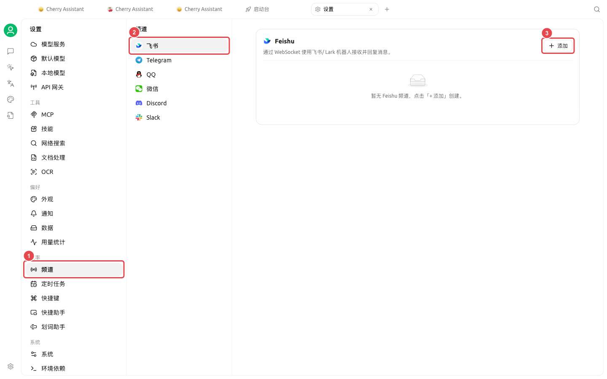
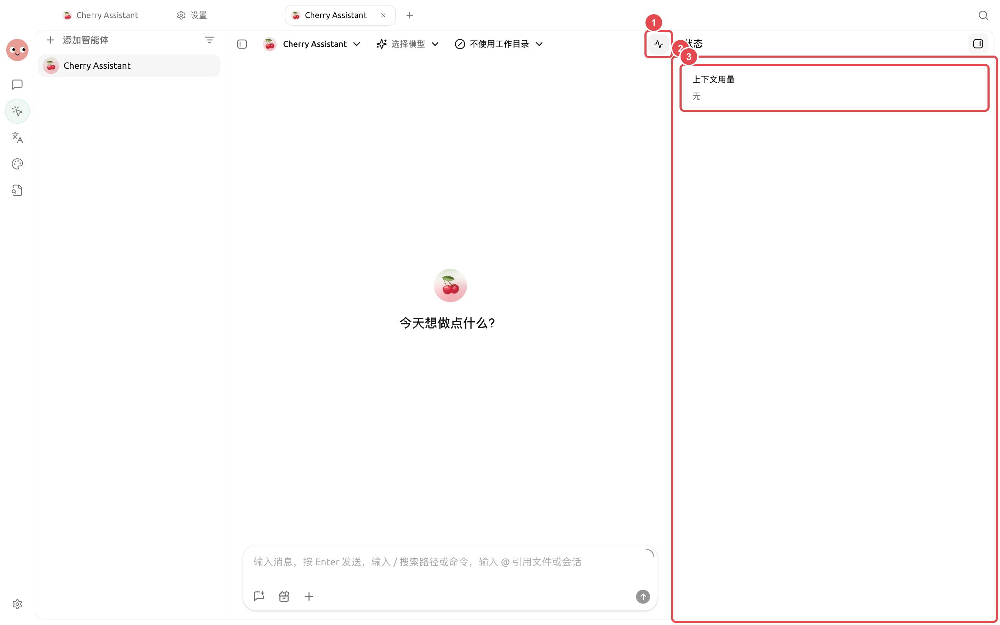
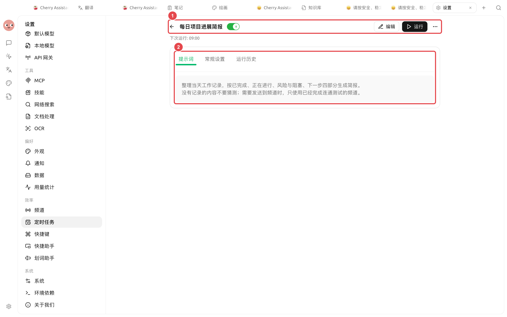

# 频道与定时日报

运营团队希望每个工作日上午自动汇总指定资料，生成日报并发送到团队频道。自动化之前先手动跑通一份，能及早发现数据缺失、路径错误和通知目标问题。

## 先准备什么

* 一个已在【工作】中验证过的日报智能体；
* 明确的数据来源和只包含所需资料的工作目录；
* 固定格式可做成技能；
* 已连接并限制消息范围的频道；
* 一个工作日定时任务。

<figure><figcaption><p>日报先绑定经过测试的频道，再把它选作定时任务的通知目标。</p></figcaption></figure>

<figure><figcaption><p>首次自动运行后，从智能体状态和运行记录检查任务是否真正完成。</p></figcaption></figure>

<figure><figcaption><p>① 任务已经启用并显示下次运行时间；② 提示词明确四段结构、缺失数据处理和频道发送条件。</p></figcaption></figure>

## 配置步骤



### 1. 手动生成一份日报

要求智能体输出“进展、指标、风险、待办”四部分。检查数据缺失时是否明确说明，而不是编造内容。



### 2. 配置通知频道

优先在智能体对话中说明要连接的平台和群，再到【设置】→【频道】核对凭据、允许的会话 ID、工作区和权限模式。



### 3. 建立定时任务

让智能体创建工作日计划，或打开【设置】→【定时任务】→【新建】。选择日报智能体、工作目录、执行时间和通知频道。



### 4. 立即测试

保存后点击【运行】，查看生成的会话、运行历史和频道消息。不要等到第二天才发现路径或接收目标错误。



### 5. 观察并调整

前几次运行检查耗时、用量和失败原因。数据源或团队格式变化时，更新技能或任务提示词，不要在多个位置维护冲突规则。



## 示例任务提示词

```
读取当前工作目录中昨天新增的数据，生成中文运营日报。固定包含进展、关键指标、异常、今日待办。找不到数据时写“暂无数据”并列出缺少的文件，不得补写数值。结果发送到已配置的团队频道，并在工作目录保留一份 Markdown 文件。
```

## 失败处理

| 现象 | 检查位置 |
| ------ | --------------------- |
| 没有运行 | 定时任务状态、下一次运行时间、系统休眠 |
| 运行失败 | 【运行历史】→【查看会话】 |
| 文件没有生成 | 工作目录、权限请求和智能体文件工具 |
| 消息没有送达 | 频道状态、接收目标和平台日志 |
| 内容重复 | 是否同时启用了心跳和多个相同计划 |

## 推荐组合与完成标准

| 项目 | 建议做法 |
| ----- | ---------------------------------- |
| 智能体 | 先手动跑通同一份日报，再交给定时任务 |
| 计划 | 优先使用【每天】或【工作日】，确认下一次运行时间 |
| 频道 | 先发到测试会话，再切换正式群 |
| 完成标准 | 运行历史成功；报告文件可打开；频道只收到一条；缺少数据时不会编造结果 |


定时任务会在无人值守时执行。上线前保持最小文件范围和合适权限，避免把高风险写入或外部修改交给完全访问模式。



截图中的演示环境没有绑定外部频道，所以只展示已经保存并启用的任务。正式使用时还要点击【运行】，确认【运行历史】成功，并在测试频道看到一条真实消息后再投入日常运行。

