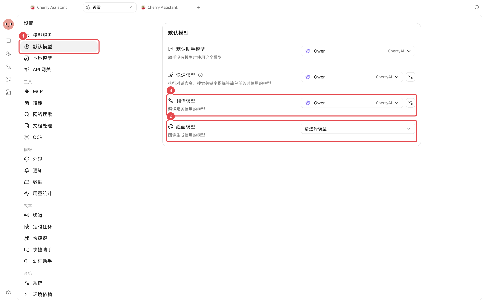
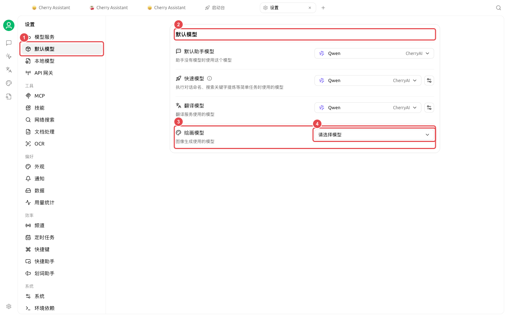
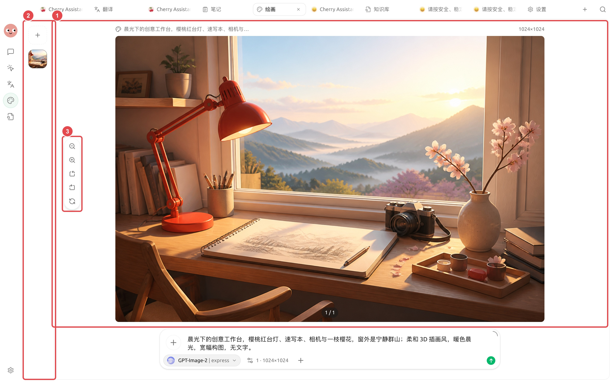

# 品牌配图套件

内容团队要为同一场活动制作横版、方形和竖版配图，并保持主体、色调和品牌规则一致。先确定主视觉，再扩展尺寸，比每张图从头生成更容易保持统一。

<figure><figcaption>
先配置并验证绘画模型，智能体的【生成图片】和【绘画】工作流才有可用连接。
</figcaption></figure>

<figure><figcaption>
先让智能体生成一张样图确认方向，再进入批量制作。
</figcaption></figure>

<figure><figcaption>
先把这张实际成图作为主视觉样稿，确认主体、光线和色调后，再扩展方形与竖版尺寸。
</figcaption></figure>

## 准备材料

* 内容主题与使用平台；
* 允许使用的品牌色和参考图；
* 不可出现的文字、标志和元素；
* 三种图片比例与留白要求。

## 操作流程




### 1. 让智能体提炼视觉方向

把文章或活动说明放入工作目录，让智能体只输出主体、场景、色调、镜头和留白建议，先不生成图片。



### 2. 在【绘画】中验证主视觉

选择合适模板和模型，先生成横版小样。检查产品外观、人物细节和品牌风险。



### 3. 用参考图扩展尺寸

选定主视觉后，将它作为参考，分别生成方形和竖版。每次说明必须保留的主体与可调整的构图。



### 4. 局部修正并增强

只对问题区域使用编辑或蒙版，最终版本再做增强。文件名包含用途和比例，避免混淆。



## 结果检查

* 三张图的色调与主体一致；
* 不包含模型生成的错误文字；
* 不意外出现品牌标志、人物或敏感信息；
* 尺寸满足发布平台要求；
* 参考图的使用得到许可。

## 推荐组合与完成标准

| 项目 | 建议做法 |
| ---- | ------------------------------- |
| 绘画模型 | 先用智能体生成一张样图验证连接，再保存绘画模板 |
| 输入材料 | 品牌色、字体、尺寸、参考图和禁用元素放在同一项目目录 |
| 批量方式 | 先确认一张，再生成同系列图片 |
| 完成标准 | 尺寸正确、文字可读、品牌元素一致、没有多余标识，原参考图仍保留 |

适合文章封面、社交媒体配图和活动素材；需要精确排版的最终海报，建议在设计工具中做最后校对。


如果希望直接在智能体对话中出图，先配置全局【绘画模型】并启用智能体的【生成图片】工具。需要细致编辑时，仍建议回到【绘画】页面。

