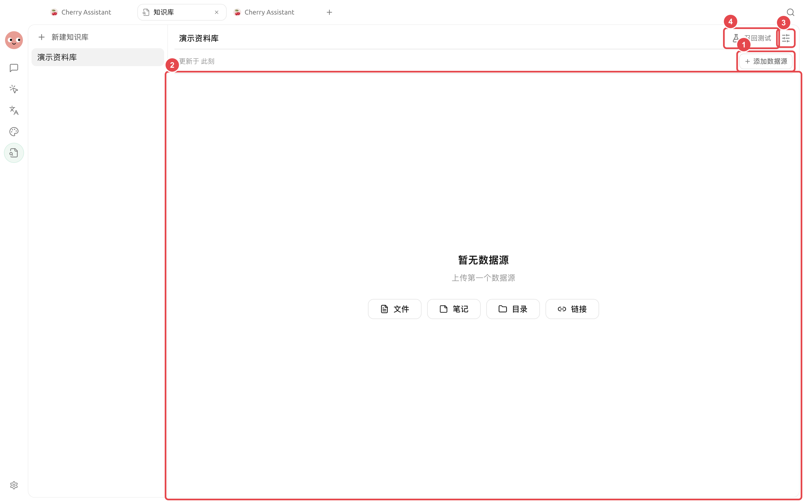
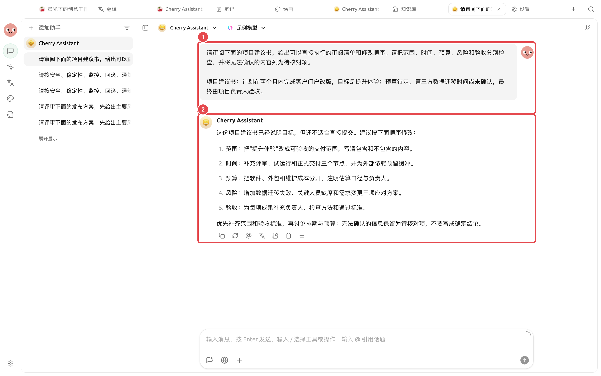

# 长文档审阅

产品经理收到一份篇幅较长的方案，需要找出事实问题、结构缺口和可执行修改，同时保留原稿和人工确认过程。下面的做法适合报告、制度、投标材料和产品方案。

## 推荐组合

* 【对话】：快速比较不同模型的审阅角度；
* 【工作】智能体：读取工作目录并生成修订稿；
* 知识库：提供制度、术语或历史资料；
* 右侧【文件】：检查原稿与产物。

<figure><figcaption><p>制度、术语和历史资料可以作为知识库来源，原稿仍放在独立工作目录。</p></figcaption></figure>

<figure><figcaption><p>① 输入原文和审阅标准；② 实际结果逐项指出缺口，并把不能确认的信息保留为待核对项。</p></figcaption></figure>

## 操作流程



### 1. 准备原稿和审阅标准

把原稿放入独立工作目录，另建一份简短的审阅说明，写清读者、目的、不能改动的事实和交付格式。



### 2. 先做小范围校准

选一个章节，让智能体按“问题、原文位置、影响、建议”输出。确认尺度合适后再处理全文。



### 3. 分开事实与表达

要求智能体把需要查证的事实单独列出，不用语言润色掩盖不确定内容。关键数字回到原资料核对。



### 4. 生成新文件并人工定稿

要求保留原文件，在 `review/` 下生成问题清单和修订稿。用右侧【文件】逐段检查，再导出或分享。



## 示例任务

```
审阅当前目录中的 proposal.docx。先按章节列出事实问题、结构缺口和表达问题，注明原文位置。不要改动原文件；确认清单后，在 review/ 下生成修订稿和待核对事项。
```

## 使用前准备与完成标准

| 项目 | 建议准备 |
| ---- | -------------------------------- |
| 文件 | 原文、审阅要求和输出目录分开放置 |
| 推荐组合 | 专用智能体 + 只含本项目文件的工作目录 + 【逐次确认】 |
| 抽查方式 | 先抽查一章，确认引用格式和判断尺度 |
| 完成标准 | 每条意见带原文位置；未读取部分明确标记；原文件未被覆盖 |

适合合同、报告、论文或规范的结构化审阅；涉及法律、医疗、财务结论时，输出只能作为辅助材料。


文档很长时，不要在一个对话里反复粘贴全文。让智能体直接读取工作目录，并按章节留下中间产物，更容易复核和恢复。

