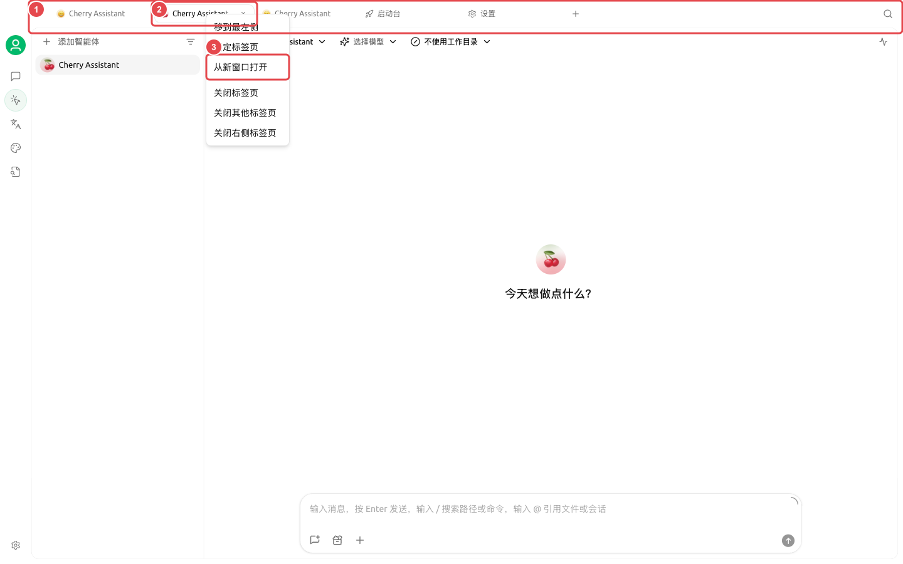
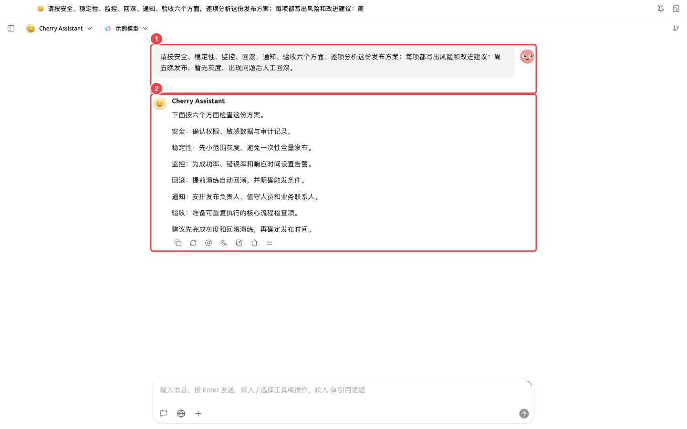

# 多窗口研究工作台

研究人员需要一边保留资料和模型比较，一边让智能体整理文件并生成报告。把研究任务拆到独立窗口后，主窗口仍能继续查资料，不会打断智能体的状态。

## 推荐布局

* 主窗口：保留资料对话和全局搜索；
* 独立窗口：打开研究智能体任务并置顶；
* 第二个标签页：打开知识库或笔记，随时核对原资料。

<figure><figcaption>
主窗口保留多模型比较，独立窗口继续运行研究智能体。
</figcaption></figure>

## 操作流程



### 1. 在【对话】比较研究问题

用多模型对比找出共识、冲突和待查证项，不急着生成最终报告。




### 2. 为研究智能体准备目录

把原始资料与输出目录分开，绑定相关知识库，并要求外部信息保留链接。



### 3. 把任务拆到独立窗口

右键智能体标签页选择【从新窗口打开】，需要时使用窗口置顶。主窗口继续查资料，不打断智能体状态。



### 4. 汇总并复核

在智能体右侧【文件】检查报告，在主窗口打开原对话核对冲突。最终只保留能回到资料或来源的结论。



<figure><figcaption>
从标签页菜单把智能体任务拆到独立窗口。
</figcaption></figure>

<figure><figcaption>
① 独立窗口保留原问题；② 结果和后续操作完整保留，主窗口可以继续查资料或整理笔记。
</figcaption></figure>

## 推荐组合与完成标准

| 窗口 | 建议内容 |
| ----- | --------------------------------- |
| 主窗口 | 资料对话、全局搜索和笔记 |
| 独立窗口 | 一个正在运行的智能体任务 |
| 固定标签页 | 项目最常用的知识库或任务 |
| 完成标准 | 资料来源、任务状态和最终笔记能互相对应；任务结束后窗口已收回或关闭 |

适合需要持续观察长任务的研究，不建议为了“看起来更专业”同时打开很多窗口。


多窗口只改变显示位置，不会创建新的账号或隔离空间。同一任务的数据和权限仍然相同。

