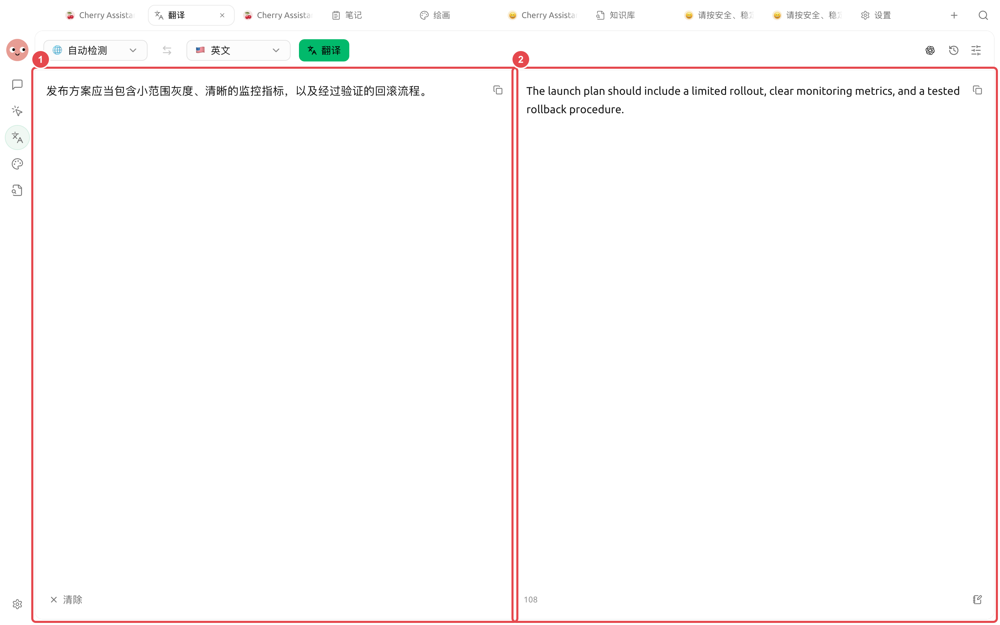

# 多语言资料整理

市场团队收到一套包含文档、截图和产品术语的资料，需要翻译成另一种语言，同时保持名称、数字和格式一致。术语表和小范围试译能减少整份材料返工。

<figure><figcaption>
先确认资料检索准确，再由智能体统一术语和输出格式，最后人工核对关键内容。
</figcaption></figure>

<figure><figcaption>
左侧保留原文，右侧显示实际译文。交付前可逐句核对灰度、监控指标和回滚流程等关键术语。
</figcaption></figure>

## 操作流程



### 1. 先建立术语表

列出产品名、功能名、人名、单位和不可改写的法律表述。为每个词写明目标语言用法。



### 2. 用一小段校准风格

在【翻译】中先处理一个代表性章节，确认正式程度、标题写法和术语，再翻译整份文件。



### 3. 图片单独做 OCR 检查

上传截图后先核对识别文字，尤其是数字、按钮名和表格。识别错误要在翻译前修正。




### 4. 让智能体做一致性检查

把原文、译文和术语表放入工作目录，让智能体列出术语不一致、漏译、数字差异和链接问题，不直接替换法务内容。



## 交付前检查

* 产品名称和界面路径与实际界面一致；
* 数字、日期、货币和单位没有变化；
* Markdown 链接、代码块和图片说明保留；
* 法律、医疗或安全内容经过专业审校。

## 推荐组合与完成标准

| 项目 | 建议做法 |
| ---- | --------------------------------- |
| 翻译入口 | 短文本和截图用【翻译】，多文件整理交给智能体 |
| 术语 | 先提供产品名、专有名词和不翻译词表 |
| 文件 | 原文与译文分目录保存，保留原文件名对应关系 |
| 完成标准 | 数字、链接和专有名词一致；图片文字已抽查；版式变化在交付说明中标记 |


历史记录便于复用，但也会保存翻译内容。处理敏感材料后，按照你的数据管理要求检查并清理记录。

