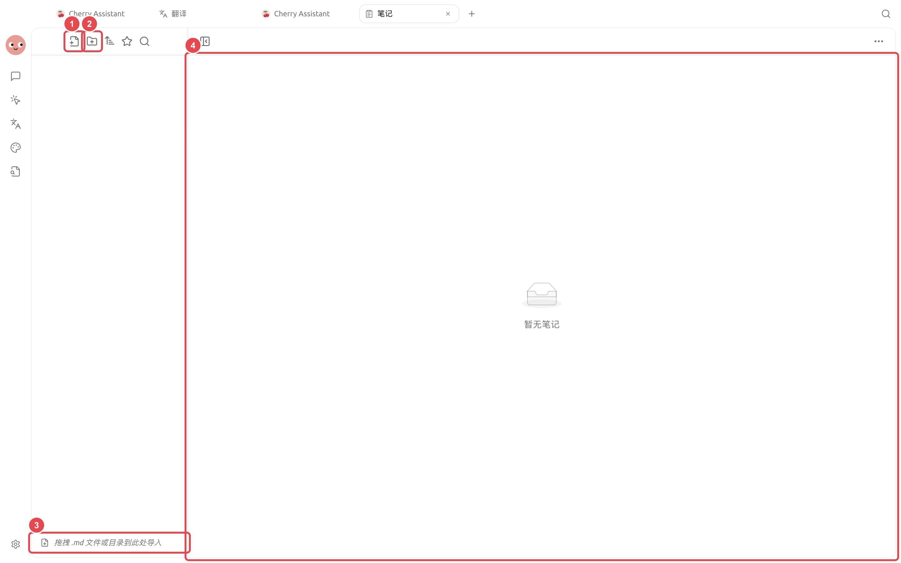
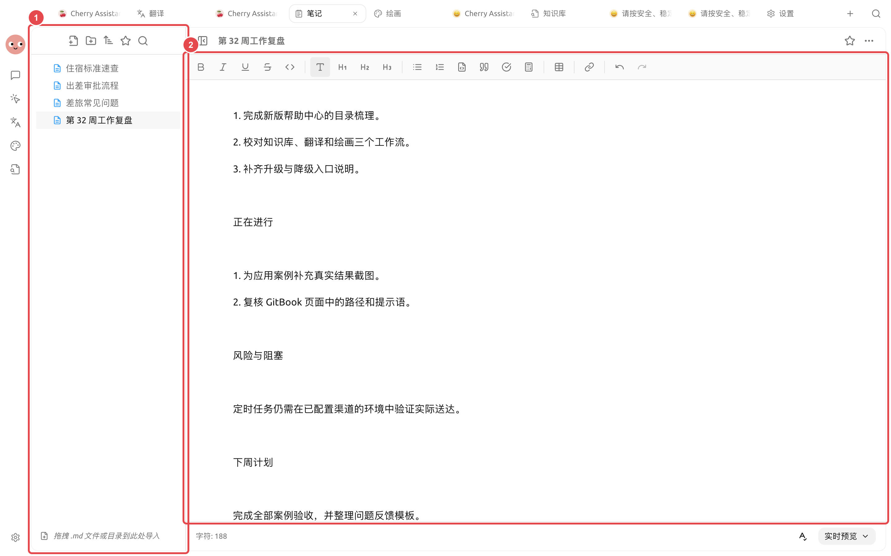

# 笔记生成周报

项目负责人一周内积累了会议笔记、进度更新和零散待办，希望周五整理成结构稳定、事实可核对的周报。关键是先统一记录方式，再让智能体汇总，而不是让它猜测缺失状态。

<figure><figcaption><p>按同一结构持续记录，周末整理时更容易核对状态和负责人。</p></figcaption></figure>

<figure><figcaption><p>① 左侧保留原始记录和本周复盘；② 右侧周报已经有真实内容，可继续人工修改、预览和导出。</p></figcaption></figure>

## 操作流程



### 1. 统一记录方式

每天在同一笔记文件夹记录事项，至少包含日期、结果、负责人和状态。未完成事项不要写成已经交付。



### 2. 周五先人工整理

合并重复事项，补齐关键数字和链接。长期背景放进知识库，本周变化留在当前笔记。



<a id="3-jiao-gei-agent-sheng-cheng-cao-gao"></a>
<a id="3-交给-agent-生成草稿"></a>

### 3. 交给智能体生成草稿

要求按“本周完成、进行中、风险、下周计划”输出，并在资料缺失时列出待补项。



### 4. 检查并导出

确认状态、数字和责任人，再在【笔记】中定稿并导出。稳定格式可以做成技能，下周继续复用。



## 示例任务

```
读取本周笔记，生成周报草稿。合并同一事项，但保留不同日期的状态变化；不推测完成情况。缺少负责人、数字或下一步时列到“待补充”。
```

## 推荐组合与完成标准

| 项目 | 建议做法 |
| ----- | --------------------------------- |
| 日常输入 | 笔记按日期或项目记录，只写事实和待办 |
| 智能体 | 使用固定的周报结构，读取本周笔记后再生成 |
| 输出 | 周报写入独立文件，不覆盖原始笔记 |
| 完成标准 | 每条进展能回到原笔记；未完成事项有负责人或下一步；没有凭空增加数据 |

适合把已经记录的工作整理成周报，不适合让智能体根据零散记忆猜测一周成果。


固定时间自动生成周报前，先手动运行几周。只有输入格式稳定、缺失信息处理可靠后，再创建定时任务。

