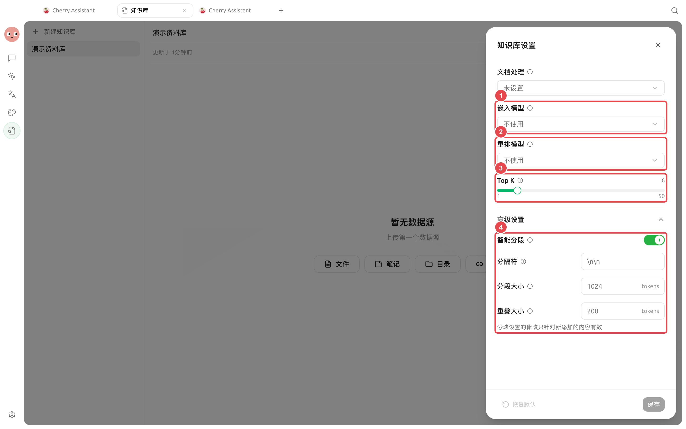
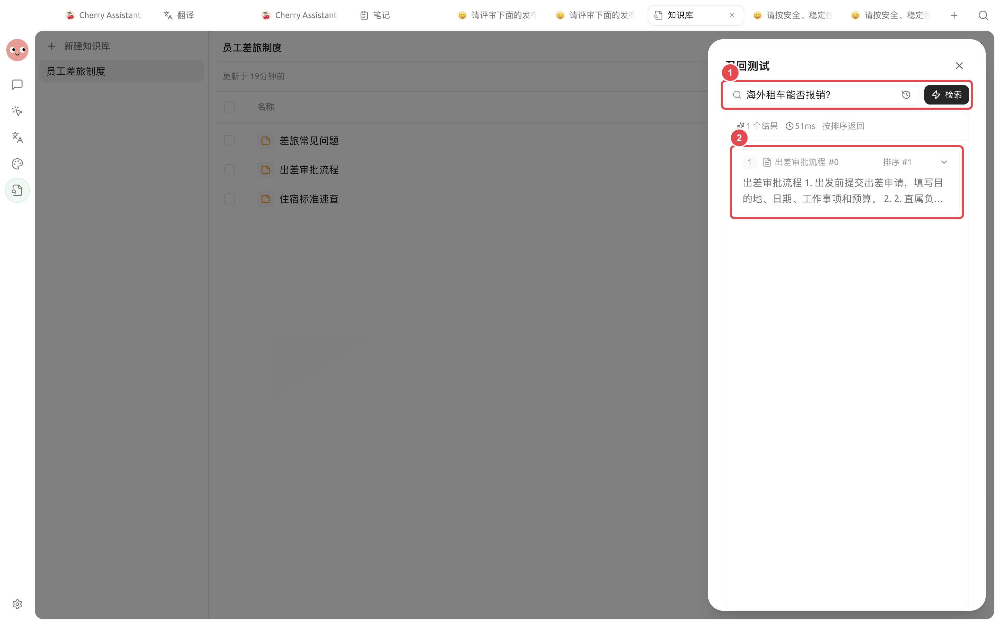

# 私有知识库问答

人事团队想让同事查询现行制度，但不希望智能体用常识补写答案。这个案例把资料范围、召回测试和回答规则放在一起；找不到内容时，智能体应明确说明。

<figure><figcaption><p>为单一主题建立独立知识库，避免现行资料与过期资料混在一起。</p></figcaption></figure>

<figure><figcaption><p>只有召回结果不稳定时，再根据资料结构调整 RAG 设置。</p></figcaption></figure>

<figure><figcaption><p>① 用真实问题测试；② 核对返回资料、原文片段和相关度。只有这里稳定，才把知识库交给智能体使用。</p></figcaption></figure>

## 操作流程



### 1. 建立主题单一的知识库

把现行资料放在一起，移除重复和过期版本。文件名写清主题与生效范围。



### 2. 用真实问题做召回测试

至少测试容易混淆的条款、口语化问法和没有答案的问题。调整资料或 RAG 设置，直到返回片段稳定。



<a id="3-chuang-jian-zhuan-yong-agent"></a>
<a id="3-创建专用-agent"></a>

### 3. 创建专用智能体

只绑定这套知识库，在提示词中要求“优先引用资料；找不到时说未找到；不要用常识补写制度”。权限保持最小范围。



### 4. 从小范围开始使用

先用于内部查找，不直接替代审批或专业判断。收集答错的问题，回到资料和召回测试中修正。



## 示例问题规则

```
回答时先给结论，再注明资料名称和相关段落。资料之间冲突时列出冲突，不替我们选择。知识库没有答案时明确写“当前资料未找到”。
```

## 推荐组合与完成标准

| 项目 | 建议做法 |
| ----- | --------------------------- |
| 知识库 | 一个主题一套资料，删除重复和过期版本 |
| 召回测试 | 同时测试标准问法、口语问法和没有答案的问题 |
| 智能体 | 只绑定需要的知识库，要求引用资料且不补写 |
| 完成标准 | 能找到正确段落；冲突资料会列出；没有答案时明确说未找到 |


私有知识库中的内容会由你选择的嵌入和对话模型服务处理。使用前确认资料的保密要求与服务范围，不把密钥和账号凭据作为知识资料导入。

