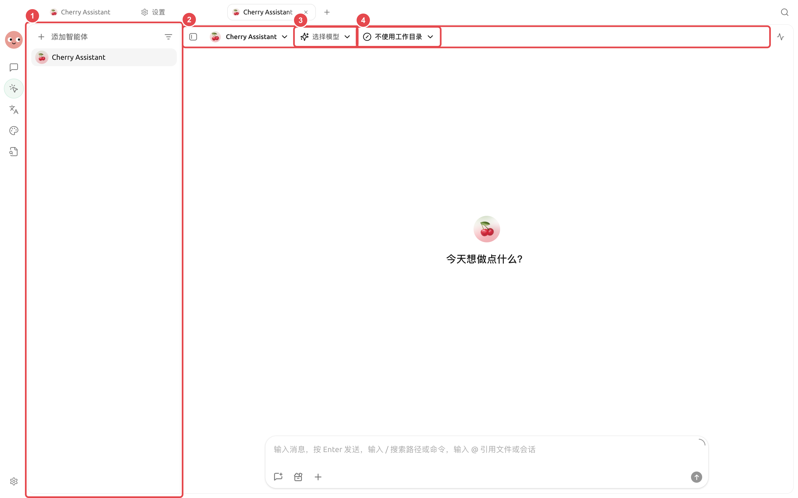
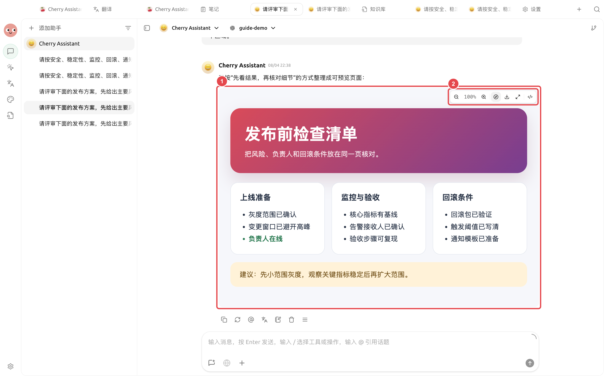

<a id="agent-xiang-mu-wen-jian-jiao-fu"></a>

# 智能体项目文件交付

运营同事要把一批零散资料整理成索引、摘要和交付文件。为了避免误改原件，需要把智能体的工作目录、可修改范围和验收方式提前说清楚。

## 适合的任务

* 把零散资料整理成目录和索引；
* 根据模板生成多份文档；
* 修改代码并留下变更说明；
* 批量改名、转换或检查文件。

<figure><figcaption><p>智能体工作区把任务、模型、工作目录和交付文件放在同一页面。</p></figcaption></figure>

<figure><figcaption><p>长任务先看【状态】面板是否正在执行、等待批准或已经完成。</p></figcaption></figure>

<figure><figcaption><p>交付物生成后要真正打开检查。图中网页预览已经显示标题、检查项和建议，不是空白占位。</p></figcaption></figure>

## 操作流程



### 1. 选择最小工作目录

只选择当前项目目录。重要文件先有备份或版本记录，权限从【逐次确认】开始。



### 2. 明确可改与不可改范围

写清哪些文件只能读取、产物放在哪里、哪些操作必须先确认，以及完成标准。



<a id="3-xian-rang-agent-lie-ji-hua"></a>
<a id="3-先让-agent-列计划"></a>

### 3. 先让智能体列计划

高风险任务可使用【仅规划】。确认文件清单和步骤后，再切换到允许编辑的模式执行。



### 4. 在右侧检查状态和文件

长任务先看【状态】是否等待批准；产物生成后在【文件】中预览。确认无误再移交，不以“任务结束”代替验收。



## 示例任务

```
整理当前目录。raw/ 中的文件只读；在 deliverables/ 下创建索引、摘要和缺失资料清单。任何删除、覆盖或批量改名都先征得确认。最后列出新增和修改的文件。
```

## 推荐组合

| 能力 | 建议用法 | 为什么 |
| ---- | ------------ | ----------------- |
| 工作目录 | 每个项目使用独立目录 | 文件边界和交付位置清楚 |
| 权限 | 修改文件保持【逐次确认】 | 便于发现误删、覆盖和越界写入 |
| 状态面板 | 结束前检查产物和失败步骤 | 不只以“智能体说完成了”为准 |
| 新任务 | 新阶段或新客户另开任务 | 避免历史要求影响当前交付 |


【完全访问】会减少确认，但也扩大误操作影响。只有在隔离、可信且可恢复的目录中，才考虑临时使用。

