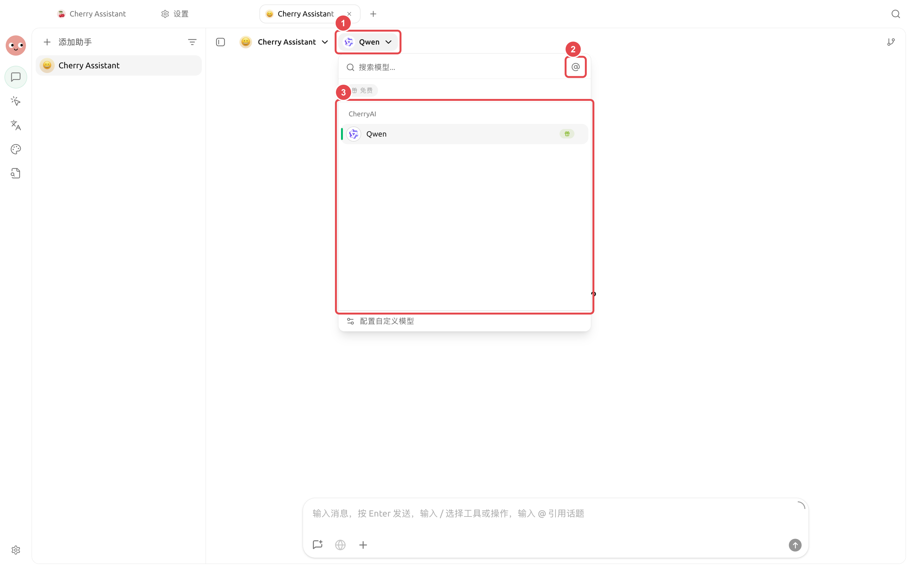
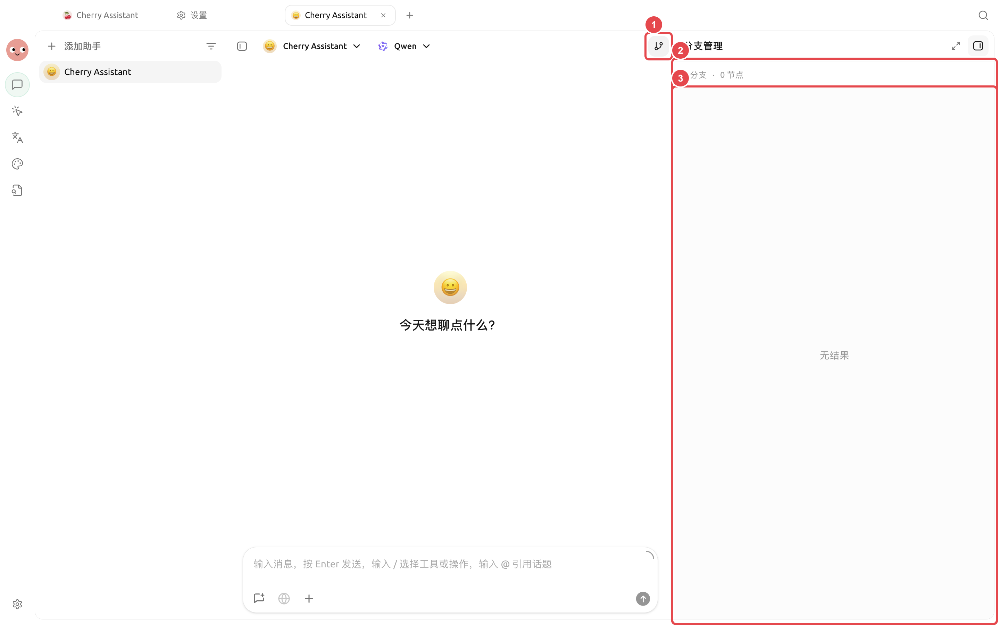
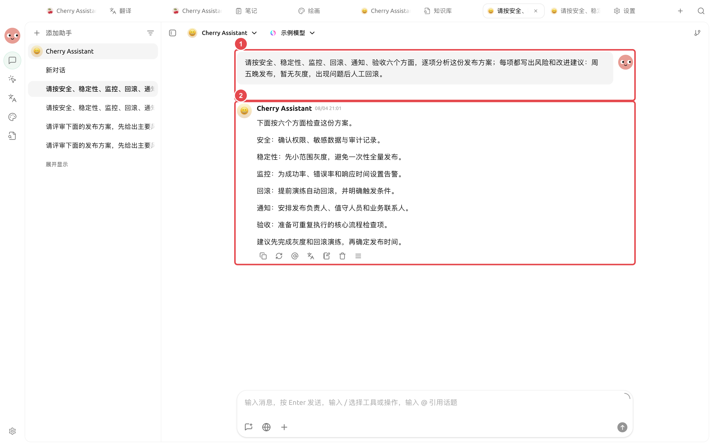

# 多模型研究复盘

一家产品团队准备做季度复盘：内部资料已经齐全，但还需要补充公开信息，并比较不同模型给出的观点。最终要交付一份能回到来源核对、明确区分事实与判断的研究报告。

<figure><figcaption><p>研究开始时先确定比较模型和问题范围，不在中途随意更换标准。</p></figcaption></figure>

<figure><figcaption><p>把不同假设放进独立分支，最后回到主线汇总已经确认的结论。</p></figcaption></figure>

<figure><figcaption><p>① 提问中写清检查维度和已知条件；② 结果按同一结构展开，方便继续比较、追问和人工核对。</p></figcaption></figure>

## 推荐组合

* 【对话】多模型：找出共识、分歧和遗漏；
* 研究智能体：推进任务、拆分子任务并生成报告；
* 知识库：检索内部资料；
* 网页搜索或可信 MCP：补充外部来源；
* 工作目录：保存原始材料和最终产物。

## 操作流程



### 1. 用同一问题比较观点

在【对话】中选择多个模型，要求分别列出结论、假设、来源和不确定项。把真正的冲突整理成待研究问题。



<a id="2-chuang-jian-yan-jiu-agent"></a>
<a id="2-创建研究-agent"></a>

### 2. 创建研究智能体

绑定相关知识库和研究技能，权限保持【逐次确认】。工作目录中把原始资料与 `report/` 输出目录分开。



### 3. 分配子任务

让智能体分别检查事实时间线、数据变化和外部观点，再由主智能体比较冲突。不能确认的信息保留为待核对，不强行合并。



### 4. 生成报告并人工复核

报告包含结论、来源、不确定项和后续行动。在右侧【文件】检查引用、日期和数字后再发布。



## 示例任务

```
复盘当前目录中的项目资料，并补充公开信息。把事实、判断和建议分开写；外部信息保留来源链接。分别检查时间线、数据和风险，最后在 report/review.md 生成报告。不要修改 raw/ 中的文件。
```

## 使用前准备与完成标准

| 项目 | 建议准备 |
| ---- | ------------------------------- |
| 研究问题 | 一句话写清要比较的结论 |
| 来源要求 | 指定时间范围、地区和可接受来源 |
| 推荐组合 | 多模型对比用于收集差异，分支用于追问，笔记用于保存确认后的结论 |
| 完成标准 | 每个关键结论能回到来源；分歧单独列出；未确认内容不写成事实 |

这个案例适合需要比较观点、复盘决策过程的研究，不适合把多模型投票直接当成事实判断。


金融、医疗、法律等高风险主题不能只依赖模型结论。报告应保留来源，并由具备相应经验或资质的人复核。

