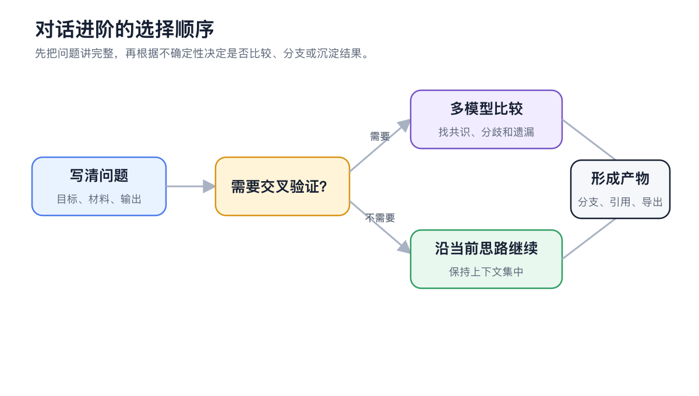

# 对话进阶

【对话】适合边交流边整理思路。除了单模型问答，还可以并排比较多个模型、从任意消息创建分支、管理长对话上下文，并把回复中的文件、图片、代码和引用作为产物继续使用。


如果任务需要连续读写本地文件、调用多种工具或长时间运行，改用【工作】中的智能体。对话更适合讨论、比较和定稿，智能体更适合执行。


<figure><figcaption>
问题和输出要求先写完整；只有需要交叉验证时再增加模型比较或消息分支。
</figcaption></figure>

## 按目标选择能力

| 目标 | 推荐做法 |
| ------------- | --------------------- |
| 比较不同模型的观点 | 在输入区选择多个模型后发送同一个问题 |
| 保留原讨论并探索另一条思路 | 从关键消息创建分支 |
| 继续很长的讨论 | 查看上下文用量，必要时总结后新开话题 |
| 让下一条问题稍后发送 | 使用消息队列，不必打断当前回复 |
| 继续处理回复中的文件或代码 | 打开产物预览，再下载、复制或在新任务中继续 |

<figure><figcaption>
模型选择器可以为同一个问题选择一个或多个模型。
</figcaption></figure>

## 推荐顺序



### 1. 先把问题写完整

说明目标、材料、限制和希望的输出方式。多个模型只会放大原问题的差异，不会自动补齐缺少的信息。



### 2. 再决定是否需要比较

需要不同视角时再选多个模型。日常问答保持单模型，界面更清楚，用量也更容易控制。



### 3. 把有效结论沉淀下来

可复用的资料存入笔记或知识库；需要继续执行的工作交给智能体，并附上已经确认的结论。



<table data-view="cards"><thead><tr><th></th><th></th><th data-hidden data-card-target data-type="content-ref"></th></tr></thead><tbody><tr><td><strong>多模型对比与消息分支</strong></td><td>比较答案，同时保留探索路径</td><td><a href="model-compare-branches.md">model-compare-branches.md</a></td></tr><tr><td><strong>长对话、上下文与排队消息</strong></td><td>让长对话保持清楚、可控</td><td><a href="context-queue.md">context-queue.md</a></td></tr><tr><td><strong>产物、引用与导出</strong></td><td>检查并带走真正有用的结果</td><td><a href="artifacts-export.md">artifacts-export.md</a></td></tr></tbody></table>
