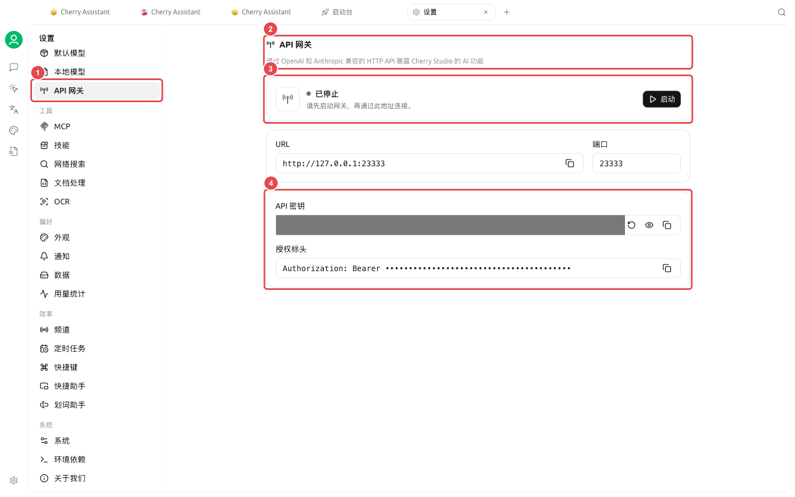

# 开发与诊断

这一组功能面向需要管理编程 CLI、让其他本机程序调用模型，或排查请求问题的用户。日常聊天和内容工作不需要开启开发者模式。

### 两个入口

| 入口 | 用途 | 使用前先确认 |
| ----------------- | ---------------------------- | -------------- |
| 启动台【编码搭档】 | 安装、配置和启动常见编程 CLI | 安装来源、模型连接与工作目录 |
| 【设置】→【API 网关】 | 向本机程序提供兼容 API，也是智能体的运行依赖 | 状态、端口与密钥安全 |
| 【设置】→【通用】→【开发者模式】 | 查看调用链，定位模型与工具错误 | 日志中可能含敏感内容 |

<figure><figcaption>
API 网关页面集中显示运行状态、地址、端口和凭据。
</figcaption></figure>


API 网关的密钥和调用链中的请求内容都可能涉及敏感信息。截图、Issue 和群聊中只分享已遮挡的必要片段。


<table data-view="cards"><thead><tr><th></th><th></th><th data-hidden data-card-target data-type="content-ref"></th></tr></thead><tbody><tr><td><strong>API 网关</strong></td><td>理解智能体依赖与本机 API 调用</td><td><a href="api-gateway.md">api-gateway.md</a></td></tr><tr><td><strong>调用链与开发者模式</strong></td><td>复现并定位一次具体请求</td><td><a href="trace.md">trace.md</a></td></tr></tbody></table>
