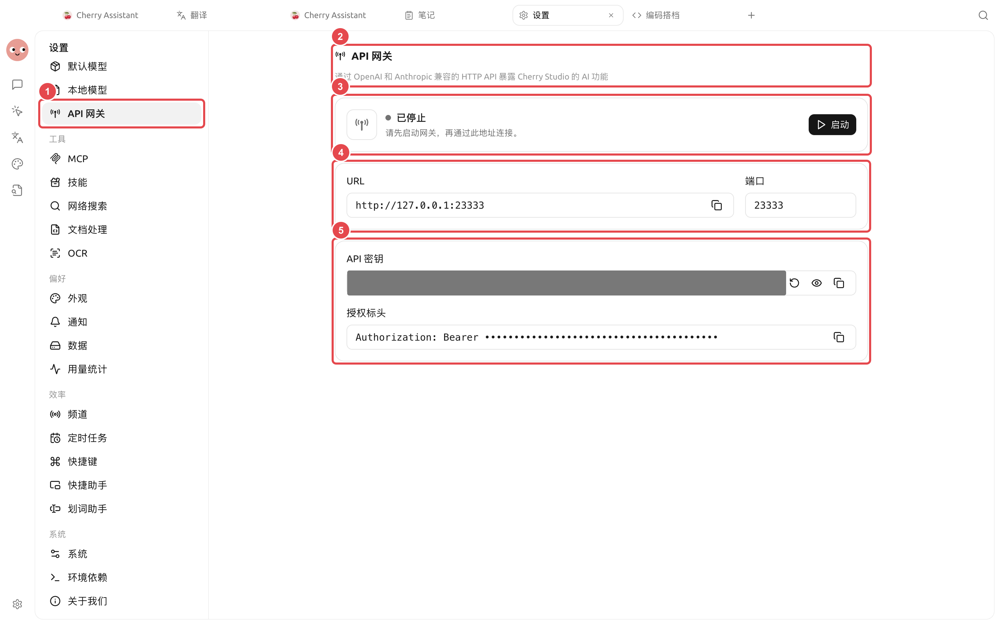

# API 网关

API 网关把 Cherry Studio 已配置的模型能力通过 OpenAI 和 Anthropic 兼容的 HTTP API 提供给本机程序。它也是智能体运行所需的内部服务。

路径：【设置】→【API 网关】。

<figure><figcaption>
外部程序连接前先检查状态和端口；密钥只提供给可信的本机程序或受控网络。
</figcaption></figure>

## 智能体使用与外部调用要区分

* 只使用 Cherry Studio 智能体：按应用提示【启用并启动】即可，不需要把 URL 或密钥复制给其他程序；
* 本机程序需要调用 Cherry Studio：启动网关，复制 URL 和 API 密钥，并按 API 文档选择兼容接口；
* 要让其他设备访问：这会扩大暴露范围，需要自行确认网络监听、防火墙和访问控制，不建议在没有安全措施时开放。

## 启动与连接



### 1. 检查端口

网关停止时可以修改端口。选择未被其他程序占用的端口；端口冲突时服务无法正常启动。



### 2. 启动网关

点击【启动】，状态变为【运行中】后，页面会显示可用 URL，并提供【API 文档】入口。



### 3. 配置授权

外部程序使用 `Authorization: Bearer <API 密钥>`。页面可以直接复制授权标头，不要把密钥写入代码仓库或截图。



### 4. 用最小请求验证

先按照 API 文档请求模型列表或发送短文本，再接入完整应用。出现错误时记录 HTTP 状态和响应，不公开完整授权头。



## 使用场景：让本机脚本调用模型

先在【设置】→【模型服务】确认模型可以正常对话，再启动 API 网关。脚本只保存本机网关地址和密钥，先请求模型列表，再发送一句短文本。接入完整程序前，确认客户端支持 OpenAI 或 Anthropic 兼容接口。

| 配置 | 建议起点 | 作用 | 注意事项 |
| ------ | ---------- | --------- | ----------------- |
| 监听范围 | 仅本机使用 | 减少网络暴露 | 不为方便调试直接开放到局域网或公网 |
| API 密钥 | 为当前网关单独保管 | 验证客户端请求 | 不写入仓库、截图或共享日志 |
| 验证请求 | 先查模型列表和短文本 | 分开验证连接与生成 | 失败时记录状态码，不记录完整密钥 |

### 完成标准

网关显示【运行中】；模型列表可读取；短文本请求成功；停止网关后客户端无法继续调用。

## 安全操作


API 密钥可以调用你在 Cherry Studio 中配置的模型服务。密钥泄露后，应先停止网关，在停止状态下点击【重新生成】，再更新所有本机客户端。


* 网关运行时端口和密钥保持只读，修改前先停止；
* 不在公共仓库、Issue、日志或教程截图中展示密钥；
* 只给需要调用的程序保存密钥；
* 用量和费用仍由实际模型服务商产生，可在【设置】→【用量统计】查看 Cherry Studio 记录。

API 网关与模型服务有什么关系？

模型服务保存上游服务商连接；API 网关把这些能力转换成兼容接口。网关本身不提供模型，仍需要至少一个可用服务商和模型。

端口正常但客户端返回未授权怎么办？

确认请求头是 `Authorization: Bearer ...`，没有多余引号或空格，并检查客户端使用的密钥是否仍是页面当前值。

