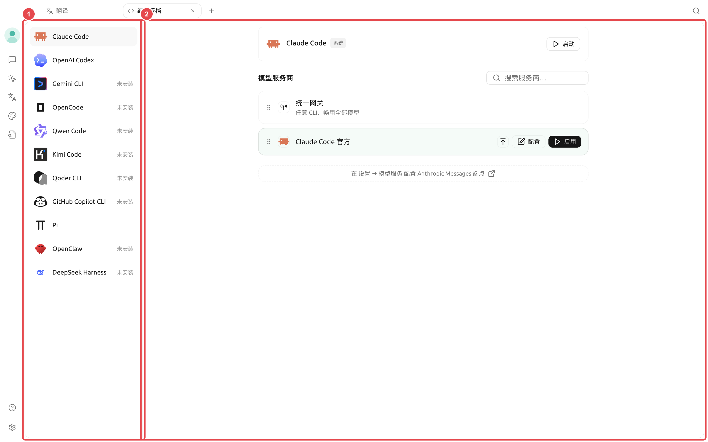
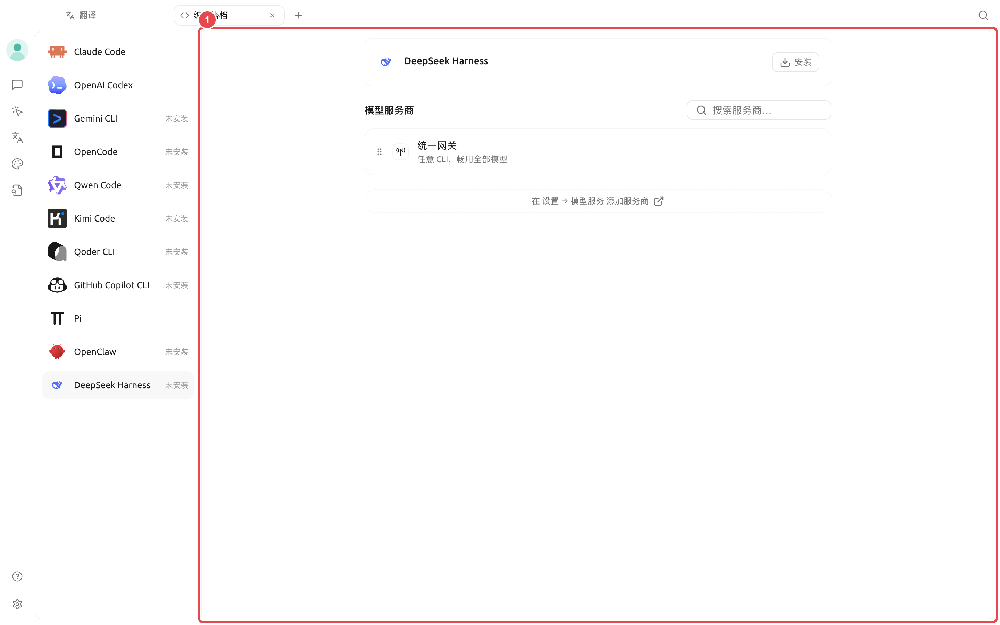

# 编码搭档（Code CLI）

【编码搭档】用于安装、配置和启动常见编程命令行工具。Cherry Studio 会区分应用托管版本、系统 PATH 中已有版本和工具自己的账号登录，不会自动覆盖系统安装。

<figure><figcaption>
① 左侧选择工具并确认安装状态；② 右侧选择统一网关、工具官方账号或兼容的模型服务。
</figcaption></figure>

### 页面能做什么

* 检查工具是否安装以及是否有可用更新；
* 安装、更新或移除 Cherry Studio 托管的工具副本；
* 检测系统 PATH 中已有的工具；
* 为需要模型服务的 CLI 选择服务商、模型和参数；
* 为使用自身账号登录的 CLI 保留原生登录方式；
* 选择工作目录和系统检测到的终端后启动。

页面包含 Claude Code、OpenAI Codex、Gemini CLI、OpenCode、Qwen Code、Kimi Code、Qoder CLI、GitHub Copilot CLI、Pi 和 DeepSeek Harness 等工具。实际可见项会随产品更新变化，以页面列表为准。

### 通用启动流程



#### 1. 从【启动台】打开【编码搭档】

选择需要的工具，先看状态是未安装、由 Cherry Studio 托管，还是来自系统。



#### 2. 完成安装或登录

未安装时点击【安装】。由工具自身提供账号登录的 CLI，按照页面提示完成原生登录，不需要从 Cherry Studio 选择服务商。



#### 3. 配置模型连接

需要 Cherry Studio 模型服务的工具，可选择【统一网关】或兼容的服务商和模型。页面会按 CLI 所需的接口类型筛选，不兼容的服务商不会列出。



#### 4. 选择目录和终端

工作目录决定 CLI 启动位置。终端只能从系统检测到的列表中选择；启动后先用只读命令确认当前路径。



#### 5. 启动并验证

点击【启动】，确认账号或模型正确，再执行文件修改或命令。需要调整推理强度、权限或工具专属选项时，打开【配置】。



### DeepSeek Harness

<figure><figcaption>
① 未安装时先完成托管安装；安装后配置兼容服务商、默认权限和智能体模式，再启动 Web UI。
</figcaption></figure>

DeepSeek Harness 与普通终端 CLI 的流程不同：安装并选择服务商后，由 Cherry Studio 托管运行，并可打开独立 Web UI。参数中可以选择默认智能体模式和默认权限：

| 配置 | 适合情况 | 注意事项 |
| -------- | -------------------------- | ------------- |
| 【标准】 | 文件、Shell、检索、技能、计划和子代理都可能使用 | 工具面最大，先使用受控权限 |
| 【PTC 代码】 | 需要通过 Code Mode 组合多步工具操作 | 更适合复杂编码任务 |
| 【极简】 | 只需要持久 Shell 和文本编辑器 | 依赖少，能力范围也更小 |
| 【只读】 | 检查项目、不写文件 | 有风险操作仍会请求确认 |
| 【工作区写入】 | 允许修改当前 DSH 工作区 | 不代表可以访问工作区外文件 |
| 【完全访问】 | 隔离、可信、可恢复的环境 | 不请求操作确认，风险最高 |

### 安装来源要分清

| 来源 | Cherry Studio 会做什么 | 你应该如何维护 |
| ---------------- | ------------------ | ----------------- |
| Cherry Studio 托管 | 安装、更新和卸载对应托管副本 | 在【编码搭档】或【环境依赖】中管理 |
| 系统 PATH | 检测并直接使用，不覆盖 | 用原包管理器更新或卸载 |
| 工具官方账号 | 保留工具自己的登录流程 | 在工具界面管理账号和授权 |

<figure><figcaption></figcaption></figure>


卸载 Cherry Studio 托管副本后，如果系统中还有同名可执行文件，页面会自动回退到系统版本。行为变化时，先确认当前使用的是哪一种来源。


### 用户案例：在项目目录启动编码工具

开发者先选定当前项目目录，选择一个已经验证的模型连接，再启动 Pi 或其他 CLI。第一条命令只读取仓库状态；确认账号、模型与目录无误后，再允许工具修改文件并运行检查。

为什么找不到已经安装的终端或 CLI？

Cherry Studio 从登录环境和标准位置检测工具。确认命令在登录终端中可运行，然后重启应用刷新环境。便携式或非标准路径目前需要从该终端手动启动。

为什么找不到已经安装的终端或 CLI？

Cherry Studio 从登录环境和标准位置检测工具。确认命令在登录终端中可运行，然后重启应用刷新环境。便携式或非标准路径目前需要从该终端手动启动。

