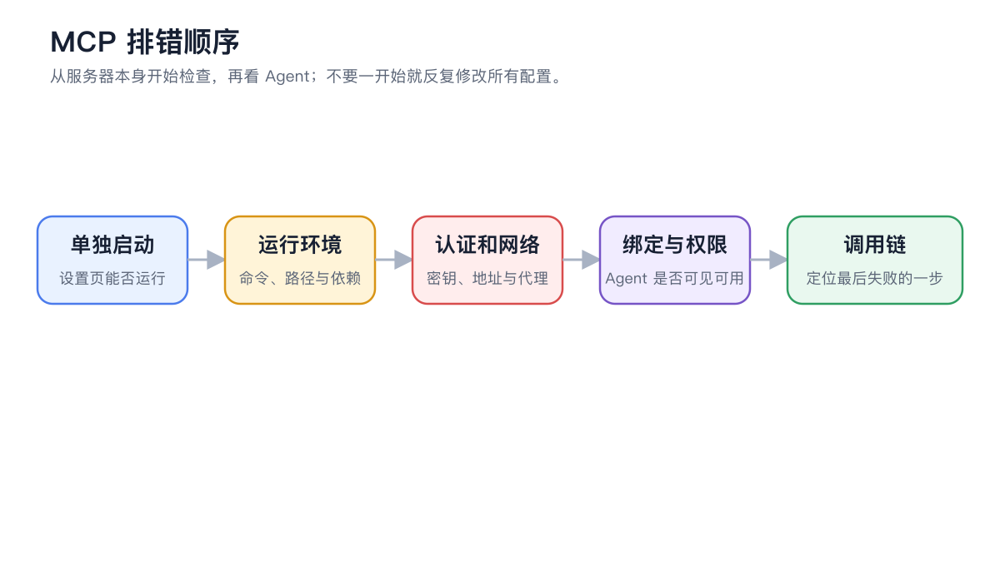

# 调用链与开发者模式

调用链用于查看一次对话或智能体任务内部发生的模型请求、工具调用和 MCP 交互。它适合排错和性能分析，不是日常聊天必须开启的功能。

<figure><figcaption>
排查 MCP 调用时先确认服务器和认证，再用调用链判断请求是否进入智能体与工具执行阶段。
</figcaption></figure>

### 开启方式



#### 1. 打开【设置】→【通用】

在【开发者模式】区域开启【启用开发者模式】。



#### 2. 重启 Cherry Studio

开发者模式在重启后生效。重启前正在运行的智能体任务应先确认状态。



#### 3. 复现一次问题

重新发送最小测试消息，只保留必要模型和工具，减少无关调用。



#### 4. 打开调用链

在对话或智能体右侧面板进入【调用链】，选择节点查看输入、输出、耗时和状态。智能体任务还能看到智能体名称、操作和工具调用数量。



### 常见节点怎么读

| 节点 | 重点检查 | 常见问题 |
| -------- | ------------------ | ---------------- |
| 模型请求 | 模型、输入、输出、Token 和状态 | 服务商错误、上下文过长、输出为空 |
| 工具调用 | 工具名、参数、结果 | 参数错误、权限等待、工具返回异常 |
| MCP 调用 | 服务名、连接类型、输入与输出 | 服务器断开、认证失败、远程错误 |
| 智能体执行 | 智能体、操作、工具数量和状态 | 子任务失败、流程没有结束 |
| HTTP 请求 | 方法、URL、状态和响应 | 地址错误、网络或鉴权问题 |


调用链可能包含提示词、文件内容、请求头和工具参数。分享截图或导出信息前，必须删除 API Key、Authorization、Cookie、邮箱、本地路径和业务数据。


### 用户案例：MCP 工具返回空结果

先在 MCP 设置页确认服务器正常，再让智能体只调用一个工具。调用链显示请求已到达服务器但输出为空，说明问题更可能在服务端数据或参数，而不是智能体没有绑定；若根本没有 MCP 节点，则回到智能体【MCP】检查绑定。

为什么开启后仍看不到调用链？

确认已经重启应用，并在重启后重新发起一次请求。启用前产生的历史消息不会自动补齐调用数据。

为什么开启后仍看不到调用链？

确认已经重启应用，并在重启后重新发起一次请求。启用前产生的历史消息不会自动补齐调用数据。

