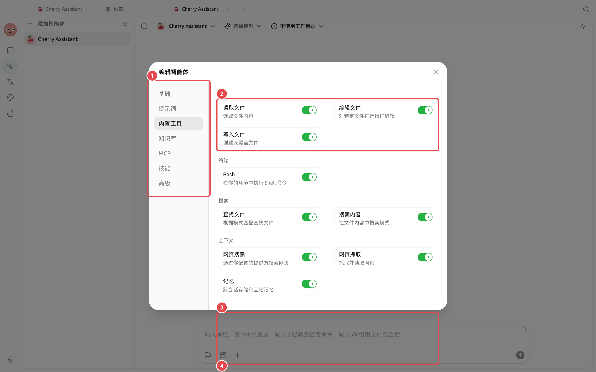

# 扩展智能体的能力

智能体已经带有文件、搜索、图片、记忆、工作流、定时任务等内置工具。需要固定工作方法时添加技能，需要连接外部系统时添加 MCP。两者解决的问题不同，不必为了“功能更多”全部安装。

<figure><figcaption>
优先使用最短路径；只有智能体确实需要访问外部系统时才增加 MCP。
</figcaption></figure>

## 先判断需要什么

| 需求 | 选择 |
| ----------------- | ---------- |
| 固定一套步骤、模板或检查清单 | 技能 |
| 查询数据库、浏览器或第三方系统 | MCP |
| 检索自己的文档资料 | 知识库 |
| 读写当前项目文件、生成图片或发通知 | 智能体内置工具 |


最方便的做法是直接在【工作】中描述目标，让智能体帮你判断缺少的是技能、MCP 还是知识库。需要核对来源、连接参数或权限时，再到【设置】手动管理。


## 安装后的最后一步

全局安装或连接成功，不代表每个智能体都能使用。打开【工作】→ 智能体菜单→【编辑】，分别在【技能】、【MCP】或【知识库】中选择。配置从下一条消息开始生效。

<figure><figcaption>
智能体的内置工具、知识库、MCP 和技能分别配置，按任务需要启用。
</figcaption></figure>

<table data-view="cards"><thead><tr><th></th><th></th><th data-hidden data-card-target data-type="content-ref"></th></tr></thead><tbody><tr><td><strong>技能与能力库</strong></td><td>安装并复用稳定工作方法</td><td><a href="skills.md">skills.md</a></td></tr><tr><td><strong>MCP 与外部工具</strong></td><td>连接额外工具和数据来源</td><td><a href="mcp/">mcp</a></td></tr><tr><td><strong>MCP 排错</strong></td><td>按连接链路逐步定位问题</td><td><a href="mcp/troubleshooting.md">troubleshooting.md</a></td></tr></tbody></table>
