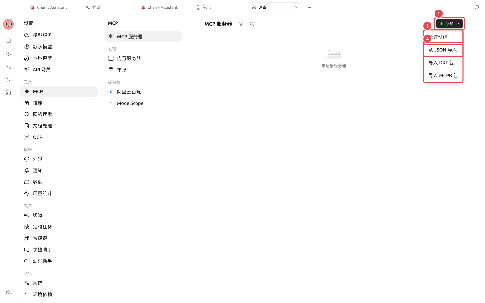
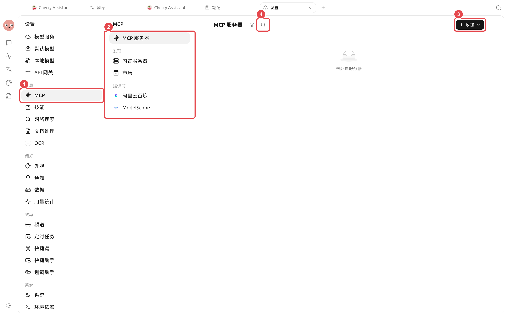
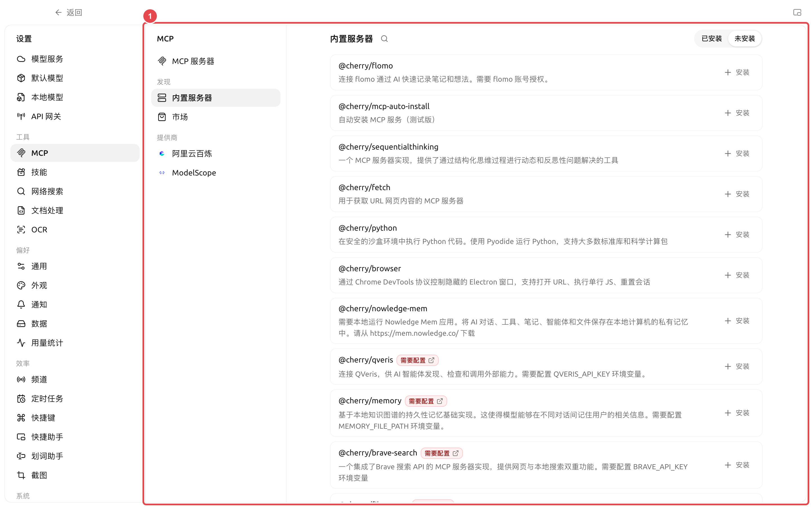

# MCP 与外部工具

MCP 是让智能体使用外部工具和资源的连接方式。Cherry Studio 可以管理 MCP 服务器、内置服务器、服务市场和部分服务商入口，再把已连接的服务器绑定给指定智能体。

### 什么时候需要 MCP

<figure><figcaption></figcaption></figure>

<figure><figcaption></figcaption></figure>

* 智能体需要调用 Cherry Studio 内置工具之外的服务；
* 团队已经有提供 MCP 接口的数据库、浏览器或业务系统；
* 希望同一套外部能力被多个智能体复用；
* 需要把工具、资源或提示词以统一方式提供给模型。

只需要固定流程时用技能，只需要检索 Cherry Studio 知识库时直接绑定知识库，不必为了“更高级”而额外搭建 MCP。

### 添加服务器

路径：【设置】→【MCP】→【MCP 服务器】→【添加】。



#### 1. 确认连接方式

本地命令通常使用标准输入输出方式；远程服务通常提供 SSE 或可流式传输的 HTTP 地址。按照服务提供方给出的配置填写，不要凭名称猜测。



#### 2. 填写配置并检查权限

本地服务器需要命令、参数和环境变量；远程服务器需要 URL，部分服务还需要授权。保存前确认命令来源和数据范围。



#### 3. 启动并查看工具

启用服务器，等待状态正常，再打开详情检查它提供的工具、资源和提示词。连接失败时先看服务器日志。

在工具列表中展开某个工具，可以查看完整的 Markdown 说明，以及按层级展示的参数、类型、必填标记和枚举值。调用前先核对必填参数；对象或数组参数应逐层展开查看，避免只按工具名称猜测输入格式。




#### 4. 绑定到智能体

打开【工作】→ 智能体菜单→【编辑】→【MCP】，启用该服务器。未启动的服务器无法正常绑定使用。



### 内置服务器与服务市场

【内置 MCP】提供可以直接安装或启用的常用能力；【服务市场】用于管理第三方市场来源。安装前仍要查看说明、命令、环境变量和权限，内置入口不代表外部服务的所有操作都没有风险。

<figure><figcaption>
① 内置列表会标明是否需要账号、API Key 或目录配置；安装后仍要完成配置并验证连接。
</figcaption></figure>

QVeris 位于【内置服务器】中，用于让智能体发现、检查和调用外部能力。安装后需要配置 `QVERIS_API_KEY`；不要把密钥写进智能体提示词、技能或公开截图。

### 在输入区使用 MCP 提示词和资源

服务器除工具外，还可能提供“提示词”和“资源”。服务器已绑定到当前助手或智能体后，打开输入区【+】面板：

* 选择【MCP 提示词】，把服务器模板插入输入框；模板中的必填参数会显示为可填写项；
* 选择【MCP 资源】，从已绑定服务器中选择文件、记录或其他资源；
* 较短的文本资源会直接插入输入框；较大或二进制资源会作为引用，由支持工具调用的模型在需要时读取。


面板只显示当前对话范围内已连接、并且真正提供对应能力的服务器。看不到【MCP 提示词】或【MCP 资源】时，先在服务器详情检查对应标签页，再确认当前助手或智能体已绑定该服务器。


### 配置建议

| 配置项 | 产品默认值 | 建议起点 | 作用 | 适用场景 | 注意事项 |
| -------- | -------------- | ----------------- | --------- | ------------- | ------------ |
| 服务器状态 | 新增后按配置决定 | 一次只启用一个并验证 | 控制服务器是否可用 | 初次接入、排错 | 多个服务同时失败时难定位 |
| 智能体绑定 | 不自动绑定所有服务器 | 只绑定当前智能体所需服务器 | 控制能力范围 | 多智能体分工 | 避免无关工具占用上下文 |
| 环境变量 | 不预填密钥 | 使用服务要求的最小权限凭据 | 提供认证或运行参数 | 私有服务 | 截图和导出前遮挡敏感内容 |
| 工具批准 | 由智能体权限模式决定 | 写入或计费工具保持确认 | 防止意外操作 | 数据库、文件、外部 API | 频道入口可使用更严格模式 |

### 用户案例：把项目数据库接给分析智能体

管理员提供只读 MCP 连接，用户在【设置】→【MCP】验证服务器正常，再只绑定给“数据分析”智能体。智能体使用只读工具取得数据，将报告写入工作目录；涉及更新数据的工具不启用。这样即使提示词出现误解，也不会直接修改业务库。

MCP 与 API 网关有什么区别？

MCP 是把外部工具接入 Cherry Studio；API 网关是把 Cherry Studio 的模型能力以兼容 API 提供给其他程序。数据流方向相反。

服务器显示已连接，智能体仍找不到工具怎么办？

检查智能体是否绑定了该服务器、工具是否被关闭、权限请求是否待处理。修改智能体配置后，新发一条消息让运行时加载新工具。

服务器显示已连接，智能体仍找不到工具怎么办？

检查智能体是否绑定了该服务器、工具是否被关闭、权限请求是否待处理。修改智能体配置后，新发一条消息让运行时加载新工具。

<figure><figcaption></figcaption></figure>
