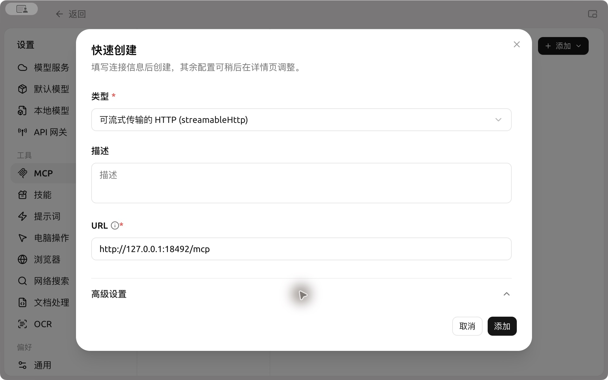
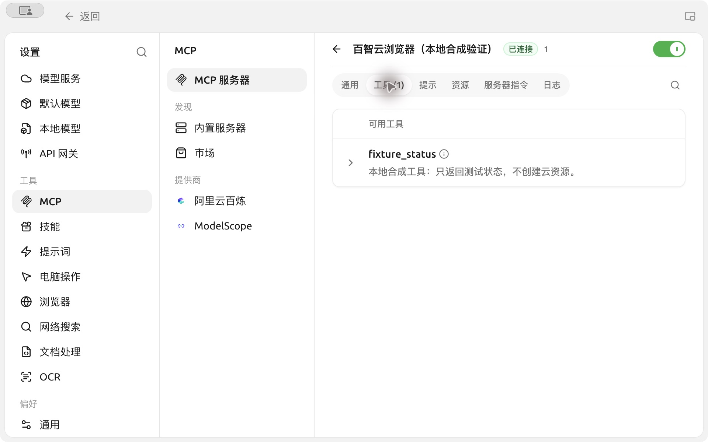
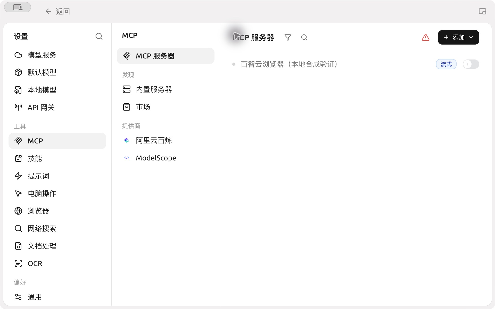
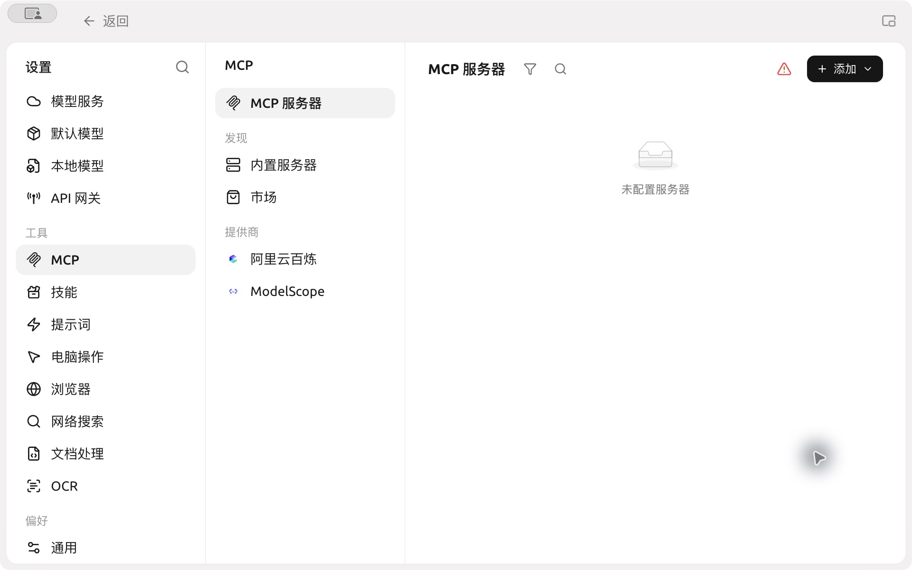

# 在 Cherry Studio 中连接百智云浏览器

当智能体需要管理云浏览器运行、保存的浏览器状态、人工交接或下载文件时，可以连接[百智云浏览器](https://baizhibrowser.cloud/zh/)（Baizhi Cloud Browser，也即 CapyBrowser）的 MCP 服务。网页导航、点击和读取还需要智能体已有兼容 CDP 客户端；此连接不会自动配置页面工具。

准备百智云账号，并按[浏览器接入指南](https://capybrowser.app.baizhi.cloud/docs/installation.md)确认自己的 Key 适用范围。百智云浏览器与 Baizhi Cloud Agent Toolkit 同属百智云，是独立服务；单独配置本连接凭据，不假定 Toolkit 应用专用 Key 通用。


浏览器启动和运行计费。关闭 Cherry Studio、解绑智能体、禁用或删除 MCP 连接，都不会结束已有云端运行或停止计费。


## 配置连接



### 1. 添加远程服务器

首次启动若停在欢迎页，点击右上角【稍后设置】。配置此 MCP 连接无需登录 CherryIN，也无需先配置模型服务。进入主界面后点击【设置】；若默认显示模型服务的登录提示，直接选择左侧【MCP】。

打开【设置】→【MCP】→【MCP 服务器】→【添加】，选择快速创建。名称填“百智云浏览器”，类型选【可流式传输的 HTTP (streamableHttp)】，URL 填：

```text
https://capybrowser.app.baizhi.cloud/mcp
```


### 2. 填写请求头

在【高级设置】的【请求头】中填写一行；已创建的条目也可在配置页修改：

```text
Authorization=Bearer <自己的浏览器 Key>
```

不能只填 `Authorization=Bearer`：`Bearer` 后必须有一个空格，再跟完整 Key。将 `<自己的浏览器 Key>` 整段（包括尖括号）替换为自己的 Key，只保留一个 `Bearer` 前缀。例如，假设 Key 是虚构的 `example-browser-key`，完整一行应为：

```text
Authorization=Bearer example-browser-key
```

这个虚构值仅用于说明格式，不能用于正式服务。这里使用等号分隔名称和值，是普通文本输入区；不要分享真实 Key、含 Key 的截图或配置导出。添加后服务器初始禁用；保存并核对该条目，再明确打开顶部开关。



图中为真实客户端的本地合成演示，未填写凭据；正式接入请使用正文中的服务地址和自己的 Key。


### 3. 检查工具并绑定智能体

等待连接状态显示【已连接】，打开服务器详情的【工具】页检查工具列表和【自动批准】。对会创建运行、写入或产生费用的工具保留人工确认。认证失败时先检查地址、Key 的适用范围及请求头格式，不要反复重试可能计费的工具。

打开【工作】→智能体菜单→【编辑】→【MCP】，只给需要的智能体启用该服务器。首次使用先核对身份与价格；工具可见不代表全部可调用，也不代表完整网页任务已能完成。



截图仅演示本地合成工具的发现，`fixture_status` 不是生产服务工具目录。


### 4. 结束自己创建的运行

人工交接时暂停智能体，保留同一运行，交还控制后再继续。任务完成后通过浏览器服务提供的结束工具或控制台明确结束运行，分别检查资源释放和最终账单。



## 更换 Key 或移除

更换 Key 时先关闭该服务器，编辑同一条目的请求头并保存，再启用和检查工具。停用时关闭条目开关；不再需要时删除该条目，保留其他连接。删除本地配置不等于撤销云端 Key 或结束已有运行。

工具输入发送至百智云，网页操作会访问目标站点；使用前阅读服务条款和隐私说明。账号和运行问题可查看[控制台](https://capybrowser.app.baizhi.cloud/)与[接入指南](https://capybrowser.app.baizhi.cloud/docs/installation.md)。

<details>
<summary>停用和移除时会看到什么？</summary>



关闭开关只停用本地连接，已有云端运行仍须明确结束。



删除时只选择该条目并确认；本示例使用独立测试配置，正式环境请保留其他连接。
</details>

此示例由百智云浏览器接入材料维护者 `ctcbyzx` 贡献并维护。
