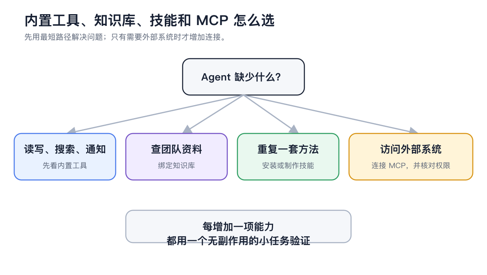
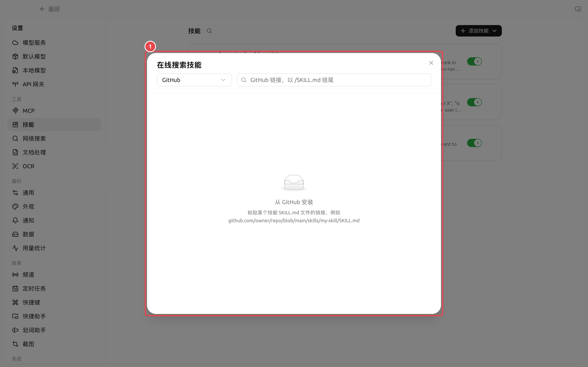
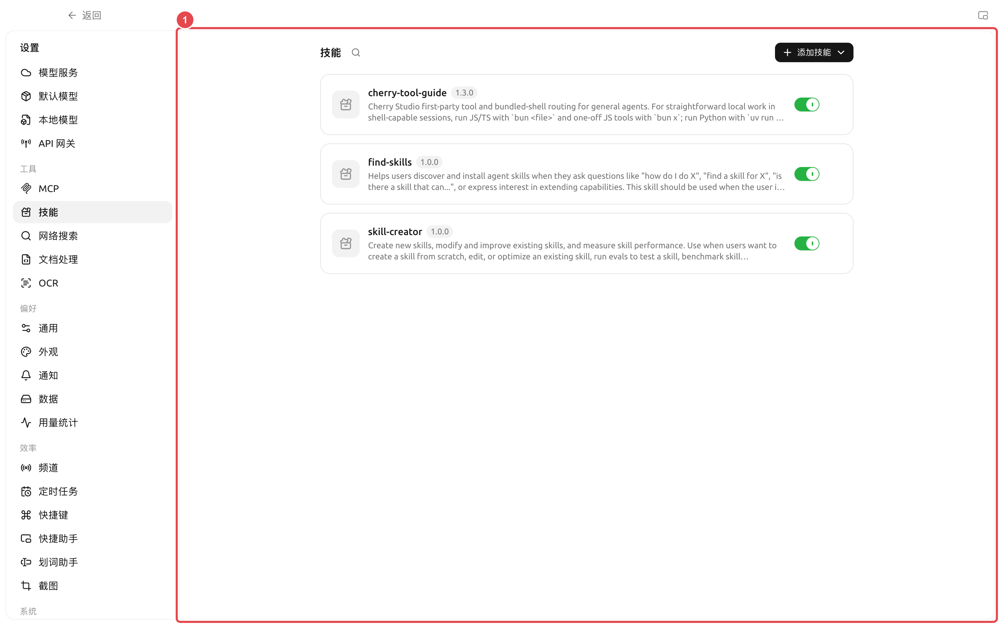

# 技能与能力库

技能是一套可复用的工作说明和配套资源。它不负责连接外部系统，而是告诉智能体应该按什么流程、标准和格式完成任务。


需要某种工作方法时，先在【工作】中告诉智能体你的目标，并让它帮你查找或安装合适的技能。只有需要检查来源、批量管理或从本地导入时，再打开【设置】→【技能】。


<figure><figcaption>
重复使用的方法适合沉淀为技能；资料、内置操作和外部系统分别使用对应入口。
</figcaption></figure>

### 安装技能

手动路径：【设置】→【技能】。

页面支持四种来源：

* 在线搜索技能注册表；
* 在在线搜索中选择【GitHub】，粘贴某个技能 `SKILL.md` 文件的链接；
* 从本地 ZIP 文件安装；
* 从包含 `SKILL.md` 的文件夹安装。

<figure><figcaption>
① 选择【GitHub】后粘贴目标技能的 `SKILL.md` 文件链接；页面会先解析具体技能，再提供安装。
</figcaption></figure>



#### 1. 先确认用途

用一句话说明你希望技能解决的问题，例如“把会议记录整理成决策、负责人和截止时间”。名称相似不代表流程相同，先看说明再安装。



#### 2. 检查来源与内容

打开技能详情，确认它会要求智能体做什么、是否包含脚本、是否需要额外工具或外部账号。来源不明的技能不要直接用于敏感目录。




#### 3. 绑定到智能体

先在【设置】→【技能】确认该技能的全局开关处于启用状态，再打开【工作】→ 智能体菜单→【编辑】→【技能】，为这个智能体启用。技能切换会随智能体配置自动保存，并从下一条消息生效。



#### 4. 用真实任务验证

给智能体一份小样本，检查步骤、输出格式和边界是否符合预期，再用于批量任务或定时任务。



### 全局启用与智能体启用

<figure><figcaption>
① 卡片右侧开关控制技能是否对所有智能体可选；关闭后，智能体编辑窗口不会再显示该技能。
</figcaption></figure>

| 状态 | 作用 | 什么时候使用 |
| -------- | ------------------------ | ------------------------- |
| 全局启用 | 让技能出现在智能体的可选技能目录中 | 技能来源可信，仍可能被一个或多个智能体使用 |
| 全局关闭 | 暂停所有智能体使用该技能，但保留安装内容 | 临时停用、排错或等待安全检查 |
| 智能体启用 | 只让当前智能体加载该技能 | 流程与当前智能体的长期职责相符 |

<figure><figcaption></figcaption></figure>

关闭全局开关不会卸载技能；重新打开后，仍要检查各智能体的启用状态。卸载则会删除技能内容并清理关联。

### 技能、提示词和 MCP 怎么选

| 需要 | 应选择 | 原因 |
| -------------- | ----------- | ------------- |
| 一句临时要求 | 当前任务提示词 | 不必增加长期配置 |
| 多次复用同一流程 | 技能 | 能同时保存说明、模板和资源 |
| 设定智能体的长期角色 | 智能体系统提示词 | 每个任务都需要遵守 |
| 访问数据库或外部服务 | MCP | 技能本身不提供连接能力 |

### 用户案例：团队周报技能

团队把周报栏目、语气、数据检查和禁用表述写成技能，绑定到“周报整理”智能体。每周只需要提供本周资料，智能体按技能输出固定结构；数据来自外部系统时，再组合 MCP，而不是把账号和接口细节写进技能正文。


卸载技能会从全局能力库中移除它，并清理智能体工作区中的关联。执行前确认没有正在使用该技能的任务；团队自定义技能应保留可恢复的源文件。


安装后为什么智能体没有使用技能？

先确认技能没有被全局关闭，再到智能体编辑窗口的【技能】中启用，或让智能体帮你完成绑定。随后新发一条消息测试。

技能可以包含程序吗？

技能包可以包含说明、资源和脚本。是否能够执行脚本，还取决于智能体的工具、工作目录、环境依赖和权限模式。

技能可以包含程序吗？

技能包可以包含说明、资源和脚本。是否能够执行脚本，还取决于智能体的工具、工作目录、环境依赖和权限模式。

