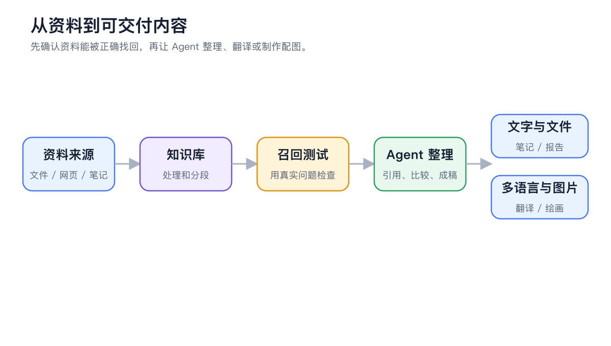
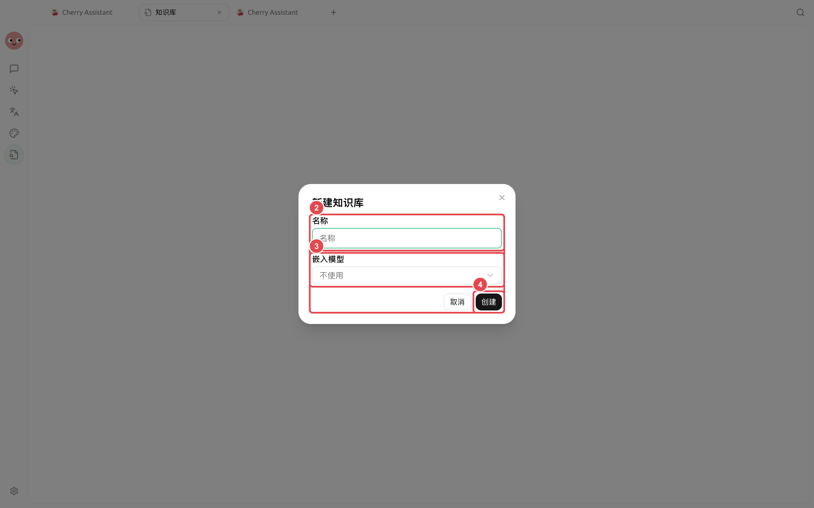

# 知识与内容工作流

知识库、笔记、绘画和翻译不是彼此孤立的工具。它们分别负责整理资料、沉淀内容、制作视觉素材和处理多语言文件，并且都能继续交给智能体使用。

<figure><figcaption>
先用真实问题通过召回测试，再让智能体根据资料制作报告、译文或配图。
</figcaption></figure>

## 四个入口怎么分工

| 入口 | 适合做什么 | 常见下一步 |
| ----- | ---------------------- | -------------- |
| 【知识库】 | 让资料可以按问题检索 | 绑定给对话助手或智能体 |
| 【笔记】 | 撰写、整理和长期维护 Markdown 内容 | 导出文档或加入知识库 |
| 【绘画】 | 生成、编辑、合并和增强图片 | 下载，或交给内容任务使用 |
| 【翻译】 | 处理文本、图片和文档 | 收藏结果、复用历史或继续编辑 |


如果目标是“用这些资料完成一份交付物”，直接在【工作】中告诉智能体资料在哪里、要产出什么。需要人工整理资料库、调整图片或逐段确认译文时，再进入对应模块。


<figure><figcaption>
新建知识库时先命名，再选择用于检索的嵌入模型。
</figcaption></figure>

## 从资料到交付物



### 1. 先整理来源

把长期参考资料加入知识库，把正在修改的草稿放在笔记或工作目录。不要把未确认的临时聊天全部导入知识库。



### 2. 验证能否找回关键信息

在知识库中使用召回测试，确认真实问题能找到正确片段。检索不到时先修资料和设置，不让智能体猜。



### 3. 再制作文字、译文和图片

让智能体根据资料起草内容；图片和译文分别在【绘画】与【翻译】中精修。最后由人检查事实与表达。



<table data-view="cards"><thead><tr><th></th><th></th><th data-hidden data-card-target data-type="content-ref"></th></tr></thead><tbody><tr><td><strong>构建知识库与召回测试</strong></td><td>从导入资料到验证检索</td><td><a href="knowledge-base.md">knowledge-base.md</a></td></tr><tr><td><strong>笔记、知识库与智能体</strong></td><td>让草稿、资料和任务顺畅流转</td><td><a href="notes-knowledge-agent.md">notes-knowledge-agent.md</a></td></tr><tr><td><strong>图片生成、编辑与增强</strong></td><td>从模板出发制作可用图片</td><td><a href="painting-workflow.md">painting-workflow.md</a></td></tr><tr><td><strong>文件、图片与长文翻译</strong></td><td>处理不同格式并复用历史结果</td><td><a href="translation-workflow.md">translation-workflow.md</a></td></tr></tbody></table>
