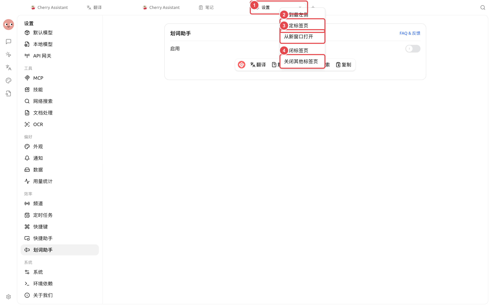

# 高效工作台

Cherry Studio 的主窗口由侧边栏、标签页和内容区组成。对话话题与智能体任务可以同时开在多个标签页，也可以拆成独立窗口；输入区工具栏则可以按使用习惯调整。

<figure><figcaption>
需要同时查看资料和任务时，把其中一个标签页从新窗口打开，主窗口继续保留全局线索。
</figcaption></figure>

### 适合使用独立窗口的场景

* 一边保留资料对话，一边运行智能体任务；
* 把长期监控任务置顶，避免被其他窗口遮挡；
* 在不同显示器上分别放对话、文件或任务；
* 展示或共享某个任务时，不暴露主窗口里的其他标签页。

### 工作台能力

| 能力 | 入口 | 作用 |
| ------ | -------------------- | -------------- |
| 新标签页 | 话题或任务右键菜单→【在新标签页中打开】 | 在主窗口中并排保留多个上下文 |
| 独立窗口 | 话题、任务或标签页右键→【从新窗口打开】 | 把当前内容拆到新窗口 |
| 置顶标签页 | 标签页右键→【固定标签页】 | 固定常用页面 |
| 窗口置顶 | 独立窗口顶部【窗口置顶】 | 让任务保持可见 |
| 回到主窗口 | 独立窗口顶部【回到主窗口】 | 把标签页重新接回主窗口 |
| 自定义工具栏 | 输入区【+】→【自定义工具栏】 | 调整常用输入工具的位置 |

在上图的标签页菜单中选择【从新窗口打开】，即可把当前内容拆到独立窗口。

### 推荐布局

办公写作可以把资料对话留在主窗口，把“写作”智能体拆到右侧屏幕；代码工作可以将智能体任务置顶，主窗口保留文件与文档；长时间监控任务使用独立窗口，但不要把需要频繁确认权限的任务放在看不到的位置。


独立窗口仍然属于同一个 Cherry Studio 数据环境。它不是新的账号或隐私空间；同一话题或任务的内容仍会同步保存。


### 相关教程

<table data-view="cards"><thead><tr><th></th><th></th><th data-hidden data-card-target data-type="content-ref"></th></tr></thead><tbody><tr><td><strong>多窗口与标签页</strong></td><td>拆分、置顶和重新接回窗口</td><td><a href="multi-window-tabs.md">multi-window-tabs.md</a></td></tr><tr><td><strong>输入工具栏与效率工具</strong></td><td>提示词管理、快捷键、快捷助手和划词助手</td><td><a href="composer-efficiency.md">composer-efficiency.md</a></td></tr></tbody></table>
