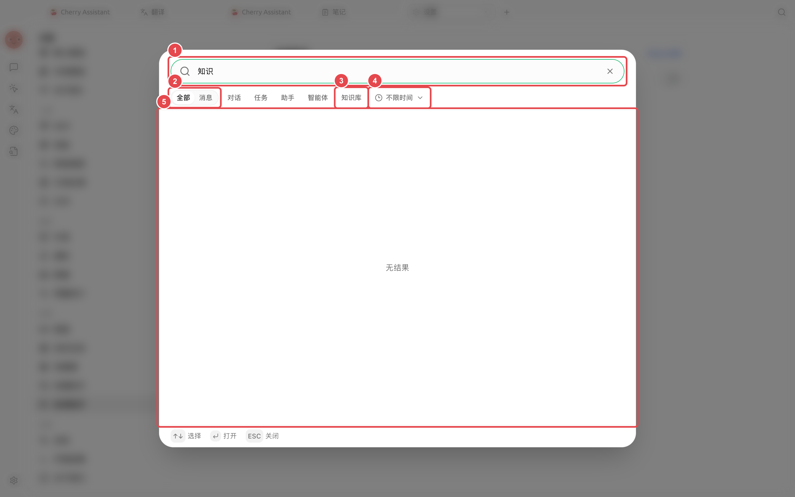

# 全局搜索

全局搜索用于在一个入口里查找消息、对话、任务、助手、智能体和知识库。它适合“记得内容，不记得放在哪里”的情况。

<figure><figcaption>
先输入有辨识度的关键词，再按对话、知识库等类型和更新时间缩小范围。
</figcaption></figure>

## 使用方法



### 1. 点击窗口顶部的搜索按钮

也可以在【设置】→【快捷键】查看或修改对应快捷键。



### 2. 输入有辨识度的关键词

优先使用项目名、人名、文件主题或结论中的短语。只输入“设置”“报告”等常见词，结果通常太多。



### 3. 缩小搜索范围

切换【消息】或使用【对话】【任务】【助手】【智能体】【知识库】筛选，再按更新时间缩小范围。



### 4. 打开结果继续工作

搜索会带你回到对应内容。打开前先看类型，避免把同名助手和智能体任务混淆。



### 应用案例：找回上个月的客户结论

搜索客户项目名，再将类型缩小到【消息】并限制更新时间。找到结论后打开原对话，先确认后续是否有修订；需要把结论用于新任务时，复制已经确认的摘要，而不是让新对话依赖记忆中的零散片段。

为什么搜索不到磁盘里的文件内容？

全局搜索主要查找 Cherry Studio 中已保存的内容。磁盘文件需要在智能体工作目录、知识库或笔记中进入相应流程后，才能通过对应入口查找。

