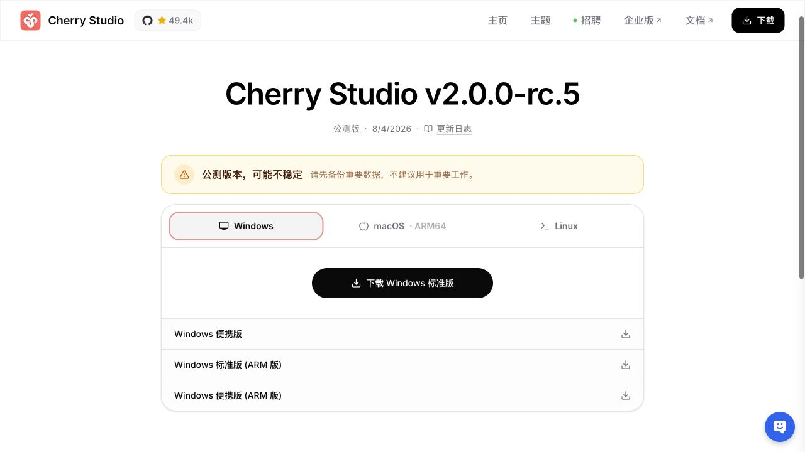

# Windows 安装

## 系统要求

需要 **Windows 10 1809（内部版本 17763，64 位）或更高版本**（含 Windows 11），Intel / AMD 设备选择 x64，Windows ARM 设备选择 ARM64。

Windows 7、8、8.1 不受支持，通过第三方兼容层启动也不属于官方支持。版本过低时安装程序会直接提示并终止，不会安装或更改任何文件；已安装的旧版本在检查更新时也不会收到超出系统要求的新版本。历史安装包仅可在 [GitHub Releases](https://github.com/CherryHQ/cherry-studio/releases) 存档查看，不再提供支持与安全更新。

## 1. 下载安装包

打开 [官方下载页](https://cherryai.com.cn/download/v2)，选择 **Windows**。

_官网的 Windows 下载选项_

大多数 Intel / AMD 电脑选择 **Windows 标准版**；Windows ARM 设备选择带有 **ARM** 标记的版本。如需不安装到系统的便携使用方式，再选择相同架构的便携版。

不确定设备架构时，打开 Windows 的“设置 → 系统 → 系统信息”，查看“系统类型”。

## 2. 安装并启动

1. 双击下载的安装程序；
2. Windows 显示用户账户控制提示时，确认文件来自官方渠道后选择继续；
3. 按安装向导完成安装；
4. 从开始菜单启动 Cherry Studio。

## 常见问题

### 提示缺少运行库

安装程序会检测与设备架构匹配的 Microsoft Visual C++ 运行库；缺少时会自动下载并安装。

如果自动下载或安装失败，请根据错误提示打开微软官方下载地址，完成安装后重新运行 Cherry Studio 安装程序：

* [x64 运行库](https://aka.ms/vs/17/release/vc_redist.x64.exe)
* [ARM64 运行库](https://aka.ms/vs/17/release/vc_redist.arm64.exe)

### 提示系统版本不受支持

安装程序或启动时提示 Windows 版本不受支持，说明当前系统低于 Windows 10 1809（内部版本 17763）。请升级 Windows 后再安装，或更换受支持的设备。Windows 7、8、8.1 不受支持，通过第三方兼容层启动也不属于官方支持，历史安装包仅可在 [GitHub Releases](https://github.com/CherryHQ/cherry-studio/releases) 存档查看。

### 无法启动

先确认安装包的架构与设备匹配，并检查安全软件是否拦截。仍无法启动时，请在反馈中附上 Windows 版本、设备架构、安装包名称和完整错误提示。

## 下一步

看到 Cherry Studio 主界面后，继续完成快速开始。
