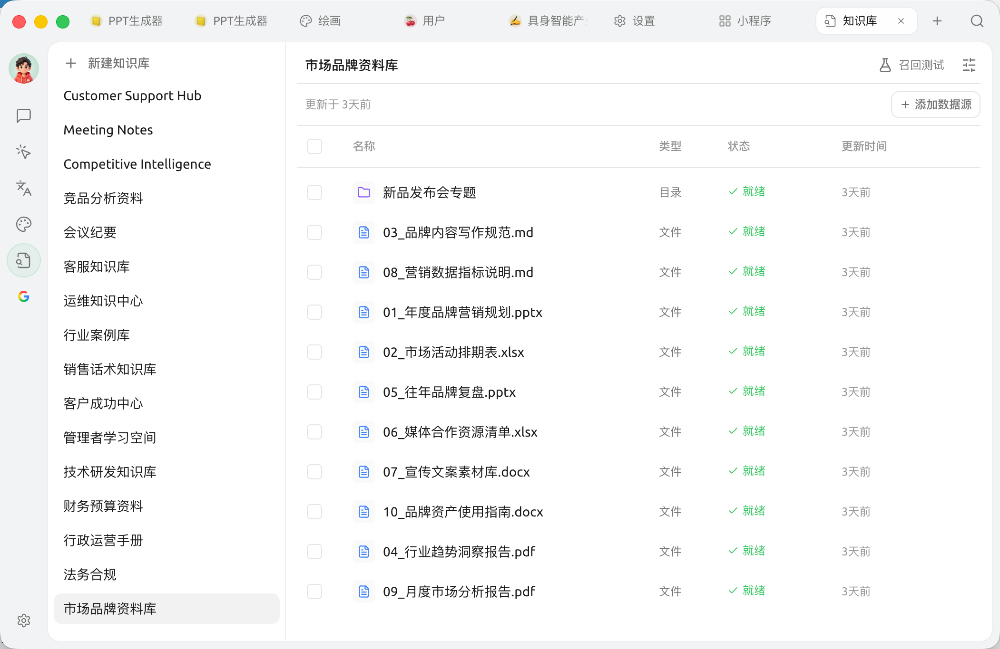

# 知识库界面参考

本页用于对照知识库界面的区域和入口。第一次使用时，请从[知识库入门](../../knowledge-base/knowledge-base.md)按“创建 → 导入 → 测试 → 使用”完成一次操作。

## 列表与操作入口

<figure><figcaption>
知识库：左栏是已建知识库列表（顶部 <code>+ 新建知识库</code>），右侧向选中的知识库添加文件 / 笔记 / 目录 / 链接数据源
</figcaption></figure>

| 区域或入口 | 作用 | 对应教程 |
| --- | --- | --- |
| 知识库列表 | 选择已有知识库，或创建新知识库 | [创建知识库](../../knowledge-base/create.md) |
| 资料列表 | 查看已导入资料及其处理状态 | [添加与整理资料](../../knowledge-base/sources.md) |
| 添加资料 | 导入文件、笔记、目录或链接 | [添加与整理资料](../../knowledge-base/sources.md) |
| 召回测试 | 检查问题能否找到正确片段 | [检查资料与召回](../../knowledge-base/recall-test.md) |
| 设置 | 配置文档处理、模型与检索参数 | [模型与检索设置](../../knowledge-base/emb-models-info.md) |

## 相关工作流

[在对话中使用](../../knowledge-base/chat.md) · [与智能体一起使用](../../knowledge-base/agent.md) · [应用案例](../../knowledge-base/cases.md) · [数据、隐私与维护](../../knowledge-base/data.md)
