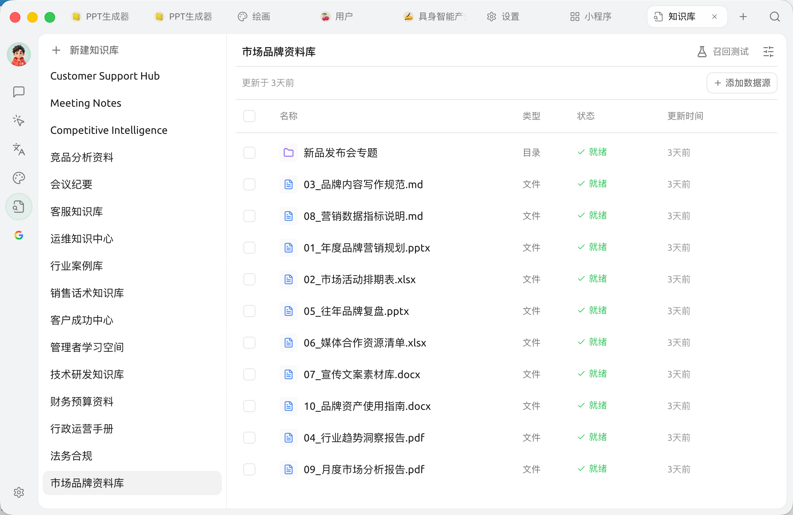

# 知识库

知识库就像给 AI 配一本 **专属参考书**：你把自己的文档、笔记、网址塞进去，之后聊天时让 AI 翻这本书来回答你的问题。

<figure><figcaption>
知识库：左栏是已建知识库列表（顶部 <code>+ 新建知识库</code>），右侧向选中的知识库添加文件 / 笔记 / 目录 / 链接数据源
</figcaption></figure>

## 用知识库能干什么？

适合反复查阅产品手册、内部制度、项目笔记或学习资料。完整流程和案例统一放在[知识库入门](../../knowledge-base/knowledge-base.md)。

## 为什么用知识库，不直接把文件丢给 AI？

临时分析一个附件时，直接在对话中使用通常更简单；需要反复查询同一批资料时，再建立知识库。知识库负责找出相关片段，正式使用前仍应通过召回测试检查这些片段。

## 怎么用？

* 第一次用：从[知识库入门](../../knowledge-base/knowledge-base.md)开始。
* 想加图片或扫描 PDF：看[文档预处理](../../knowledge-base/document-preprocessing.md)。
* 想选择检索方式：看[模型与检索设置](../../knowledge-base/emb-models-info.md)。嵌入模型是可选项，需要嵌入时也可以了解[本地模型](../../pre-basic/settings/local-models.md)。
* 想了解存储和数据处理：看[知识库数据](../../knowledge-base/data.md)。

## 与其他能力的组合

* 基于资料完成一次问答：看[在对话中使用](../../knowledge-base/chat.md)。
* 让智能体在多步任务中查资料：看[与智能体一起使用](../../knowledge-base/agent.md)；完整工作入口见[智能体概览](../../advanced-basic/agent.md)。
* 智能体验证通过后，需要接入聊天平台时再看[频道](../../advanced-basic/automation/channels.md)。

各项功能如何配合，见[进阶能力地图](../../advanced-basic/capability-map.md)。

***

### 获取帮助与提交反馈

如果您在配置或使用过程中遇到任何疑问、Bug 或有功能改进建议，请参考 [反馈与建议](../../question-contact/suggestions.md) 中提供的官方渠道。
