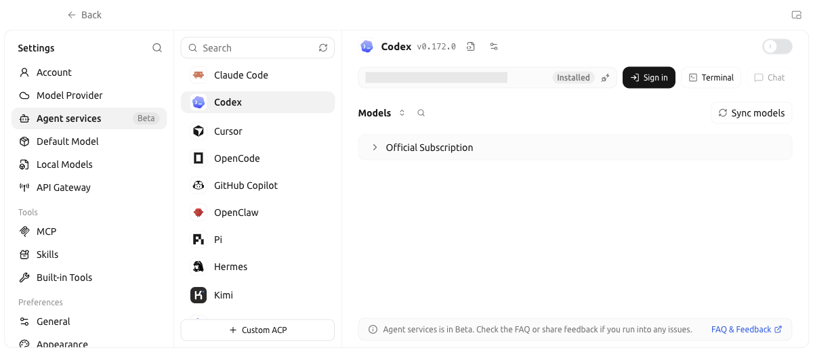
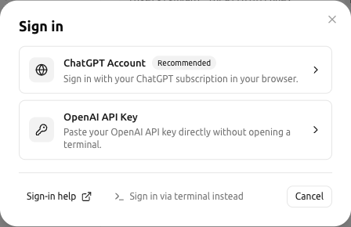

# Connect a Local Agent

Open **Settings** → **Agent services** to connect a local agent such as Codex, Claude Code, or Cursor. Once enabled, you can chat with it in **Work**. The agent runs on your computer, and its selected model may be provided over the network.

## Run Your First Task with Codex



### 1. Find or Install Codex

Select **Codex** in **Agent services**. If it's already installed, check that **Program** shows the version you want to use. If you see **Not installed**, click **Install**. Follow the on-screen instructions for other agents. Cursor, for example, lets you sign in without installing a separate CLI.

<figure><figcaption></figcaption></figure>



### 2. Sign In and Check the Connection

If Cherry Studio detects an existing Codex sign-in, click **Check connection**. If you need to sign in, click **Sign in** and select **ChatGPT Account** to authorize in your browser or **OpenAI API Key** to enter a key in the app. Return to Cherry Studio and check the connection.

<figure><figcaption></figcaption></figure>



### 3. Enable Codex and Open a Chat

Turn on the switch in the upper right, then click **Chat**. You can also open Codex from the agent list in **Work**. Start with the default model. To change models, set a default in **Agent services** or choose an available model in the conversation.



### 4. Send a Read-Only Task

Click **New task** and choose a project directory containing a `README.md` before sending your first message. Use a read-only mode or a mode that asks for approval, then send this prompt.

```
Read the README.md in the current directory and summarize the project in three bullet points. Do not modify any files.
```

Once you receive a summary based on the README, you can ask follow-up questions in the same task. The first message locks in the agent and working directory. Start a new task to work in another directory.



## Choose a Model Source

* To use the agent's own models, sign in or configure credentials using the method it supports. The agent supplies the model list. If it provides no choices, use its native configuration.
* If the agent supports models from a Cherry Studio provider, configure the provider in **Settings** → **Model Provider**, then return to **Agent services** and choose a compatible model. Cherry Studio routes requests locally. You can leave the **Unified Gateway** service off.

## If the Connection Fails

* **The CLI is installed but the page shows it as missing.** Click **Detect again**. For a CLI installed in a custom location, open the agent's **Advanced Settings**, enter its **Custom executable path**, save, and check the connection again.
* **The agent asks you to sign in or configure credentials.** Follow the on-screen instructions to sign in again. If the agent requires terminal sign-in, complete it there, then return to Cherry Studio and check the connection.

## Connect a Custom ACP Agent

If your tool supports ACP (Agent Client Protocol) and is missing from the list, select **Custom ACP** at the bottom. Enter the executable path and the launch arguments required by the tool, plus any environment variables it needs. Save the configuration, check the connection, then enable the agent.
