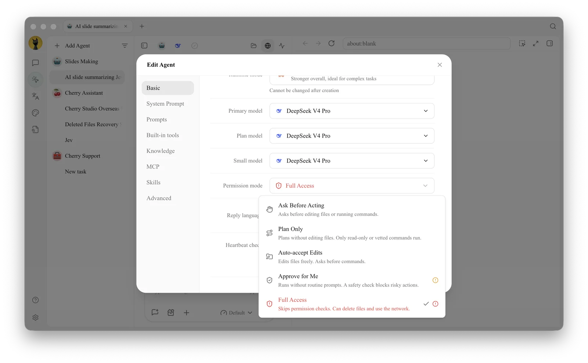

# Permissions, Memory, and Background Tasks

Agents can perform file, terminal, and network operations, and can also invoke sub-agents and background tasks. Permissions determine "whether to ask first," memory determines "whether it will still know next time," and the status panel on the right tells you "what is happening now."

<figure><figcaption><p>For daily use, start with Ask Before Acting; use Plan Only when you want to review the approach first, and use Full Access only for tasks with clear boundaries that are recoverable. </p></figcaption></figure>

### Permission Modes

| Mode | Behavior | Use Case | Notes |
| -------- | ------------- | ------------- | ---------------- |
| **Ask Before Acting** | Asks before editing files or running commands | Default starting point, real project directories | Frequent confirmations for many operations, but easiest to control |
| **Auto-accept Edits** | Edits files freely, asks before running commands | Document organization, recoverable code changes | Confirm working directory and version control status first |
| **Approve for Me** | Runs without routine prompts; a safety check blocks risky actions | Model supports it and task boundaries are clear | Some models may still ask every time |
| **Plan Only** | Plans without editing files; only read-only or vetted commands run | Solution review, pre-release audit | Suitable for reviewing the plan before execution |
| **Full Access** | Skips permission checks | Isolated, trusted, recoverable environments | May delete files or access the network, highest risk |

Detected system or global package installs require approval and a live responder outside **Full Access**; **Plan Only** still blocks installation. **Full Access** permits unattended installs, but direct `mise` mutations remain blocked in every mode.

The available modes depend on the runtime mode: Pi does not provide **Plan Only**, and new Pi Agents default to **Approve for Me**; **Claude Agent** provides all five modes.

Configuration path: Left navigation **Work** → Agent menu → **Edit** → **Basic** → **Permission mode**.


Channels can individually override the Agent's permission mode. External chat entry points are more likely to receive unexpected instructions, so you should usually choose **Inherit Agent Settings** or a stricter mode than the Agent. Do not enable Full Access just to avoid a few confirmations.


### Agent Memory

Memory has shared and private scopes. Shared memory is available to Assistants and Agents that have enabled access. It can contain personal preferences, facts, experiences, plans and constraints that help with future assistance. Private memory holds project and customer knowledge and follows one Agent across tasks and working directories.

#### Enable Shared Memory

Open **Settings → Tools → Shared memory**, alongside MCP and Skills.

* **Generate memory in chats** extracts information from newly completed, authorized conversations.
* **Automatically organize memory** organizes existing files, including duplicates and topic structure.

Both global switches default to on. They use the application's default model and may consume its quota. Generation and organization can be switched independently, and **Organize now** runs organization manually.

Also check **Shared memory** in each Agent or Assistant's **Basic** settings. Agents default to on, with the switch above **Heartbeat**; Assistants default to off. Shared conversation extraction applies to authorized desktop main sessions and persistent Assistant conversations.

#### How Conversation Information Is Saved

After eight successful turns in a conversation, the app extracts memory during idle time. Remaining new turns are processed daily at 21:00 in the system local time zone. Admitted pending work survives shutdown, and the next launch catches up missed batches. Each batch includes existing shared memory and up to sixteen user/assistant messages ending at its final reply. Long input retains newer complete turns and records budget skips; ambiguous context is not guessed. User quotes support saved facts; Assistant replies provide context. Multiple model batches receive an additional duplicate/conflict check. Model or network failures allow two retries ten minutes apart, then wait for the next 21:00; foreground chat only defers extraction. Disabling generation, clearing memory or revoking access discards affected pending work.

Experiences and plans with future value are considered automatically, including one-time events and temporary circumstances. Saved information retains the original timing, conditions and certainty.

You can also tell the Agent directly in **Work**:

```
Remember: All externally published Chinese copy must use full-width punctuation and avoid exaggerated titles. Apply this rule to all future related tasks.
```

When correcting information, identify the old fact and what changed. Automatic extraction preserves existing facts when conflicts arise. Pi and Claude Code also support memory-file writes through native file tools, with permission and version checks. Check the tool result to confirm a save; if saving is unconfirmed, read the file again before editing.

Stopped or failed turns are omitted as whole turns within the same sixteen-message window. Ordinary Agent or Assistant configuration changes preserve pending extraction. If a save is uncertain and the file was subsequently changed, that batch is recorded as conflict-skipped while later batches continue. Foreground chat also defers organization without consuming its attempt allowance.

#### When Saved Information Takes Effect

Each topic or Agent session reads an entry snapshot on its first authorized request. Later turns and context compaction reuse that snapshot, with authorization and forgotten state checked again. Ordinary additions and edits load automatically in a new conversation.

The model reads linked topic files as needed through the controlled tools available to the current runtime.

#### Recall Earlier Conversations

With shared memory enabled, supported Assistants, Pi and Claude Code can use `memory_search` to recall their own conversations. The prompt directs the model to search when necessary information is missing from the current context.

Assistants search only their own topics. Agents search only their own desktop main conversations. The question currently being answered is excluded; earlier messages in the same conversation remain searchable. Each answer allows four calls, shared by search and message expansion. Results return original excerpts for the current answer, with truncation marked on longer content.

#### View, Clear and Restore

Shared-memory settings show the latest run result and provide **Restore backup** and **Clear global memory**. Both actions require confirmation. Clearing affects only shared-memory content and preserves Agent-private memory, legacy files and existing backups.


Clearing nonempty memory retains forgetting markers. Conversations that may contain old memory remain blocked after restart or disabling shared access. You can start a new conversation to continue chatting with filtered memory. Changes to expired state or invalid state also trigger protection. If recovery encounters later edits or forgetting markers, it reports a conflict and preserves the current state.


The Agent's **Memory** tab shows the identity files `SOUL.md` and `USER.md`, legacy `memory/FACT.md`, and read-only `memory/JOURNAL.jsonl`. Active memory uses `MEMORY.md` and `.memories/` topics. After FACT migration succeeds, edits in the legacy tab affect only the retained FACT file. JOURNAL is kept as history.

### Sub-agents, Workflows, and Background Commands

In complex tasks, an Agent can delegate research, organization, and verification to sub-agents, or orchestrate multiple steps through workflows. Time-consuming commands can run in the background without blocking the entire conversation. The Agent can also create a new session after your confirmation, or send tasks to an existing session; the request returns immediately, and the completion result returns to the initiating session later, preserving the source and delivery status.

The **Status** panel on the right allows you to view:

* Ongoing and completed tasks;
* Sub-agents and workflows;
* Background commands and stop entry;
* Tool call success, failure, and count;
* Context usage and declared artifacts.

After enabling **Settings** → **Notifications** → **Conversation Completion Notification**, when working in other tabs or windows, you will receive system notifications when the assistant reply is complete, an Agent task is complete, or approval is pending; clicking the notification returns you to the corresponding conversation.

### User Case: Continuously Maintaining Project Standards

The team writes stable code conventions into Agent memory and creates detailed review steps as skills. Each time a new branch is reviewed, a task is opened, allowing the Agent to use sub-agents to check interfaces, data migrations, and tests separately, and then the main Agent summarizes the conclusions. When rules change, update the memory; there is no need to modify the history of each task.

<details>

<summary>Can memory replace a knowledge base? </summary>

Each serves a different purpose: memory holds personal information or Agent-private knowledge for future answers; conversation recall finds earlier discussions; a Knowledge Base manages organized reference documents with a controlled retrieval scope.

</details>

<details>

<summary>If a task appears stuck, where should you look first? </summary>

First open the **Status** panel on the right to check if it is waiting for permissions, if background commands are still running, if subtasks have failed, or if the service provider is retrying. If you need deeper request details, open Developer Mode to view the call chain.

</details>
