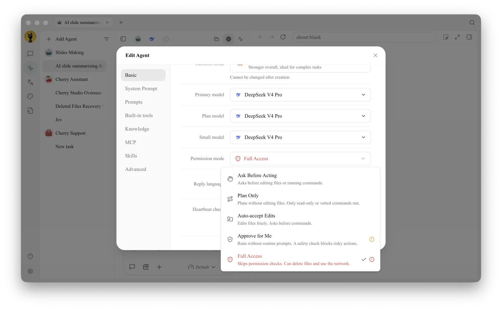

# Permissions, Memory, and Background Tasks

Agents can perform file, terminal, and network operations, and can also invoke sub-agents and background tasks. Permissions determine "whether to ask first," memory determines "whether it will still know next time," and the status panel on the right tells you "what is happening now."

<figure><figcaption><p>For daily use, start with Ask Before Acting; use Plan Only when you want to review the approach first, and use Full Access only for tasks with clear boundaries that are recoverable. </p></figcaption></figure>

### Permission Modes

| Mode | Behavior | Use Case | Notes |
| -------- | ------------- | ------------- | ---------------- |
| **Ask Before Acting** | Asks before editing files or running commands | Default starting point, real project directories | Frequent confirmations for many operations, but easiest to control |
| **Auto-accept Edits** | Edits files freely, asks before running commands | Document organization, recoverable code changes | Confirm working directory and version control status first |
| **Approve for Me** | Runs without routine prompts; a safety check blocks risky actions | Model supports it and task boundaries are clear | Some models may still ask every time |
| **Plan Only** | Plans without editing files; only read-only or vetted commands run | Solution review, pre-release audit | Suitable for reviewing the plan before execution |
| **Full Access** | Skips permission checks | Isolated, trusted, recoverable environments | May delete files or access the network, highest risk |

The available modes depend on the runtime mode: Pi does not provide **Plan Only**, and new Pi Agents default to **Approve for Me**; **Claude Agent** provides all five modes.

Configuration path: Left navigation **Work** → Agent menu → **Edit** → **Basic** → **Permission mode**.


Channels can individually override the Agent's permission mode. External chat entry points are more likely to receive unexpected instructions, so you should usually choose **Inherit Agent Settings** or a stricter mode than the Agent. Do not enable Full Access just to avoid a few confirmations.


### Agent Memory

Agent memory follows the Agent, not a specific task or working directory. It is suitable for storing long-term preferences, project facts, technical decisions, and experience; one-time progress should be recorded as timestamped logs for retrieval by subsequent tasks.

Tell the Agent directly in **Work**:

```
Remember: All externally published Chinese copy must use full-width punctuation and avoid exaggerated titles. Apply this rule to all future related tasks.
```

When corrections are needed, explicitly state that the old information is no longer valid and request a memory update. Do not write passwords, API Keys, private identity information, or short-term irrelevant content into long-term memory.

### Sub-agents, Workflows, and Background Commands

In complex tasks, an Agent can delegate research, organization, and verification to sub-agents, or orchestrate multiple steps through workflows. Time-consuming commands can run in the background without blocking the entire conversation. The Agent can also create a new session after your confirmation, or send tasks to an existing session; the request returns immediately, and the completion result returns to the initiating session later, preserving the source and delivery status.

The **Status** panel on the right allows you to view:

* Ongoing and completed tasks;
* Sub-agents and workflows;
* Background commands and stop entry;
* Tool call success, failure, and count;
* Context usage and declared artifacts.

After enabling **Settings** → **Notifications** → **Conversation Completion Notification**, when working in other tabs or windows, you will receive system notifications when the assistant reply is complete, an Agent task is complete, or approval is pending; clicking the notification returns you to the corresponding conversation.

### User Case: Continuously Maintaining Project Standards

The team writes stable code conventions into Agent memory and creates detailed review steps as skills. Each time a new branch is reviewed, a task is opened, allowing the Agent to use sub-agents to check interfaces, data migrations, and tests separately, and then the main Agent summarizes the conclusions. When rules change, update the memory; there is no need to modify the history of each task.

<details>

<summary>Can memory replace a knowledge base? </summary>

No. Memory is suitable for a small amount of stable facts and experience used across tasks; a knowledge base is suitable for systematic documentation and can control the Agent's retrieval scope.

</details>

<details>

<summary>If a task appears stuck, where should you look first? </summary>

First open the **Status** panel on the right to check if it is waiting for permissions, if background commands are still running, if subtasks have failed, or if the service provider is retrying. If you need deeper request details, open Developer Mode to view the call chain.

</details>
