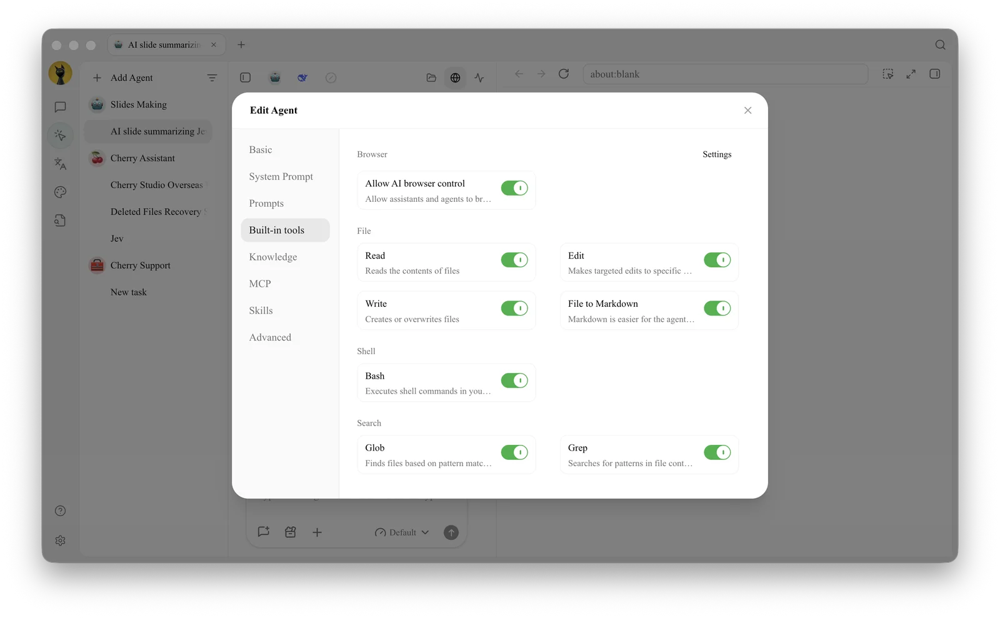

# Built-in Tools, Knowledge Bases, Skills, and MCP

These four capabilities enhance the Agent, but they solve different problems: built-in tools handle common operations, knowledge bases define searchable materials, skills provide working methods, and MCP connects to external tools and data.

### Differences and Combinations

<figure><figcaption></figcaption></figure>

| Capability | Problem Solved | Examples |
| ---- | ----------------------------- | ------------------------- |
| Built-in Tools | What the Agent can do directly within Cherry Studio | Read/write files, web search, image generation, memory, notifications, scheduled tasks |
| Knowledge Bases | Which private materials the Agent can retrieve | Product specifications, contract templates, team handbooks |
| Skills | What processes and standards the Agent should follow | Weekly report formats, code review checklists, writing guidelines |
| MCP | Which external tools and resources the Agent can connect to | Databases, browsers, third-party business systems |

Configuration path: Left navigation [Work] → Open Agent menu → [Edit] → [Built-in Tools].

### Built-in Tools

Built-in tools are grouped into Browser, File, Shell, Search, Context, Orchestration, and Media. Common capabilities include:

* [Image Generation]: Uses the configured drawing model;
* [Knowledge Search] and [Manage Knowledge]: Appear only after a knowledge base is bound;
* [Web Search] and [Web Scraping]: Uses the internet capabilities configured in Cherry Studio;
* [Memory]: Saves and retrieves stable information across tasks;
* [Scheduled Tasks] and [Notifications]: Allows the Agent to manage schedules and send results to channels;
* [Task] and [Workflow]: Uses sub-agents or orchestration to handle complex tasks;
* [File to Markdown]: Reads PDF, Word, PowerPoint, Excel, OpenDocument, RTF, EPUB, and CSV files from the working directory or current session attachments, and passes structured content to the Agent for segmented processing;
* Session coordination tools: Finds existing Agent sessions, creates independent sessions, sends tasks, and receives trackable completion results;
* File and Bash tools: Reads, creates, modifies files, and executes commands.


[File to Markdown] does not modify the original file and does not provide OCR for scanned PDFs. For scanned documents, first use [OCR] or document processing capabilities, then pass them to the Agent.


### Knowledge Base Scope

The knowledge bases selected in [Knowledge Bases] define the retrieval boundary for that Agent. If none are selected, knowledge base tools are not loaded; if multiple are selected, the Agent works only within these knowledge bases and does not automatically read from other repositories.

### Skills

Enable installed skills in [Skills]. Skill content enters the Agent's working environment to constrain processes and outputs. If you need a new skill, you can ask the Agent in [Work] to find and install it for you; the manual management path is [Settings] → [Skills].

### MCP

First, connect and start servers in [Settings] → [MCP], then return to the Agent edit window to bind them in [MCP]. Servers that are not running cannot be enabled; once connected, the tools they provide enter the Agent's tool directory and remain subject to permission mode controls. If a server also provides resources or prompts, you can select and use them directly from the [+] panel in the input area.


Enabling a tool does not mean you should skip approval. For file writes, terminal commands, external data modifications, and potentially billable image generation, prioritize [Ask Before Acting]; use looser permissions only for tools with trusted sources and clear risks.


### Recommended Combinations

| Task Requirement | Suggested Combination | When to Add More | Notes |
| -------- | ------------- | ------------- | ------------- |
| Process local files | File tools + dedicated working directory | Add skills when fixed formats are needed | Keep [Ask Before Acting] enabled |
| Answer based on internal materials | Knowledge base + Knowledge Search | Hand off to channels after retrieval is stable | Test with questions that have no answers first |
| Execute fixed processes repeatedly | Skills + necessary built-in tools | Add MCP when external data is needed | Do not store account keys in skills |
| Call external systems | MCP + minimal privilege credentials | Relax approvals after tasks are stable | Confirm writes, deletions, and billable operations |

### User Case: Market Research Agent

Bind a product materials knowledge base to the Agent, enable the "Research Report" skill, connect a trusted web search MCP, and keep the built-in web scraping and file writing tools. The Agent first determines the product scope from internal materials, then searches for external information, and finally writes to the working directory according to the structure defined by the skill. Internal materials, external sources, and output formats each have clear ownership, making future maintenance easier.

Why are there still no retrieval results after binding a knowledge base?

Ensure the knowledge base has completed processing and contains searchable content, then check if the binding still exists in the Agent edit window. If a knowledge base is deleted, the related binding is automatically removed.

Do I need to restart the task after enabling a skill?

No need to close the task. After editing the Agent, the new skill configuration is loaded starting from the next message; the currently generating reply is not interrupted.

