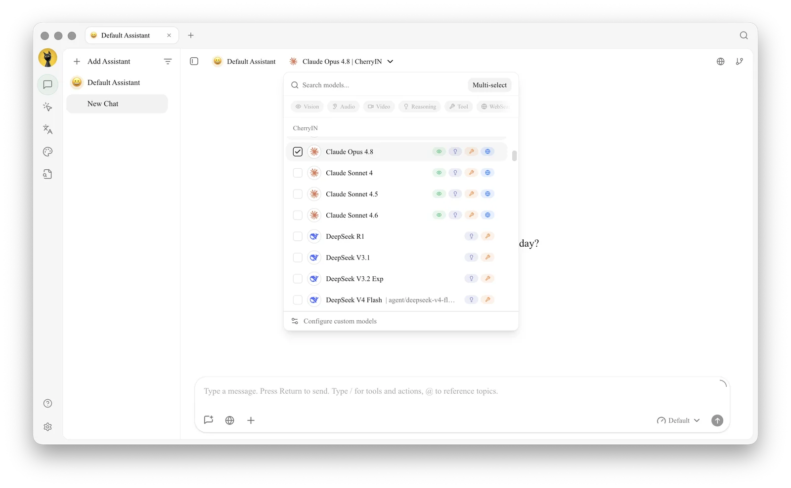

# Multi-Model Comparison

Multi-model comparison is ideal for questions without a single correct answer, such as reviewing proposals, exploring copywriting directions, or cross-checking sources.

## Comparing Multiple Models Simultaneously



### 1. Open [Chat] and click the model name

Click **Multi-select** at the top right of the model list, then tick the models you want to compare. Before first use, ensure that the services associated with these models are connected properly.



### 2. Send the same question

Include evaluation criteria in your question, for example, "Compare from the perspectives of feasibility, risk, and cost." Avoid asking only "Which is better?"



### 3. Compare differences, not just pick the longest answer

Focus on whether facts are consistent, assumptions are explicit, what is missing, and which option best fits your constraints. Verify important facts against original sources.



<figure><figcaption>
Turn on Multi-select in the model selector, then send the same question to every selected model.
</figcaption></figure>


Selecting multiple models triggers separate requests for each. When dealing with costs, speed, or sensitive data, use short questions first to confirm connectivity and performance before processing long materials.


When is it not suitable to use multiple models?

Using a single model is more appropriate when looking up a specific fact, organizing short text, or when the material contains content that should not be sent to multiple service providers.

## Compare model and prompt configurations

After selecting several models in normal chat, expand **Model prompt comparison** above the input. Turn on **Override system prompt** for each model you want to customize, then enter that model's instructions. Leave it unchecked to use the current assistant prompt. A checked but empty field intentionally uses no user system prompt.

Each prompt belongs to its named model, even if you reorder the selection. Sending the turn records the selected prompts with the replies. Use **View this reply's system prompt** in a reply header to inspect its configuration later. Regeneration, retry and edit-and-resend preserve the recorded model/prompt association, even if the assistant prompt has changed. Historical edit mode does not edit prompt overrides; start a new comparison to choose new prompts.

Prompt fields are cleared after sending or queueing a draft. A queued draft keeps its own captured values. Prompt comparisons wait for an idle normal conversation and are not available for Agent sessions or temporary chats. The same model cannot be selected twice in one comparison.

The prompt text is stored with the conversation locally and is sent to that model's provider as system instructions. Review sensitive content before sending. Runtime tool and citation instructions still apply.
