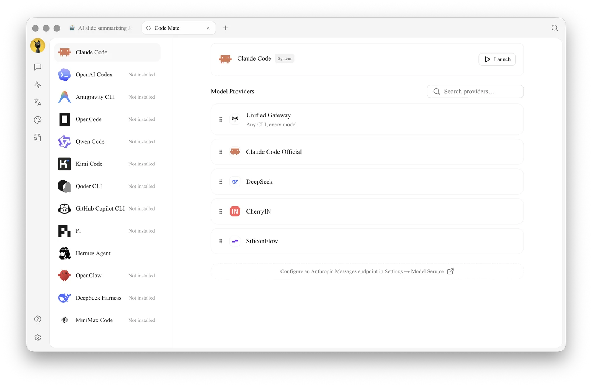
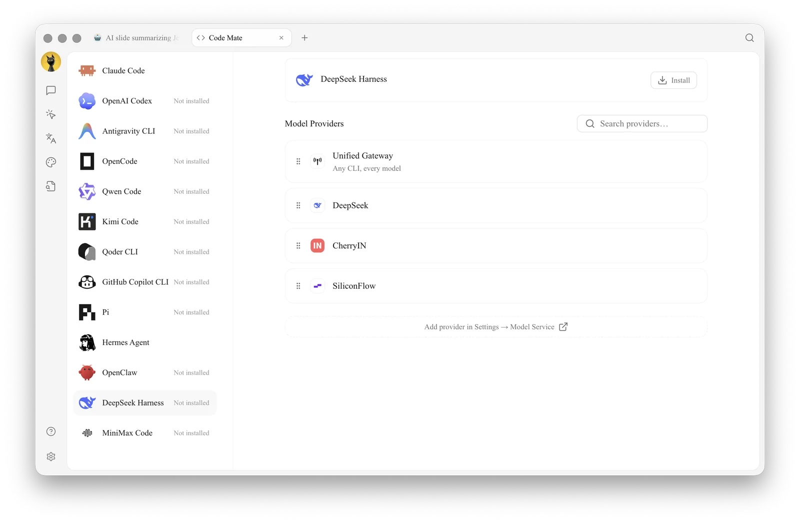

# Code Mate (Code CLI)

**Code Mate** is used to install, configure, and launch common programming command-line tools. Cherry Studio distinguishes between app-managed versions, versions already present in the system PATH, and the tool's own account login. It does not automatically overwrite system installations.

<figure><figcaption>
① Select the tool on the left and confirm its installation status; ② Select the Unified Gateway, the tool's official account, or a compatible model service on the right. 
</figcaption></figure>

## What the Page Can Do

* Check if a tool is installed and if updates are available;
* Install, update, or remove Cherry Studio-managed tool copies;
* Detect tools already present in the system PATH;
* Select a provider, model, and parameters for CLIs that require model services;
* Preserve native login methods for CLIs that use their own account login;
* Select a working directory and a system-detected terminal to launch.

The page includes tools such as Claude Code, OpenAI Codex, Antigravity CLI, OpenCode, Qwen Code, Kimi Code, Qoder CLI, GitHub Copilot CLI, Pi, Hermes Agent, OpenClaw, DeepSeek Harness and MiniMax Code. The actual visible items may change with product updates; refer to the page list for the current status.

For CLIs that use Cherry Studio model services, the **Model Providers** list on the right shows the compatible providers. It also includes **Unified Gateway** ("Any CLI, every model"), which routes the CLI through Cherry Studio's gateway so it can use any model you have configured. You can drag providers to reorder them, and search the list with **Search providers…**.

## General Launch Process




### 1. Open **Code Mate** from **Launchpad**

Select the required tool and check whether its status is Not Installed, Managed by Cherry Studio, or from the System.



### 2. Complete Installation or Login

If not installed, click **Install**. For CLIs that provide their own account login, follow the page prompts to complete native login. You do not need to select a provider from Cherry Studio.



### 3. Configure Model Connection

For tools that require Cherry Studio model services, you can select **Unified Gateway** or a compatible provider and model. The page filters by the interface type required by the CLI; incompatible providers are not listed.



### 4. Select Directory and Terminal

The working directory determines where the CLI launches. The terminal can only be selected from the list detected by the system; after launching, use read-only commands first to confirm the current path.



### 5. Launch and Verify

Click **Launch**, confirm that the account or model is correct, then execute file modifications or commands. If you need to adjust reasoning intensity, permissions, or tool-specific options, open **Configuration**.



## Claude Code Model Modes

When configuring Claude Code, **Model** offers two modes:

* **General**: All requests use the same model, offering simple configuration;
* **Detailed**: Set Fable, Opus, Sonnet, Haiku, and Subagent separately in **Model Role Mapping**. The **Actual Request Model** in the table is the model ultimately used for each role; you can also enable **1M** context for specific roles if needed.

Use **Detailed** only when you specifically need to assign different models to roles such as background subtasks, compression, or titles. Roles left blank will follow the main model. After making changes, use a small task to confirm that each role can request normally.

## DeepSeek Harness

<figure><figcaption>
① If not installed, complete the managed installation first; after installation, configure the compatible provider, default permissions, and Agent mode, then launch the Web UI. 
</figcaption></figure>

The process for DeepSeek Harness differs from standard terminal CLIs: after installation and provider selection, it is run under Cherry Studio management, and a standalone Web UI can be opened. In the parameters, you can select the default Agent mode and default permissions:

| Configuration | Suitable For | Notes |
| -------- | -------------------------- | ------------- |
| **Standard** | May use files, Shell, retrieval, skills, planning, and sub-agents | Largest tool surface; use controlled permissions first |
| **PTC Code** | Requires combining multi-step tool operations via Code Mode | Better suited for complex coding tasks |
| **Minimal** | Only requires persistent Shell and text editor | Fewer dependencies, smaller capability scope |
| **Read-Only** | Inspect projects without writing files | Risky operations still request confirmation |
| **Workspace Write** | Allows modifying the current DSH workspace | Does not imply access to files outside the workspace |
| **Full Access** | Isolated, trusted, and recoverable environments | Does not request operation confirmation; highest risk |

## Distinguish Installation Sources

| Source | What Cherry Studio Does | How You Should Maintain It |
| ---------------- | ------------------ | ----------------- |
| Cherry Studio Managed | Installs, updates, and uninstalls the corresponding managed copy | Manage in **Code Mate** or **Dependencies** |
| System PATH | Detects and uses directly, without overwriting | Update or uninstall using the original package manager |
| Tool Official Account | Preserves the tool's own login flow | Manage account and authorization in the tool's interface |
| App Built-in | Uses directly, does not provide system-level uninstallation | Updates with Cherry Studio |


After uninstalling the Cherry Studio managed copy, if a same-named executable file still exists in the system, the page will automatically fall back to the system version. When behavior changes, first confirm which source is currently being used.


## Use Case: Launching Coding Tools in a Project Directory

| Selection | Recommended Starting Point | Applicable Scenario | Notes |
| ----- | ----------------------------- | ------------ | ---------------- |
| Installation Source | Use the existing system version if available | Teams that already manage CLIs centrally | Updates and uninstallation remain the responsibility of the original package manager |
| Model Connection | First select a connection already verified as available in Cherry Studio | CLIs that require model services | Tools with native account login should follow the native login flow |
| Working Directory | Select only the current project directory | Modifying code, running checks | Confirm the terminal's current path after launching |
| First Command | Read-only view of project status | Verifying account, model, and directory | Allow file writing only after confirmation |

### Completion Criteria

The page identifies the installation source; the terminal opens in the correct directory; the minimal read-only command succeeds; and the account or model displayed by the tool matches expectations.

Why can't I find an already installed terminal or CLI? 

Cherry Studio detects tools from the login environment and standard locations. Ensure the command runs in the login terminal, then restart the app to refresh the environment. Portable or non-standard paths currently require manual launch from that terminal.

