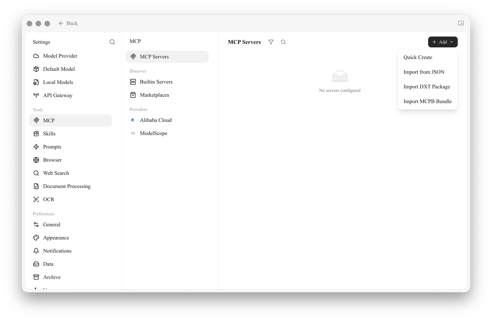
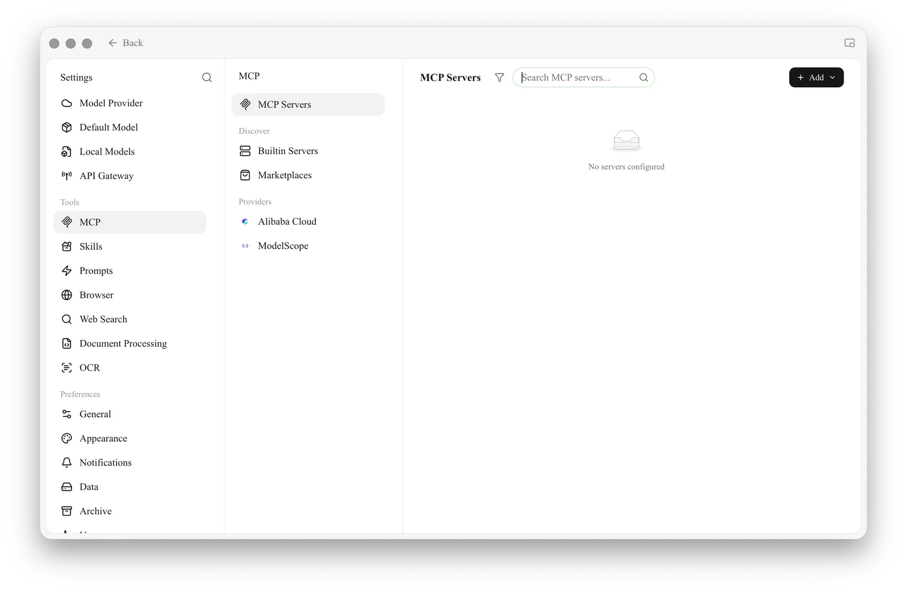
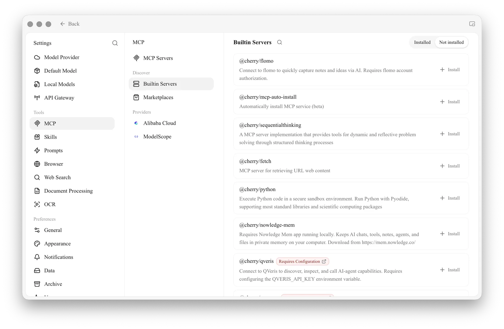

# MCP and External Tools

MCP is how Agents connect to external tools and resources. Cherry Studio can manage MCP servers, built-in servers, marketplaces and some provider entries, and then bind connected servers to specific Agents.

### When You Need MCP

<figure><figcaption></figcaption></figure>

<figure><figcaption></figcaption></figure>

* An Agent needs to call services beyond Cherry Studio's built-in tools;
* Your team already has databases, browsers or business systems that expose an MCP interface;
* You want the same set of external capabilities reused by several Agents;
* You need to provide tools, resources or prompts to the model in a uniform way.

If you only need a fixed workflow, use a Skill; if you only need to search a Cherry Studio knowledge base, bind the knowledge base directly. There's no need to set up MCP just because it seems "more advanced".

### Add a Server

Path: **Settings → MCP → MCP Servers → Add**.



#### 1. Confirm the connection type

Local commands usually use standard input/output; remote services usually provide an SSE or streamable HTTP URL. Fill in the configuration exactly as the service provider specifies — don't guess from the name.



#### 2. Fill in the configuration and check permissions

Local servers need a command, arguments and environment variables; remote servers need a URL, and some also need authorization. Before saving, confirm where the command comes from and what data it can reach.



#### 3. Start it and review the tools

Enable the server, wait for its status to turn healthy, then open its details to check the tools, resources and prompts it provides. If the connection fails, check the server log first.

Expand a tool in the tool list to see its full Markdown description and its parameters shown by level, with types, required markers and enum values. Check the required parameters before calling it; expand object and array parameters level by level rather than guessing the input format from the tool's name.



#### 4. Bind it to an Agent

Open **Work** → the Agent's menu → **Edit** → **MCP**, and enable the server. A server that isn't running can't be bound and used properly.



### Built-in Servers and Marketplaces

**Built-in MCP** offers common capabilities you can install or enable directly; **Marketplaces** manages third-party marketplace sources. Still review the description, command, environment variables and permissions before installing — a built-in entry doesn't mean every operation of the external service is risk-free.

<figure><figcaption>
① The built-in list shows whether an account, API key or folder configuration is needed; after installing, you still need to finish the configuration and verify the connection.
</figcaption></figure>

QVeris is under **Built-in Servers** and lets Agents discover, inspect and call external capabilities. After installing it, you need to configure `QVERIS_API_KEY`; don't put the key in Agent prompts, Skills or public screenshots.

### Use MCP Prompts and Resources in the Input Area

Besides tools, a server may also provide "prompts" and "resources". Once the server is bound to the current assistant or Agent, open the **+** panel in the input area:

* Choose **MCP Prompts** to insert a server template into the input box; required parameters in the template appear as fields you can fill in;
* Choose **MCP Resources** to pick a file, record or other resource from a bound server;
* Short text resources are inserted directly into the input box; larger or binary resources are added as references that a tool-calling model reads when needed.


The panel only shows servers that are connected within the current conversation and actually provide that capability. If you don't see **MCP Prompts** or **MCP Resources**, first check the corresponding tab in the server's details, then confirm the current assistant or Agent is bound to that server.


### Recommended Settings

| Setting | Product default | Suggested start | Purpose | When it applies | Caveats |
| -------- | -------------- | ----------------- | --------- | ------------- | ------------ |
| Server status | Depends on the configuration after adding | Enable one at a time and verify | Controls whether the server is available | First-time setup, troubleshooting | When several servers fail at once, it's hard to pinpoint |
| Agent binding | Servers aren't bound automatically | Bind only the servers the Agent needs | Controls the scope of capabilities | Several Agents with different roles | Keeps irrelevant tools from filling up the context |
| Environment variables | No keys prefilled | Use credentials with the minimum permissions the service requires | Provides authentication or runtime parameters | Private services | Mask sensitive content before screenshots and exports |
| Tool approval | Decided by the Agent's permission mode | Keep confirmation on for tools that write or cost money | Prevents unintended actions | Databases, files, external APIs | Channel entry points can use a stricter mode |

### Example: Connecting a Project Database to an Analysis Agent

An admin provides a read-only MCP connection. The user verifies the server works in **Settings → MCP**, then binds it only to the "Data Analysis" Agent. The Agent uses read-only tools to fetch data and writes its report to the working directory; tools that update data are left disabled. That way, even if the prompt is misunderstood, the business database can't be changed directly.

What's the difference between MCP and the API Gateway?

MCP brings external tools into Cherry Studio; the API Gateway offers Cherry Studio's model capabilities to other programs through a compatible API. The data flows in opposite directions.

The server shows as connected, but the Agent still can't find the tools. What should I do?

Check whether the Agent is bound to the server, whether the tool is turned off, and whether a permission request is pending. After changing the Agent's configuration, send a new message so the runtime loads the new tools.

