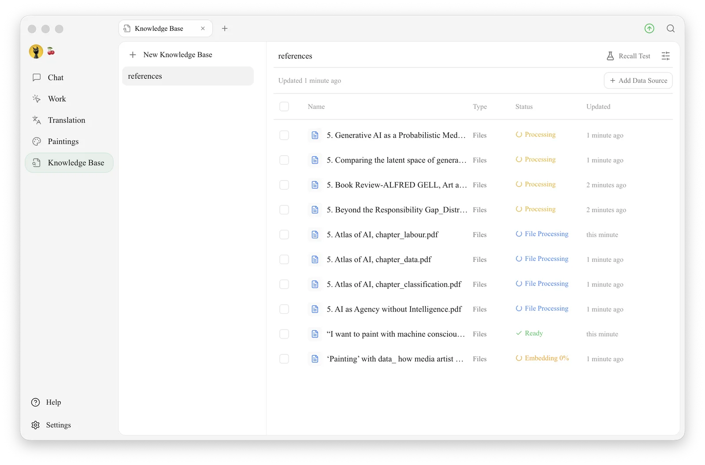

# Knowledge Base

A knowledge base is like giving the AI its own **reference book**: you put your documents, notes and web pages into it, and later, during chats, the AI looks things up in that book to answer your questions.

<figure><figcaption>
Knowledge Base: the left column lists your knowledge bases (with <code>+ New Knowledge Base</code> at the top); the right side shows the selected knowledge base's items and their processing status, with <strong>Add Data Source</strong> and <strong>Recall Test</strong> at the top
</figcaption></figure>

## What Can You Do With a Knowledge Base?

Use it for material you need to consult repeatedly, such as product manuals, internal policies, project notes or study materials. See [Getting Started with Knowledge Bases](../../knowledge-base/knowledge-base.md) for the complete workflow and examples.

## Why Use a Knowledge Base Instead of Just Sending Files to the AI?

For a one-off attachment, using chat directly may be simpler. A knowledge base is useful when you need a reusable collection of sources. It retrieves relevant passages; check those passages with a recall test before relying on the answers.

## How to Use It

* First time: start with [Getting Started with Knowledge Bases](../../knowledge-base/knowledge-base.md).
* Adding images or scanned PDFs: see [Document Preprocessing](../../knowledge-base/zhi-shi-ku-wen-dang-yu-chu-li.md).
* Choosing how to search: see [Model and Retrieval Settings](../../knowledge-base/emb-models-info.md). Embedding models are optional; [local models](../../pre-basic/settings/local-models.md) are one option when you need embeddings.
* Checking storage and data handling: see [Knowledge Base Data](../../knowledge-base/data.md).

## Combining With Other Features

* For a question grounded in your sources, follow [Using in Chat](../../knowledge-base/chat.md).
* For multi-step work, follow [Using with Agent](../../knowledge-base/agent.md). The [Agent overview](../../advanced-basic/agent.md) explains the wider workflow.
* Once the Agent works as expected, see [Channels](../../advanced-basic/automation/channels.md) for messaging integrations.

The [Advanced Capability Map](../../advanced-basic/capability-map.md) explains how these features fit together.

***

### Get Help and Submit Feedback

If you have any questions, bugs, or feature suggestions during configuration or use, please use the official channels listed in [Feedback and Suggestions](../../question-contact/suggestions.md).
