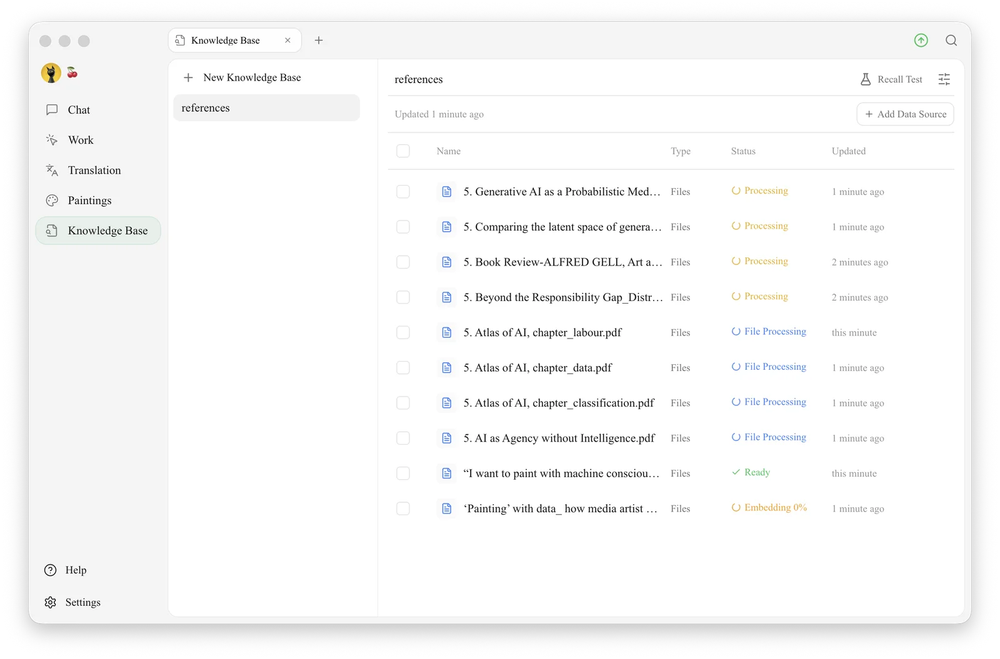

# Knowledge Base Interface Reference

Use this page to identify the knowledge base interface. For the complete create → import → test → use workflow, start with [Getting Started with Knowledge Bases](../../knowledge-base/knowledge-base.md).

## Lists and Controls

<figure><figcaption>
Knowledge Base: the left column lists your knowledge bases (with <code>+ New Knowledge Base</code> at the top); the right side shows the selected knowledge base's items and their processing status, with <strong>Add Data Source</strong> and <strong>Recall Test</strong> at the top
</figcaption></figure>

| Area or control | Purpose | Related guide |
| --- | --- | --- |
| Knowledge base list | Select a knowledge base or create one | [Create a Knowledge Base](../../knowledge-base/create.md) |
| Source list | Inspect sources and their processing status | [Add and Organize Material](../../knowledge-base/sources.md) |
| Add Data Source | Import files, notes, folders, or links | [Add and Organize Material](../../knowledge-base/sources.md) |
| Recall Test | Check whether a question retrieves the correct passages | [Verify Sources and Recall](../../knowledge-base/recall-test.md) |
| Settings | Configure document processing, models, and retrieval | [Model and Retrieval Settings](../../knowledge-base/emb-models-info.md) |

## Related Workflows

[Use in Chat](../../knowledge-base/chat.md) · [Use with an Agent](../../knowledge-base/agent.md) · [Application Cases](../../knowledge-base/cases.md) · [Data, Privacy, and Maintenance](../../knowledge-base/data.md)
