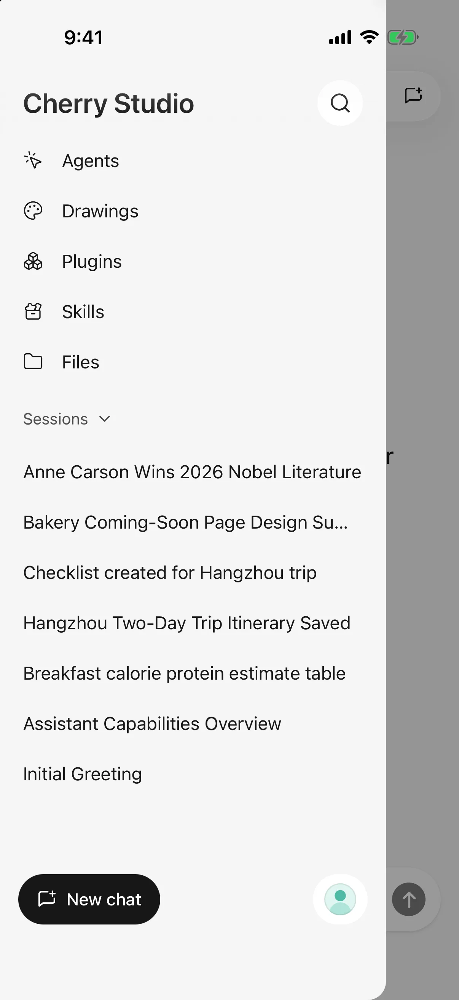
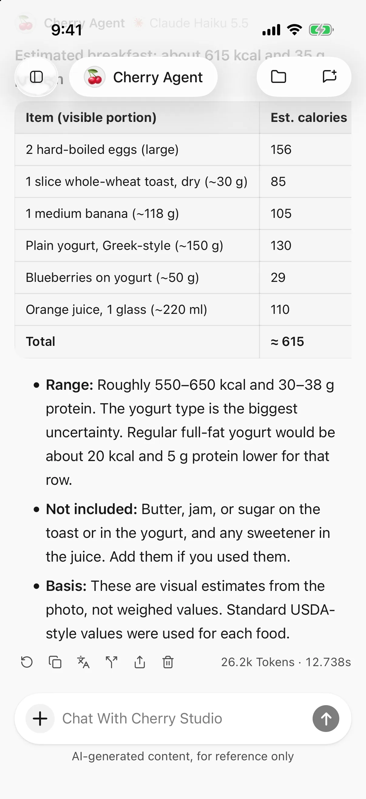

# Cherry Studio Mobile

Cherry Studio Mobile brings model chat, agents, skills, plugins, file work, and image creation to Android, iPhone, and iPad. It also connects to desktop agents and remote servers.

- **First time here?** Use [Quick start](quick-start.md) to choose an account/provider and send a message.
- **Upgrading?** Read [changes to familiar workflows](#upgrading-check-these-workflow-changes), then open the relevant guide.
- **An operation failed?** Start with [checks and AI diagnosis](diagnostics.md) and [troubleshooting](troubleshooting.md).

<figure data-mobile-shot="phone"><figcaption>
<strong>iPhone</strong> · Open agents, drawings, plugins, skills, and files from the sidebar
</figcaption></figure>
<figure data-mobile-shot="phone"><figcaption>
<strong>iPhone · Conversation example</strong> · Turn information from a photo into a table
</figcaption></figure>

## Current status

* Android is available through [Google Play](https://play.google.com/store/apps/details?id=com.cherryai.cherrystudio_app), with GitHub APK downloads on the [international download page](https://cherryai.com/download?platform=mobile).
* Install on iPhone/iPad through the [App Store](https://apps.apple.com/us/app/cherry-studio-ai-anywhere/id6809783714), or use an available TestFlight beta.
* See [download and installation](installation.md) for installation steps, updates, and switching channels.

## Upgrading? Check these workflow changes

| Earlier workflow | Current behavior |
| --- | --- |
| Enable search, calendar, or drawing switches per agent | Built-ins follow model/platform/service/OS access; retired switches are gone, while Skills/MCP retain bindings. See [agents](agents-and-tools.md) |
| Regeneration replaces the only answer | Multiple models and retained paths are supported; editing a question creates a branch. See [branches](conversation-branches.md) |
| Include thinking and choose paged/long chat images | Select in the original chat; export final content only. Image cards have a height cap; use HTML/Markdown for full content. See [sharing](sharing-and-export.md) |
| Only text files can be created, with HTML converted for PPT | Create/edit native Word, Excel, and PowerPoint files directly; HTML conversion still produces picture slides. See [files](file-generation.md) |
| Find Backup directly on settings home | Backup, DeepSeek import, and runtime-cache cleanup live in **Settings → Data**. See [settings](settings-and-usage.md) |
| Skill discovery only shows mobile-tagged entries | The mobile filter is gone; still check actual tool requirements after installing. See [Skills](skills.md) |

## Find the guide for your task

### Getting started

[Download and install](installation.md) · [Quick start](quick-start.md) · [Accounts and organization spaces](accounts-and-organizations.md) · [Import from desktop](desktop-sync.md)

### Everyday tasks

[Chat and files](chat-and-files.md) · [Multiple models and conversation branches](conversation-branches.md) · [Voice and audio transcription](voice.md) · [Reply and skill-document translation](translation.md) · [File library and shared workspaces](file-library.md) · [Create and edit files](file-generation.md) · [HTML to image and PPT](html-export.md) · [Web search and page reading](web-search.md) · [Image generation](image-generation.md) · [Sharing and export](sharing-and-export.md)

### Agents & automation

[Agents and tools](agents-and-tools.md) · [Skills](skills.md) · [Let AI use tools](using-tools.md) · [Calendar and reminders](calendar-and-reminders.md) · [Location and health records](location-and-health.md) · [Plugins and external tools](plugins.md)

### Computers & servers

[Desktop agents and scheduled-task results](remote-chat.md) · [UU Remote desktop](remote-desktop.md) · [SSH remote servers](ssh.md)

### Configuration & data

[Providers and models](providers-and-models.md) · [Model management](model-management.md) · [Model information and list updates](model-updates.md) · [Import DeepSeek conversations](deepseek-import.md) · [Settings, usage, and background replies](settings-and-usage.md) · [Backup and restore](backup-and-restore.md) · [Data, privacy, and permissions](data-privacy.md)

### Troubleshooting

[Checks and AI diagnosis](diagnostics.md) · [Troubleshooting](troubleshooting.md) · [Ask an effective question](../question-contact/ask.md) · [Report a problem](../question-contact/suggestions.md)

### Developers & contribution

[Mobile documentation contributions and issue reports](development.md)

> Your own model services require usable credits. Existing community entitlements and organization models follow their account service; plugin and other platform charges remain service-owned.
