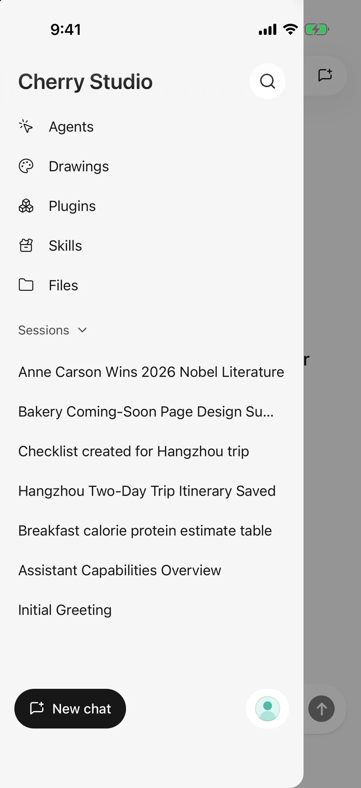

# Cherry Studio Mobile

Cherry Studio Mobile is an AI client designed for Android, iPhone, and iPad. Connect your own model services to chat, configure agents, and generate images from a mobile device.

These guides describe Mobile **0.3.0**, including skills, folder workspaces, painting boards, and translation. Desktop agents require a compatible desktop version. Store and beta channels can offer different versions; check the one installed on your device.

- **First time here?** Follow [Quick start](quick-start.md) to connect a model and send your first message.
- **Have a task in mind?** Browse [Everyday tasks](#everyday-tasks) for chats, images, files, and sharing.
- **Something went wrong?** Start with [Troubleshooting](troubleshooting.md).

<figure data-mobile-shot="phone"><figcaption>
<strong>iPhone</strong> · The sidebar holds agents, drawings, plugins, skills, files, and recent chats
</figcaption></figure>
<figure data-mobile-shot="phone"><figcaption>
<strong>iPhone</strong> · A vision model turns a photo into a table
</figcaption></figure>

## Current status

The mobile app is now available on Google Play and the App Store:

* Install on Android from [Google Play](https://play.google.com/store/apps/details?id=com.cherryai.cherrystudio_app). APK downloads remain available.
* Install on iPhone and iPad from the [App Store](https://apps.apple.com/us/app/cherry-studio-ai-anywhere/id6809783714). The TestFlight beta remains available.
* Screens and capabilities may change between versions. Follow the behavior of the version installed on your device.

Open the [mobile option on the download page](https://cherryai.com/download?platform=mobile), or read the [installation guide](installation.md) first.

## Find the guide for your task

### Getting started

[Download and install](installation.md) · [Quick start](quick-start.md) · [Import from desktop](desktop-sync.md)

### Everyday tasks

[Chat and files](chat-and-files.md) · [Reply and skill-document translation](translation.md) · [File library and shared workspaces](file-library.md) · [Web search and page reading](web-search.md) · [Image generation](image-generation.md) · [Create and edit files](file-generation.md) · [HTML to image and PPT](html-export.md) · [Sharing and export](sharing-and-export.md)

### Agents & automation

[Agents and tools](agents-and-tools.md) · [Skills](skills.md) · [Use desktop agents from your phone](remote-chat.md) · [Let AI use tools](using-tools.md) · [Calendar and reminders](calendar-and-reminders.md) · [Location and health records](location-and-health.md) · [Plugins and external tools](plugins.md)

### Configuration & data

[Providers and models](providers-and-models.md) · [Model management](model-management.md) · [Model information and list updates](model-updates.md) · [Settings, usage, and background replies](settings-and-usage.md) · [Backup and restore](backup-and-restore.md) · [Data, privacy, and permissions](data-privacy.md)

### Troubleshooting

[Troubleshooting](troubleshooting.md) · [Ask an effective question](../question-contact/ask.md) · [Report a problem](../question-contact/suggestions.md)

### Developers & contribution

[Mobile documentation contributions and issue reports](development.md)

These guides cover recent mobile features. Update through official channels if your older version lacks an entry. Example names and model lists in screenshots may differ from your configuration.

> Cherry Studio does not include model credits. Connected platforms determine their own charges and availability.
