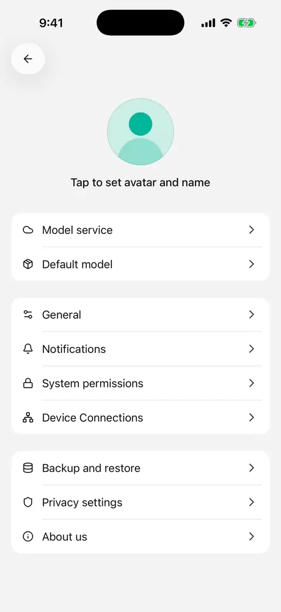

# Backup and restore

Before changing phones, reinstalling, or clearing data, create a full mobile backup in **Settings → Backup and restore**. This guide describes **0.3.0**.

Sharing preserves selected results. A full backup restores the app's conversations, agents, configuration, and files.

## Create and save a backup

1. Finish active conversations, paintings, and other tasks, and wait for configuration changes to save.
2. Open **Settings → Backup and restore → Create backup**.
3. Wait for completion and review the date, conversation/message/file counts, and size.
4. Choose **Save to Files** or **Share** and save outside the app.
5. Confirm the archive exists at its destination. Opening or dismissing the system share sheet does not prove that it was saved.

The app shows progress while processing; wait or cancel. Keep important backups somewhere accessible independently of this phone before uninstalling.

**Archives are unencrypted and include conversation content, database-held model keys, and custom tool headers.** Do not attach a full backup to a public issue.

<figure data-mobile-shot="phone"><figcaption>
<strong>iPhone walkthrough</strong> · Settings → Backup and restore → Create backup, then save or share it
</figcaption></figure>

## What is included?

| Included | Excluded or requiring attention after restore |
| --- | --- |
| Local conversations, agents, model services, and general configuration | Remote desktop conversation history remains on the computer |
| Files, paintings, avatars, folders, and workspace associations | System permissions must be granted as needed on the destination device |
| Installed skills and their configuration | Plugin grants and credentials in system secure storage are not copied; reconnect relevant accounts |
| Trash contents and original deletion dates | Pair computers again; expired trash may be cleaned up when the restored app starts |

Some destination-device preferences remain, including device identity, privacy choices, and background-notification settings. Other supported content comes from the backup. Unfinished tasks are not replayed.

## Restore on a phone

1. Back up the destination device first to preserve anything you still need.
2. Choose **Select backup to restore** and open a mobile backup archive.
3. Wait for format, compatibility, and integrity checks. Resolve reported problems instead of repeatedly confirming.
4. Review the source device, App version, date, and content counts.
5. Confirm **Replace current data**. Restoration replaces current conversations, agents, settings, and files; **it does not merge records**.
6. Follow the restart instructions. Supported Android clients restart automatically; otherwise fully close and reopen the app.
7. Read the outcome, inspect important conversations and files, and reconnect plugins/accounts and pair your computer again.

If restoration cannot take effect, the app reports the result and retains the previous data. Selecting an archive or seeing preparation progress is not proof of completion.

## Limits and common problems

* This is local full backup and replacement restore. Scheduled backups, WebDAV/S3 automatic backups, partial restoration, and desktop backup interchange are not provided.
* Backups support up to 1 GB and 10,000 files. Expanded data also has a size limit. Both export and restore need additional free space.
* Incompatible versions, different data structures, and damaged archives are rejected. A newer backup is not necessarily restorable in an older App.
* Missing original files prevent a complete backup. Preserve accessible results, then describe the error through [feedback](troubleshooting.md).
* If the app is busy, finish active tasks. If space is insufficient, free storage before retrying.

For provider configuration transfer, see [Import configuration from desktop](desktop-sync.md). To preserve a few exchanges, use [Sharing and export](sharing-and-export.md).
