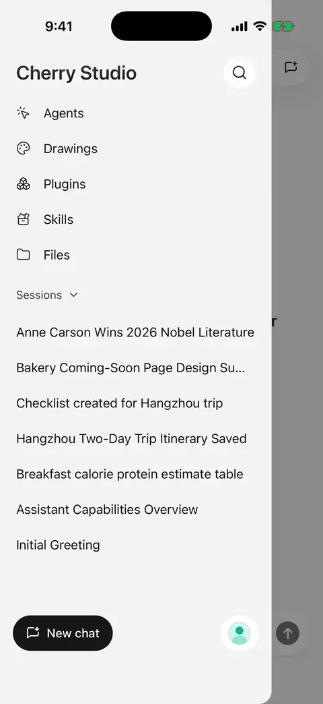
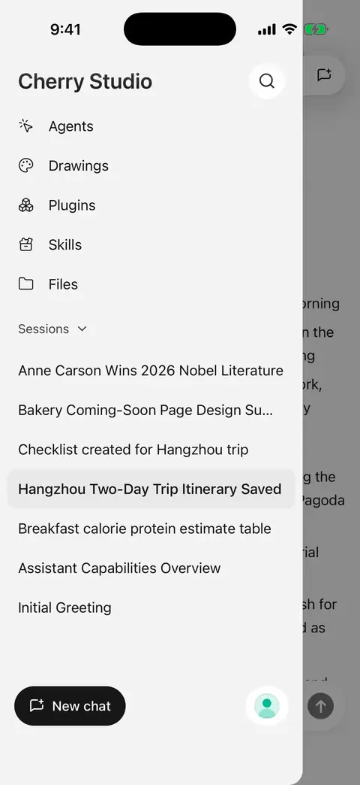
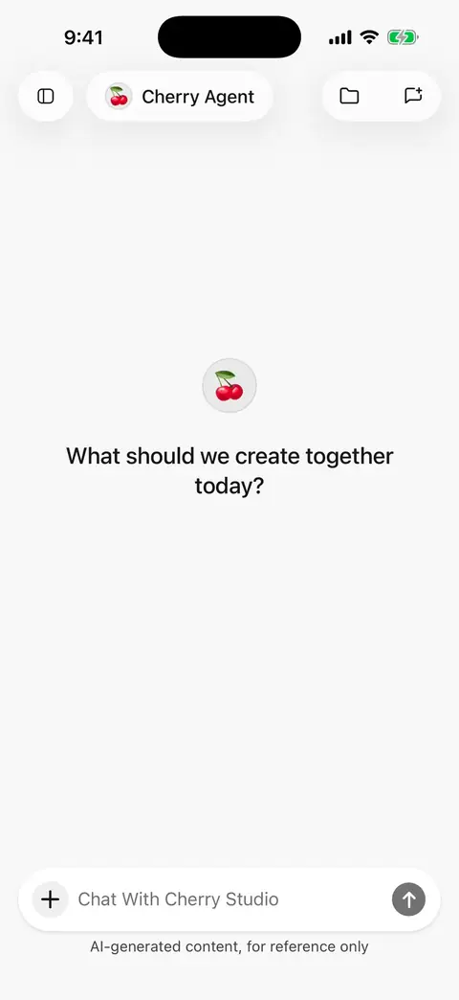

# Chat and files

Use a conversation for one topic, and an agent to choose its model and reusable instructions. Separate topics can have separate conversations with the same agent.

## Start a conversation or change models

Choose **New chat** in the sidebar, select an agent and model, then send a message. A new conversation starts as a draft; sending the first message creates its history.

Change models from the conversation's model picker. This updates the current agent's model for the next request; existing answers are not rewritten.

Put lasting preferences, such as “Give the conclusion before the steps,” in [agent instructions](agents-and-tools.md). Put requirements for one question in the message itself.

## Find previous conversations

* Browse recent conversations in the sidebar, or use its recent-list menu to group them by agent. Tap an agent name to expand/collapse its conversations. The chosen view mode persists across app launches.
* The search button beside the sidebar title searches **conversation titles and message content**. Before typing, it shows recent conversations.
* A message result opens the conversation at that message. Browse nearby history or choose **Return to latest messages**.
* Long-press a sidebar conversation to enter multi-selection and confirm batch deletion. [Export](sharing-and-export.md) or [back up](backup-and-restore.md) needed content first. Deleted conversations do not enter file trash; their attachments and workspace files remain.

Search locates the whole message without highlighting every keyword inside it. It searches conversations, not every file on your phone.

<figure data-mobile-shot="phone"><figcaption>
<strong>iPhone walkthrough</strong> · Search matches titles and message text; tap a result to jump to it
</figcaption></figure>
<figure data-mobile-shot="phone"><figcaption>
<strong>iPhone walkthrough</strong> · Long-press to multi-select; batch deletion asks for confirmation
</figcaption></figure>

## Add images

Tap **＋** beside the input to choose photos, take a picture, or add an image through Files. Select a model that understands images; the Vision filter can help.

For example, attach a photo and ask “Turn the checklist in this picture into a table.” Specify which part matters.

Supported formats are JPEG, PNG, GIF, and WebP, with a 10 MB per-image limit. Local chat no longer imposes one fixed request-wide image count or byte ceiling, but model capabilities, provider limits, and context capacity still apply. Drawing models have their own reference-image limits. Convert incompatible formats to JPEG or PNG.

Some larger JPEG, PNG, and WebP images are resized on import. GIFs, generated images, and images that cannot be re-encoded may remain unchanged. Do not assume an oversized failed request will be recompressed and retried.

Before sending, open an image attachment to crop, rotate, mirror, straighten, or adjust perspective, with undo, redo, and original comparison. Saving uses the edited result and retains the original; cancellation leaves the current attachment unchanged.

<figure data-mobile-shot="phone"><figcaption>
<strong>iPhone walkthrough</strong> · Add a photo, describe the task, switch to a vision model if needed, then send
</figcaption></figure>

## Attach documents or existing files

1. Tap **＋ → Files**.
2. Browse library folders to choose a file, or upload through the system picker.
3. Give a specific task, such as “Summarize the second section and list its action items.”

Local chat allows **5 MB** per text file, **50 MB** per PDF, and **20 MB** per other supported document. MB here means 1024 × 1024 bytes. Extraction and model context have separate limits; an accepted file is not necessarily read in full. PDF extraction still processes at most the first **100 pages**.

PDF, DOCX, XLSX, and PPTX can now be previewed in the app, with external opening for oversized or unsupported files. Associate a [folder workspace](file-library.md) from the conversation header to share project material across chats. [Remote desktop attachments](remote-chat.md) have different transfer limits.

### Which document parser should I choose?

Open **Settings → General → Document parser**. Selection saves immediately and applies to subsequent document processing; it does not rewrite previous answers.

| Option | Best for | Tradeoff |
| --- | --- | --- |
| Built-in | Summaries and questions about mostly text-based documents | Extracts text from PDF, DOCX, XLSX, and PPTX with lower model usage |
| AnyDoc | Complex documents where headings and tables matter | Preserves more structure for non-PDF documents, usually using more tokens |

PDFs still use system text extraction. Switching parsers does not turn scanned pages into selectable text. If no text is found, provide a text-based copy or send the relevant pages as images to a vision model.

**Preview support is different from model input support.** Models receive the parsed document content. Audio, video, or archive files do not become usable attachments simply by changing model capability flags.

## Copy, retry, branch, or delete

| Action | When to use it | Result |
| --- | --- | --- |
| Select text or copy | Keep part or all of an answer | Use text selection or the answer's copy action |
| Answer again | The latest answer failed, was interrupted, or is unsatisfactory | Processes the original question again and replaces the latest answer in place |
| Branch into a new chat | Explore another direction from an earlier point | Continues in a separate conversation, retaining the original |
| Delete this turn | Remove an exchange | Removes its question, answer, and intervening tool records |

Answer again is available only for the latest answer after generation has stopped. It does not keep multiple selectable answer versions. Use a branch for earlier points.

Completed tool results may be retained when resuming an interrupted answer. Retrying or deleting **does not undo calendar changes, edited files, or sent content**. Retrying can incur additional charges. Copy, share, or branch first if you need the previous answer.

Turn deletion is permanent and does not refund usage. Wait for generation/operations to finish, or stop them, before deleting.

## Long messages, queued inputs, and translation

Expand the composer for a larger editor, then return or send. Follow-up messages submitted while a reply runs appear in a queue with their order, text, and attachment summaries. Remove an individual input that has not started without stopping the active reply.

Queued inputs are retained with conversation state and can recover after an app restart. After a model request fails, eligible queued messages can continue. Remove an unwanted task explicitly; leaving the screen or backgrounding is not cancellation.

Completed local text replies can be [translated](translation.md) from their toolbar. Keep multiple completed language results and include expanded translations in exports.

## Thinking depth and long conversations

Supported models provide a **Thinking depth** control. Available levels depend on the model; not all offer Off or the same number of levels. Use the default or faster levels for simple questions, and consider more thinking for complex analysis. Higher levels can take longer and use more tokens.

**Compacting context / Context compacted** means earlier information is being summarized to make room for continued conversation or tool work. Visible history remains, but the summary may omit details. Restate important constraints, numbers, or exact quotations in the next message when needed.

Compaction cannot fit an arbitrarily large attachment. Reduce material or start a new conversation if the request still exceeds limits.

See [background replies and notifications](settings-and-usage.md) for interruptions and [sharing and export](sharing-and-export.md) for sharing several messages together.

For saved outputs and revisions, see [Create and Edit Files](file-generation.md). To turn a saved HTML file into an image or presentation, see [HTML to Image and PPT](html-export.md).
