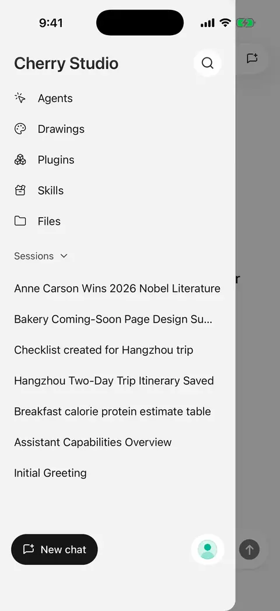
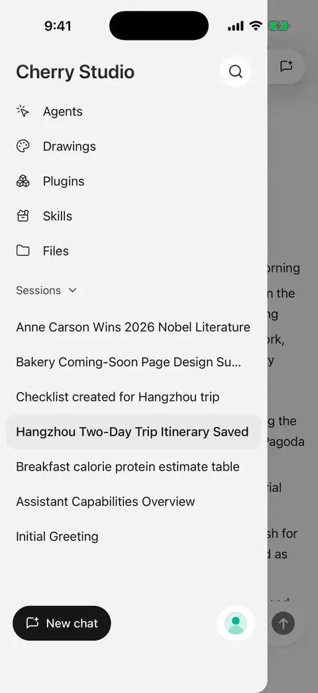
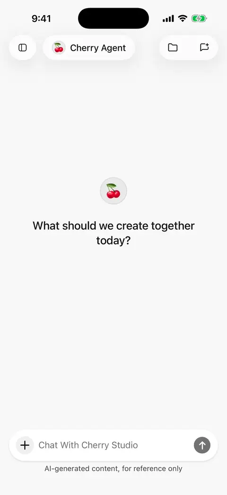

# Chat and files

Use a conversation for one topic, and an agent to choose its model and reusable instructions. Separate topics can have separate conversations with the same agent.

## Start a conversation or change models

Choose **New chat** in the sidebar, select an agent and model, then send a message. A new conversation starts as a draft; sending the first message creates its history.

A single model choice updates the current agent for the next request without rewriting history. The picker also supports parallel text-model selection without replacing the agent default; see [multiple models and branches](conversation-branches.md).

Put lasting preferences, such as “Give the conclusion before the steps,” in [agent instructions](agents-and-tools.md). Put requirements for one question in the message itself.

## Find previous conversations

* Browse recent conversations in the sidebar, or use its recent-list menu to group them by agent. Tap an agent name to expand/collapse its conversations. The chosen view mode persists across app launches.
* The search button beside the sidebar title searches **conversation titles and message content**. Before typing, it shows recent conversations.
* A message result opens the conversation at that message. Browse nearby history or choose **Return to latest messages**.
* Long-press a sidebar conversation to enter multi-selection and confirm batch deletion. [Export](sharing-and-export.md) or [back up](backup-and-restore.md) needed content first. Deleted conversations do not enter file trash; their attachments and workspace files remain.

Search locates the whole message without highlighting every keyword; it does not search every phone file. Tablets, foldables, and wide windows can keep the sidebar/files beside chat. The header can collapse the sidebar, while rotation/window changes retain the current conversation. See [branches](conversation-branches.md) for tree/flat presentation.

<figure data-mobile-shot="phone"><figcaption>
<strong>iPhone walkthrough</strong> · Search matches titles and message text; tap a result to jump to it
</figcaption></figure>
<figure data-mobile-shot="phone"><figcaption>
<strong>iPhone walkthrough</strong> · Long-press to multi-select; batch deletion asks for confirmation
</figcaption></figure>

## Add images

Tap **＋** beside the input to choose photos, take a picture, or add an image through Files. For visual understanding, select a vision model using the Vision filter. On supported devices, text-only models can instead receive on-device OCR text; recognizing writing does not provide full image understanding.

For example, attach a photo and ask “Turn the checklist in this picture into a table.” Specify which part matters.

Supported formats are JPEG, PNG, GIF, and WebP, with a **30 MiB** per-image limit. Local chat no longer imposes one fixed request-wide image count or byte ceiling, but model capabilities, provider limits, and context capacity still apply. Drawing models have their own reference-image limits. Convert incompatible formats to JPEG or PNG.

Some larger JPEG, PNG, and WebP images are resized on import. GIFs, generated images, and images that cannot be re-encoded may remain unchanged. Do not assume an oversized failed request will be recompressed and retried.

Before sending, open an image attachment to crop, rotate, mirror, straighten, or adjust perspective, with undo, redo, and original comparison. Saving uses the edited result and retains the original; cancellation leaves the current attachment unchanged.

<figure data-mobile-shot="phone"><figcaption>
<strong>iPhone walkthrough</strong> · Add a photo, describe the task, switch to a vision model if needed, then send
</figcaption></figure>

## Attach documents or existing files

1. Tap **＋ → Files**.
2. Browse library folders to choose a file, or upload through the system picker.
3. Give a specific task, such as “Summarize the second section and list its action items.”

Local chat allows **5 MiB** per text file, **50 MiB** per PDF, and **20 MiB** per other supported document. One MiB is 1024 × 1024 bytes. Extraction and model context have separate limits; an accepted file is not necessarily read in full. PDF extraction still processes at most the first **100 pages**.

PDF, DOCX, XLSX, and PPTX can now be previewed in the app, with external opening for oversized or unsupported files. Associate a [folder workspace](file-library.md) through **＋ → Folders** to share project material across chats. [Remote desktop attachments](remote-chat.md) have different transfer limits.

### Which document parser should I choose?

Open **Settings → General → Document parser**. Selection saves immediately and applies to subsequent document processing; it does not rewrite previous answers.

| Option | Best for | Tradeoff |
| --- | --- | --- |
| Built-in | Summaries and questions about mostly text-based documents | Extracts text from PDF, DOCX, XLSX, and PPTX with lower model usage |
| AnyDoc | Complex documents where headings and tables matter | Preserves more structure for non-PDF documents, usually using more tokens |

PDF uses native extraction and, on supported devices, local OCR for scanned pages; changing Built-in/AnyDoc does not change that PDF route. Inspect unrecognized-page, truncation, and failure notices. Supply selectable text or relevant pages to a vision model when needed. Images sent to text-only models can also use local OCR; animation recognition uses the first frame.

**Preview support differs from model input support.** Models receive parsed document content. Audio can be transcribed locally into text, limited to 100 MiB/two hours; see [voice](voice.md). Video/archives do not become readable merely by editing model capability flags.

## Share from another app

Choose **Cherry Studio** from the system share menu in a browser, Photos, or a file app, then choose an agent or an existing local conversation. Supported text and attachments enter the composer. Review them, add instructions, and send explicitly; sharing does not automatically submit a model request.

Choosing an agent opens a fresh draft composer and may replace an unsent draft. Keep important unsent text before sharing. The same attachment format, size, and model limits still apply.

## Copy, retry, branch, or delete

| Action | Current behavior |
| --- | --- |
| Select/copy text | Insert several inline quotes among your questions, or copy final text |
| Answer again/add another model | Retains selectable answer paths under the same question instead of replacing the only answer |
| Edit a sent question | Resubmits as a branch while retaining the original and follow-ups |
| Edit a completed answer | Where offered while idle, changes final text used by subsequent turns |
| Branch into a new chat | Continues independently while keeping the original |
| Delete this turn | Removes the chosen exchange; file trash cannot restore it |

See [multiple models and branches](conversation-branches.md) for actions, reading, and read-only parallel-tool limits. Availability follows message state; wait or stop as the screen allows.

Regeneration makes a new request. Deleting history or editing text **does not undo created events, modified files, or sent content**, and does not refund charges. Share or back up material you need first.

## Long messages, queued inputs, and translation

Expand the composer for a larger editor, then return or send. Follow-ups enter a queue: open an item for complete text/attachments, remove an unstarted item, or take it back for editing. Where **Steer** is offered, send the queued requirement into the active task for subsequent execution; see [queues and Steer](conversation-branches.md#queue-take-back-and-steer).

Queued inputs are retained with conversation state and can recover after an app restart. After a model request fails, eligible queued messages can continue. Remove an unwanted task explicitly; leaving the screen or backgrounding is not cancellation.

Completed local text replies can be [translated](translation.md) from their toolbar. Keep multiple completed language results and include expanded translations in exports.

## Thinking depth and long conversations

Supported models provide a **Thinking depth** control. Available levels depend on the model; not all offer Off or the same number of levels. Use the default or faster levels for simple questions, and consider more thinking for complex analysis. Higher levels can take longer and use more tokens.

The composer can show current-branch context occupancy and model capacity. **≈** marks an estimate, not cumulative billing or an older answer's input count; model windows and compaction affect it.

**Compacting context / Context compacted** means earlier information is being summarized to make room for continued conversation or tool work. Visible history remains, but the summary may omit details. Restate important constraints, numbers, or exact quotations in the next message when needed.

Compaction cannot fit an arbitrarily large attachment. Reduce material or start a new conversation if the request still exceeds limits.

See [background replies and notifications](settings-and-usage.md) for interruptions and [sharing and export](sharing-and-export.md) for sharing several messages together.

For saved outputs and revisions, see [Create and Edit Files](file-generation.md). To turn a saved HTML file into an image or presentation, see [HTML to Image and PPT](html-export.md).
