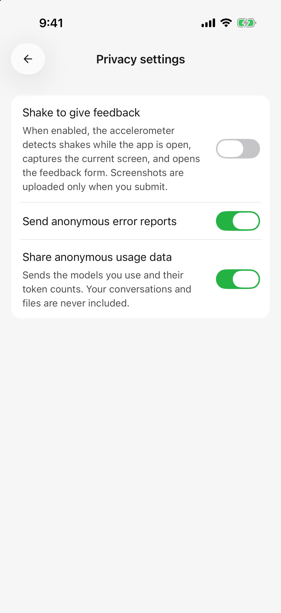
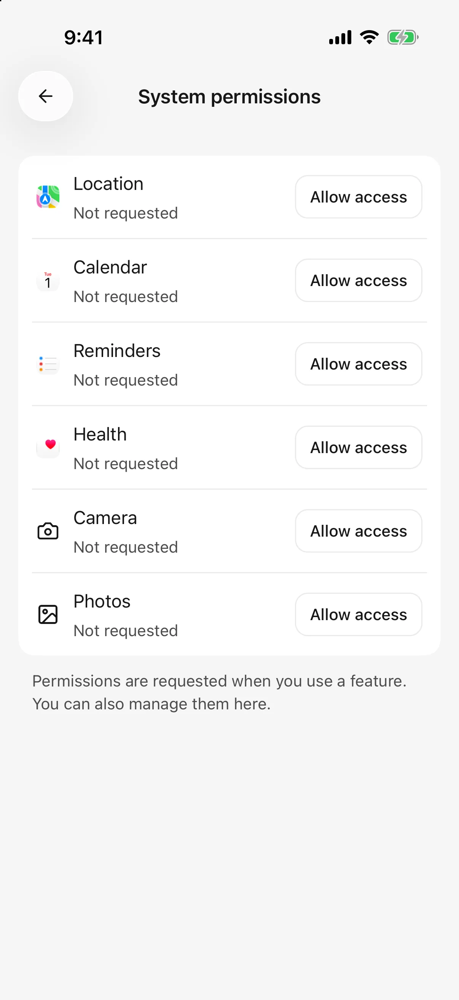

# Data, privacy, and permissions

Conversations and configuration are stored on the current device. Cloud models and connected tools still receive the information needed for your requests.

## Where does data go?

| Feature | Data involved |
| --- | --- |
| Cloud chat/image generation | The selected provider receives messages, participating history, images, parsed document content, or drawing prompts |
| Search/page reading | The selected service receives keywords or URLs; returned material participates in model answers |
| Plugins/custom tools | Connected services process authorized requests; retrieved content may be provided to the model |
| Calendar, reminders, location | Authorized device information is read or changed; relevant results can participate in answers |
| Translation | Original replies or skill documents go to the translation model; completed results are stored locally |
| iOS health queries | Each query confirms the recipient; results enter history and may accompany later messages |
| Remote desktop conversations | Messages and attachments go to the authorized computer for its models and tools to process |
| Desktop import | Selected provider addresses, keys, and supported model configuration transfer over the local network |

Retention depends on each service's policy and account settings. Local storage does not make a cloud conversation entirely offline.

## Anonymous usage and error reports

First use or a privacy-policy update asks you to **Agree and continue** or **Disagree** after explaining anonymous data use. Change your choice later in **Settings → Privacy**.

* **Share anonymous usage data:** includes installation identity, app/system versions, models used, and token quantities; not conversation text, files, or API keys.
* **Send anonymous error reports:** helps investigate crashes and failures, with a separate setting.

Disabling usage reporting does not block messages you send to model providers or revoke plugin access. Manage those connections separately.

<figure data-mobile-shot="phone"><figcaption>
<strong>iPhone</strong> · Anonymous error reports and usage data are independent options
</figcaption></figure>

## Keys and plugin authorization

API keys grant model-service access. Keep them out of agent instructions, public screenshots, and issue reports. If exposed, revoke the key at the provider and replace it in the app.

Built-in plugin credentials use device secure storage and are not transferred by desktop import. Static authentication headers for custom MCP servers are stored locally with server configuration and also need careful handling.

## Manage system permissions

Open **Settings → System permissions**. Tool approval and operating-system authorization can appear separately and both may be required.

| Symptom | What to check |
| --- | --- |
| Only some photos are visible | Selected-photo access may be enabled; adjust the system selection/permission |
| No prompt after denying access | Change Cherry Studio permissions in system settings |
| Calendar reads work but edits do not | Check read and write permissions separately |
| No health records | Confirm records exist and that data type is authorized |
| Pairing works but configuration cannot load | Check local-network access and [desktop import](desktop-sync.md) |

Agent capability switches control whether that agent can use the related built-in tools; system permissions control the app’s access to device data. Manage plugins and custom MCP tools separately. Disabling an agent’s capability does not revoke system permission; use system settings to revoke access. Automatic tool approval does not bypass system permissions. Android currently does not offer the iOS reminder and health-record tools.

<figure data-mobile-shot="phone"><figcaption>
<strong>iPhone</strong> · System permissions show location, calendar, reminders, health, camera, and photos
</figcaption></figure>

## Before changing devices or removing app data

Create a full archive in **Settings → Backup and restore**, save outside the app, and confirm it exists. Restore replaces current data rather than merging it. Archives are unencrypted and contain database-held model keys and custom tool headers. Plugin grants, secure-storage account credentials, system permissions, and computer pairing need attention again; see [Backup and restore](backup-and-restore.md).

[Sharing and export](sharing-and-export.md) preserves selected results; images, HTML, and Markdown cannot restore the full app. Desktop configuration import does not transfer local chat history, and remote conversations remain on the computer.

Library deletion moves files to 30-day trash; references remain unavailable until restoration. Deleting a conversation does not enter file trash or automatically delete its attachments. See [File library](file-library.md).

## Does deleting history undo actions?

No. Deletion or answering again does not undo calendar changes, edited external documents, or sent messages, and does not refund model costs. Inspect the actual result in the relevant service if reversal is needed.

## Submitted feedback and screenshots

Submitting through **Settings → About → Feedback** includes diagnostics from the last 24 hours: error/request summaries and system information. Diagnostic logs exclude conversation text and credentials. Your description and any screenshot can contain private material, so inspect them first.

Shake feedback is off by default. When enabled, shaking in the foreground captures the current page and opens the form. The screenshot stays local unless you enable its inclusion for that submission. Deleting local feedback history does not delete an already submitted report. This flow is separate from anonymous-usage and automatic-error-report controls.

## What should a bug report include?

Include the app/device/system versions, steps, expected result, actual result, and error text. Redact real keys, credential-bearing URLs, private conversations, and file contents before publishing screenshots or details.
