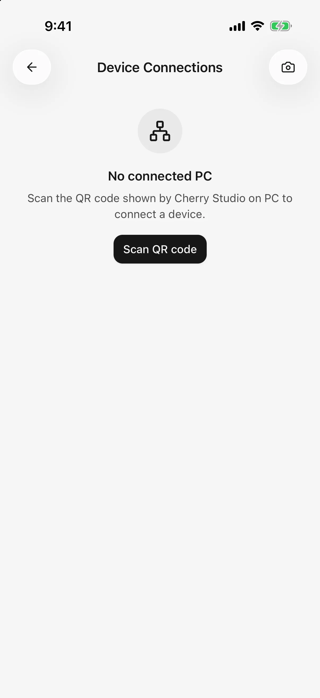

# Import configuration from desktop

Reuse supported model providers already configured in Cherry Studio on your computer, without entering every address and key again.

**This guide covers provider configuration and enabled-model import, not chat-history transfer.** Pairing can also provide [desktop-agent access](remote-chat.md), with a separate permission. Configuration is not continuously synchronized; explicitly import later changes.

## Connect your computer

1. Connect both devices to the same local network, such as your home Wi-Fi, and keep Cherry Studio Desktop running.
2. Open **Device connections** on desktop and display its pairing QR code.
3. On mobile, open **Settings → Device connections → Scan QR code**. Allow camera and local-network permissions when requested.
4. Complete pairing and configuration-sync authorization on both devices. After pairing from Settings, start synchronization from device details; onboarding continues through import and model selection.

If the camera is unavailable, use the manual field to paste the pairing QR content from desktop. It expects pairing data, not an ordinary website link.

<figure data-mobile-shot="phone"><figcaption>
<strong>iPhone</strong> · Settings → Device Connections: scan the QR code shown on desktop
</figcaption></figure>

## Select and import providers

Use **Sync providers from desktop** in the paired device's details. Alternatively, choose **Sync from desktop** in the model service list's menu and select the computer.

1. Wait for enabled desktop providers to load.
2. Select the providers to import.
3. Read the notice that selected addresses and keys will be replaced while existing models remain.
4. Synchronize and review the added, updated, and skipped counts.
5. Select an imported model in chat. During onboarding, continue to its chat-model selection step.

## What happens to existing mobile settings?

| Item | Result |
| --- | --- |
| Selected provider | Receives the desktop configuration and keys, and becomes enabled on mobile |
| Enabled desktop model missing on mobile | Added |
| Same model already on mobile | Existing mobile settings retained; no duplicate |
| Mobile-only providers/models | Retained |
| Disabled desktop providers/models | Excluded from import |
| Chat history and plugin account grants | Not imported |

If you use different keys on desktop and mobile, take particular care with the first row. A provider can have its credentials replaced even when no new models need adding.

## Why are some providers unavailable?

Read the reason shown beside the provider:

* **Unsupported authentication:** a desktop login may not provide an exportable key usable on mobile. Configure a supported method separately on mobile.
* **No usable API key:** key-based providers need a valid enabled key on desktop. Explicitly keyless HTTP gateways follow the import preview's requirements.
* **Unreadable configuration:** update mobile, or skip that entry and import the others.

0.3.0 can import supported HTTP-service configurations, including gateways such as LM Studio and keyless connections. Invocation still depends on the exported API: native Ollama endpoints remain unsupported; compatible endpoints depend on their actual configuration.

The model runs on the computer or service host. Its address must be reachable from the phone. On mobile, `localhost` and `127.0.0.1` refer to the phone itself; replace them with a reachable service address. Import does not automatically forward requests through the computer.

## Paired successfully, but cannot synchronize

Pairing stores connection credentials; fetching configuration still needs a reachable computer. Keep desktop running and check the shared local network, guest-network isolation, firewall, and proxy settings.

On iPhone/iPad, enable Cherry Studio's local-network permission in system settings if previously denied. If the app says pairing needs repair, scan a new desktop QR code.

## Does removing a device revoke both sides?

**Remove device** on mobile removes only that phone's saved connection credentials. To revoke desktop authorization too, remove the mobile device in desktop's Device connections.

Configuration import is not a full backup. Use [Backup and restore](backup-and-restore.md) before changing devices, or [export selected work](sharing-and-export.md).
