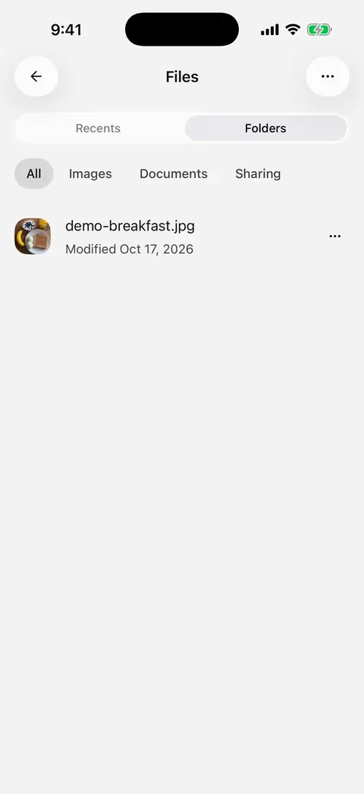
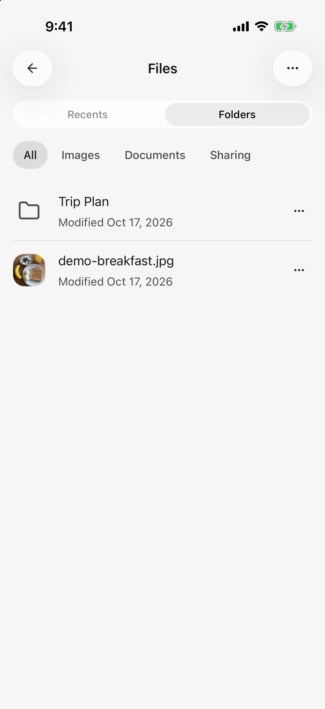
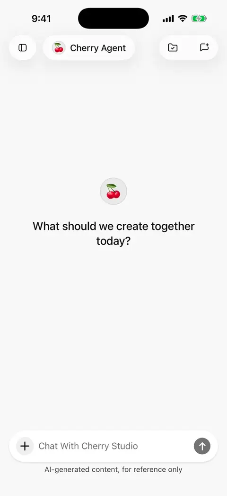

# File library and shared workspaces

Open **Files** in the sidebar to manage imported attachments, generated files, and exported work. Mobile **0.3.0** supports folders, conversation workspaces, and a 30-day trash.

## Organize material in folders

1. Switch to folder browsing in the library and choose **New folder**, for example “Trip plan.”
2. Open a folder to create subfolders inside it.
3. Use a file or folder's actions to rename or move it. Choose and confirm the destination when moving.
4. Find material through file-type filters and Recents; ask the agent when you need to search by name.

A rename cannot conflict with another item in the same folder. Imports, moves, and restores may add a numbered suffix to resolve a collision; check the resulting name.

<figure data-mobile-shot="phone"><figcaption>
<strong>iPhone walkthrough</strong> · Create a folder from the library directory view
</figcaption></figure>
<figure data-mobile-shot="phone"><figcaption>
<strong>iPhone</strong> · Browse the library by recent items or folders, filtered by type
</figcaption></figure>

## Give a conversation a workspace

A workspace is **the folder associated with this conversation**. Agents can read and save work using relative paths, and several conversations can work with the same material.

1. Open a local conversation and tap the folder action in its header.
2. Select a folder in the tree. Arrows expand subfolders; file rows open previews.
3. Return to chat and specify the material and output, for example:

> Read itinerary.md in this workspace and save the action items as checklist.md. Mark missing dates as unconfirmed.

* Change or remove the association at any time. The library root cannot itself be a workspace.
* New attachments and generated files enter the current workspace. Attaching an existing library file from elsewhere copies it into the workspace while retaining the source.
* With no workspace, new imports and outputs go to the library root.
* Changing the workspace does not move earlier files or change other conversations. A running task uses the workspace captured when it started; a switch affects later tasks.
* Renaming or moving the folder preserves the association. Deleting a conversation does not delete its folder or files.

Sharing a workspace means sharing a folder within this device, not cloud synchronization. For computer workspaces, see [Use desktop agents from your phone](remote-chat.md).

<figure data-mobile-shot="phone"><figcaption>
<strong>iPhone walkthrough</strong> · Link a chat to a folder and let AI save the itinerary there
</figcaption></figure>
<figure data-mobile-shot="phone"><figcaption>
<strong>iPhone walkthrough</strong> · A second chat uses the same folder, reads the file, and adds a new one
</figcaption></figure>

## Ask AI to organize files

In Standard mode, ask the agent to find folders, move or rename items, send them to trash, or find and restore recently deleted items. For example:

> Find folders with “Trip” in their names. List them first without moving anything.

> Move the checklist.md we just identified into “Trip plan/Before departure.” Tell me its saved name and location.

Moving, renaming, trashing, and restoring follow the agent's approval mode: **Ask when needed** asks for confirmation; **Automatically approve** can execute directly. Permanent deletion and emptying trash remain actions you perform in the interface. See [Let AI use tools](using-tools.md).

## Preview files and edited results

Supported images, text, Markdown, HTML, PDF, DOCX, XLSX, and PPTX can open in the app. Use the menu to open oversized or unsupported files in another app.

Image previews offer cropping, rotation, mirroring, straightening, and perspective adjustment. Saving an image edit creates a new file and retains the original. Text-edit version rules are explained in [Create and edit files](file-generation.md): the library shows the current version, while earlier messages retain the content they referenced.

## Recover deleted files

1. Open **Recently deleted** from the library's More menu.
2. Select a file or folder, check its remaining retention time, and restore it.
3. Check its location in the library. Messages and paintings that referenced those files can access them again after restoration.

Trashing a folder includes its active contents. Items whose original location is unavailable return to the root, with name collisions resolved. A conversation's workspace is unavailable while its folder is trashed and usable again after restoration.

Trash retains items for 30 days. You can permanently delete them or empty trash sooner; expired items are cleaned up on startup or foreground entry. **Deleted conversations do not enter this trash.** Deleting a conversation also leaves its attachments in the library for separate management.

Trash does not replace a [full backup](backup-and-restore.md). Before uninstalling or clearing App data, save backups and important results outside the app.
