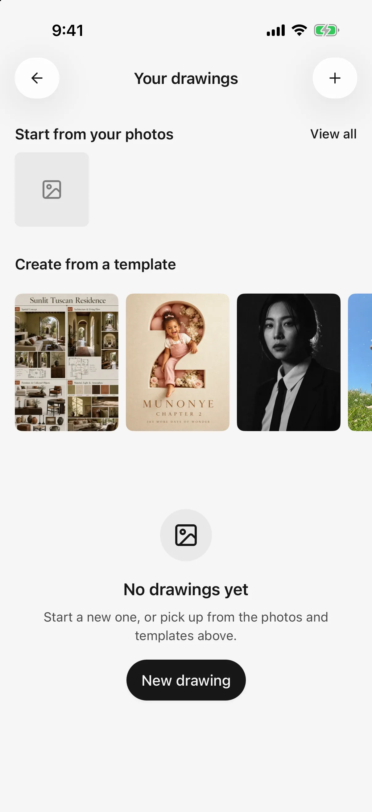
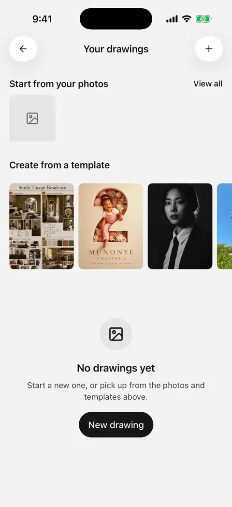
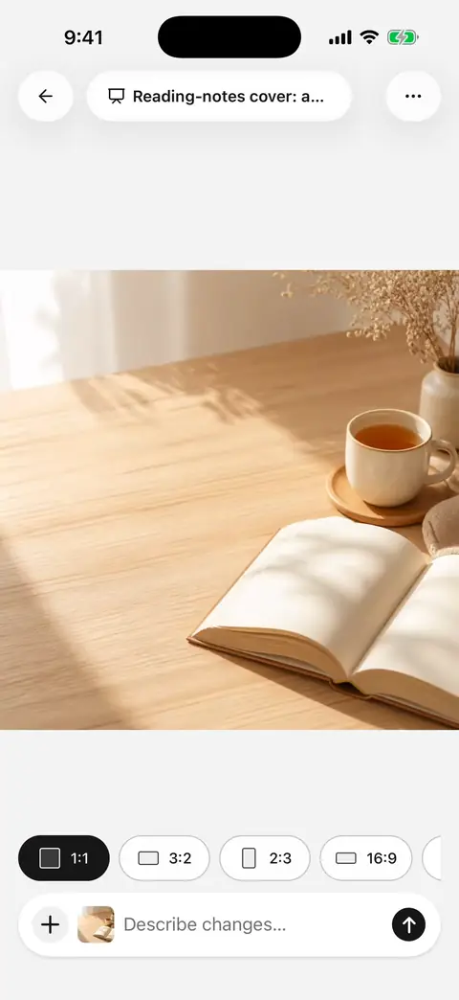
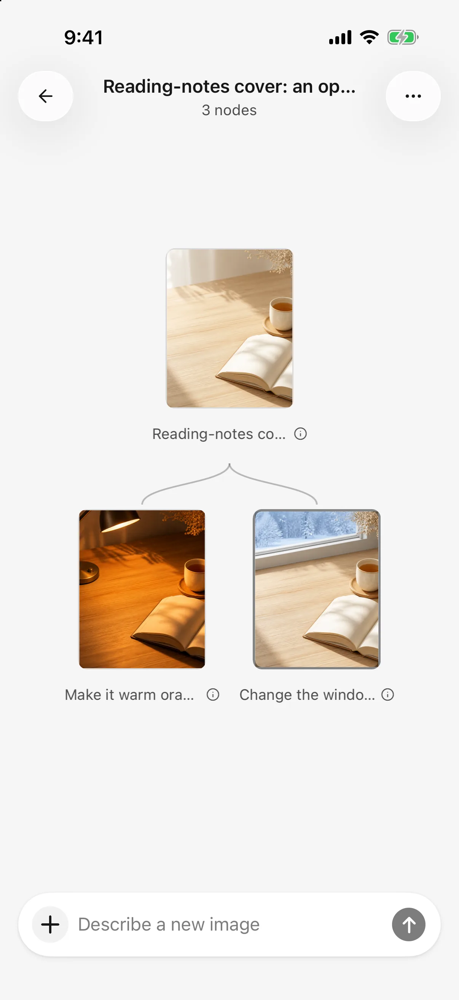

# Image generation

Standalone drawing in Mobile **0.3.0** uses a board to retain the relationships between generations and edits. Start from text, a reference image, or a template, then choose a result to develop further. Configure an image-generation model first; understanding images does not necessarily mean a model can generate them.

## Three ways to create

| Workflow | Start here | Results |
| --- | --- | --- |
| Standalone drawing | Open **Drawings**, start a creation, select a photo, or use a template | Board results, accessible again from the drawing list |
| Image model in chat | Choose an image-generation model for a Standard-mode agent | Image attachments in that conversation |
| Drawing tool used by a text agent | Select a drawing model in **Settings → Default model** and enable the agent's image-generation capability | Tool activity and images in chat |

The tool workflow requests confirmation for every image call, including under automatic approval. Standalone and direct image-model requests are submitted when you press Send. Board instructions below apply to standalone drawing.

## Start from a description

1. Open a new creation from Drawings.
2. Choose a model and generation parameters through the composer's **＋** menu.
3. Describe the subject, purpose, style, and composition; check references and send.
4. Wait for the result and inspect its details. On failure, open error details before retrying.

Example:

> A landscape cover for reading notes: an open book and cup of tea on a wooden table, soft morning light, warm white and pale wood, space on the left, no text.

The first generation creates a board. Aspect ratio, size, count, and other parameters depend on the model. Larger or more numerous outputs can take longer and cost more. Expand the composer for a longer editing field.

<figure data-mobile-shot="phone"><figcaption>
<strong>iPhone</strong> · Drawings: start new, or begin from photos or templates
</figcaption></figure>
<figure data-mobile-shot="phone"><figcaption>
<strong>iPhone walkthrough</strong> · Choose a drawing model in + → Generation settings, describe, and generate
</figcaption></figure>

## Start with a template

Choose a template, inspect its example and prompt, then use its try action. This prepares an editable text draft; it does not immediately generate or automatically attach the template preview as a reference.

Customize the subject, purpose, or composition, select a model, and check parameters before sending. The preview is an example, not a result generated by your request.

## Switch between focus and overview

* **Focus** displays the current image. Pinch or double-tap to zoom; swipe horizontally between images from the same generation.
* Use the board action in the header for the **overview**. Pan and zoom through related nodes, then tap a thumbnail to focus it.
* The lineage strip shows sources, the current image, and later results. Tap to navigate or hold a thumbnail for a temporary comparison.
* Tap a prompt caption in the overview, or open generation information from the menu, to read the full description. Rename the board from its overview.

<figure data-mobile-shot="phone"><figcaption>
<strong>iPhone walkthrough</strong> · Edit a result, return to the original for another direction, and the board branches
</figcaption></figure>
<figure data-mobile-shot="phone"><figcaption>
<strong>iPhone</strong> · Board overview: one original with two edit directions
</figcaption></figure>

## Continue with a reference image

The focused image becomes a reference for the next generation. Inspect references before submitting. Removing it means this request will not continue from that image. The overview's composer starts a new branch without referencing an existing image.

> Keep this image's composition and subject, change the background to evening, and preserve the other details where possible.

Reference and editing support depend on the model. A text-to-image-only model does not gain editing capabilities from the board; image-required models need a reference. Not every image on the board is sent with the next request.

### Explain changes with positional notes

Long-press the focused image to add a note, select it, and type the change. Switch to the whole-image selection for general instructions. Sending supplies the reference and these instructions to the model.

Notes are positional text guidance, **not precise masks**. They cannot guarantee that changes remain inside a marked area. Describe what must stay unchanged and inspect the result.

Supported models offer ratio shortcuts. Choosing one prepares settings or instructions without sending; review the input and submit explicitly.

## Failures, cancellation, and repeated requests

You can browse the board while generation runs. Check task status before taking the next step. Failed results offer retry and error details; earlier successful results remain usable. Stopping a running generation removes its placeholder.

Cancellation does not prove the provider stopped processing or guarantee a refund. Unsupported models, incompatible references, credits, rate limits, and network failures need different remedies.

## Save and share

Use the focused image's menu to save to Photos, share, or inspect generation information. Saving to Photos needs permission. Deleting a painting version differs from deleting its library file; see [File library and shared workspaces](file-library.md).

Control future exports through **Settings → General → Share watermark**. Chat images can be exported with selected exchanges; see [Sharing and export](sharing-and-export.md).
