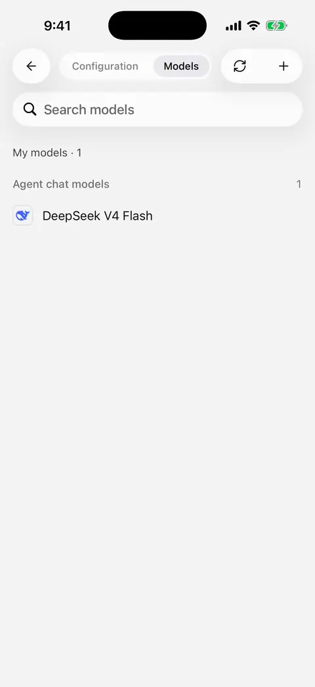

# Model information and list updates

“Update” can mean several things. A model information update does not switch your chosen model, grant account permissions, or automatically add every new model to your list.

| What you want | Where to do it | What changes |
| --- | --- | --- |
| New model names, capabilities, limits, or pricing | Open a provider's **Models** tab | The shared model information used by the app |
| Models currently returned by a platform | Tap **Sync** on that provider's Models tab | A preview of additions and models not returned; you select which changes to apply |
| Your computer's existing setup | Choose **Sync from desktop** | Selected provider configuration and missing enabled models |
| New app features and fixes | Update through the official installation channel | The app itself |

## When does model information update?

On first use, the app downloads model information in the background. Model selection, creation, and editing may show loading or retry states until it finishes. Check the network and retry after a failed first download.

Downloaded information is stored on your device. Later launches use that saved information without downloading it again at every startup. **Opening a provider's Models tab** triggers a background update attempt.

**Model information updated** appears only when a newer version was applied and you remain on the Models screen. An unchanged catalog, failed background refresh, or leaving the page can all produce no notification. Silence does not necessarily mean failure.

## What happens offline?

An existing saved catalog remains usable if a refresh fails. A failed download does not clear your model configuration. First use without saved information still requires an internet connection.

Browsing saved information offline does not make cloud models available offline; sending a request still requires a connection to your provider.

## Will my edits be overwritten?

Remote information updates do not rewrite your saved model overrides or custom models. Fields still following defaults inherit new information, so default names, capabilities, or pricing may change.

These updates do not change your **API keys, provider addresses, or authentication settings**, and do not enable a provider. Clear a manually entered token limit and save if you want it to follow the catalog/app default again.

## Fetch a provider's model list

1. Open **Settings → Model service → Provider → Models**.
2. Wait for provider changes to save. If editing a key, save its editing sheet first, then tap **Sync**.
3. Review available additions and models **not returned by the remote service**.
4. Select the changes you want and tap **Update**. Nothing is selected automatically.
5. Read the confirmation before applying any removals.

Fetching the list does not enable the provider. Failed or empty results retain existing models; repair configuration, retry, or [add a model manually](model-management.md).

<figure data-mobile-shot="phone"><figcaption>
<strong>iPhone walkthrough</strong> · Sync models: search, select, and tap Update to add them
</figcaption></figure>

## Does “not returned” mean a model was discontinued?

Not necessarily. Keys, account permissions, incomplete listing APIs, and temporary faults can affect results.

Models are not automatically removed after a single response. Removal requires your selection and confirmation; conversation history remains. Protected models may be skipped; see [model deletion rules](model-management.md). Do not bulk-remove working models simply because they were not returned.

## Why does chat work when synchronization fails?

Model discovery and chat use different request addresses. Some platforms support chat but do not expose a model-list API.

Custom-provider settings display the separate **Model list request URL**. If the platform does not support it, copy the exact model ID from the platform, add it manually, and check the connection.

## A new model exists, but I cannot see it

Check that:

1. You opened the Models tab to allow an information update.
2. You synchronized with the relevant provider or manually added the model.
3. Your account/key can access it.
4. The provider and model are enabled and the picker filter is set to All.

Model information, account access, and locally added models are separate. The app must also support the model's connection format.
