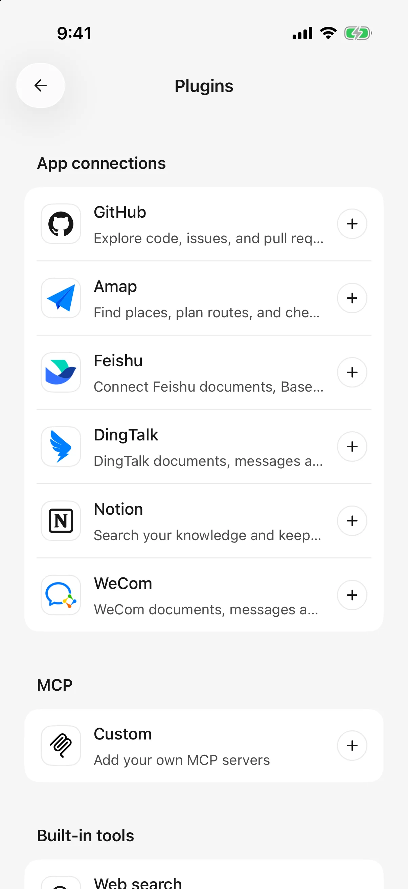

# Plugins and external tools

Plugins let an agent access other services within your authorization, such as reading Feishu documents, organizing Notion pages, or finding routes with Amap.

The model interprets the task; the plugin accesses the service. Select a text model supporting tool calling first.

## Connect and use a plugin

1. Open **Plugins** in the sidebar and select a service.
2. Read its capabilities, examples, and permissions, then tap **Connect**.
3. Complete the account authorization or enter the required service key.
4. Return to Cherry Studio and confirm the account/workspace if requested, until it shows **Connected**.
5. Give a specific request in chat. Optionally use **＋ → Plugins** to insert the target plugin, then add your question.

For example: “Use Feishu to summarize three conclusions from this document: [link].” The inserted name appears in the composer and sent message.

Connected plugins work across agents without separate authorization for each. Composer selection makes the intended service explicit. The **＋ → Plugins** option in the chat composer is hidden when no usable plugin is connected.

<figure data-mobile-shot="phone"><figcaption>
<strong>iPhone</strong> · Plugins: app connections, custom MCP, and built-in tools
</figcaption></figure>

## Common connections

| Plugin | Useful for | Connection notes |
| --- | --- | --- |
| Feishu | Documents, Base tables, tasks, calendars | Set up a Feishu application and authorize your account; organization approval may be required. This connection currently supports Feishu accounts, not international Lark accounts |
| Notion | Find/read/edit pages and database records | Authorize a workspace and confirm the account; workspace permissions still apply |
| GitHub | Read repositories/discussions and manage issues/pull requests | Use app authorization or a personal access token; organization access may need approval |
| Amap | Places, nearby services, weather, routes | Use a **Web Service Key** from Amap's platform; route queries do not automatically read device location |
| DingTalk | Documents, calendar, tasks, other office operations | Authorize an account and organization; some actions require further authorization |
| WeCom | Authorized documents, spreadsheets, schedules, other office data | Paste the generated authorization link into WeCom's File Transfer Assistant and open it there, then return to Cherry Studio |

A listed capability is not a promise of account access. Plans, organization settings, resource permissions, and quotas determine what your account can use.

### Preparing Feishu

The “application” in this flow is a Feishu authorization configuration, not another phone app to install. Follow the connection page's **Configure application** or setup-guide link. If using an existing application, enter its App ID and App Secret, enable the permissions needed for documents/tasks/calendar, then authorize your personal account.

Partial grants can still produce a usable connection. To add capabilities later, enable the corresponding application permissions, complete organization approval, and update authorization. Reconnecting alone does not grant missing permissions.

### Additional DingTalk approval

Complete the requested action authorization in DingTalk, then return and **request the operation again**. Authorization does not automatically replay the failed action.

### Expired WeCom link

Links last five minutes. Generate a new link and open it inside WeCom, rather than only in an ordinary browser.

## What can I do after connecting?

Start with a read. Replace the bracketed text with your links, names, or dates, then check the sources and coverage of the result.

| Plugin | Adaptable request | What to check |
| --- | --- | --- |
| Feishu | “Read this document: [link]. List conclusions, tasks, owners, and deadlines. Mark missing information as unconfirmed; do not create tasks yet.” | Whether owners and dates are explicit; task creation is a separate next step |
| Notion | “Read this page: [link]. Summarize recent project progress and retain source links.” | Workspace access and whether relevant page content was fully read |
| GitHub | “Read the last week's issue discussions in [repository URL], group them by topic, and include links.” | Repository visibility, date range, and whether discussion conclusions are confirmed |
| Amap | “Compare public transport from [city and starting point] to [destination], including walking, transfers, and estimated duration.” | City and address for duplicate place names; estimates are not live departure times |
| DingTalk | “Read this document: [link] and summarize material about [topic]. Do not edit it.” | Organization and document access, plus any further authorization in DingTalk |
| WeCom | “Read this document: [link]. Summarize three key conclusions with sources, without editing.” | The authorized account's access and tools actually available on the connection |

### Turn document notes into saved tasks

For example, use two requests with Feishu:

1. “Read these meeting notes: [link]. List proposed tasks, owners, and deadlines, but do not create them.”
2. After checking: “Create only items 1 and 2 as Feishu tasks with the owners and dates we confirmed. Return the results and links.”

Document reading, people lookup, and task creation must all be available where needed. Resolve duplicate names and unclear dates first. A task table in the chat is not proof that tasks were saved. Assignment and invitations may also notify other people.

### Read and update Base tables or databases

Provide the table link and view, then state the filter: “Read only records with status In progress in this view. List names and deadlines without making changes.” A project may have several tables or views with similar names.

Before editing, identify the exact record and field. Ask the agent to state coverage when results have pagination or limits; one query is not necessarily the whole database. The current Notion connection does not provide attachment handling or access to Notion agents.

### Can tools work together?

Available connected tools can cooperate in one task—for example, reading a document and [saving a checklist file](file-generation.md). When copying material between services, specify the destination and exact content, then check each result. Success in one step does not automatically roll back if another fails.

For approval, result checks, and failure handling, see [Let AI Use Tools](using-tools.md).

## I closed authorization, but it is not connected

Closing a browser neither cancels authorization nor proves connection succeeded. Return to the connection page, use **Open authorization page** or **Check again** if needed, and finish account confirmation.

Restart expired or denied requests. To switch accounts, follow the instruction to disconnect the existing account first.

## Disconnect and revoke

Use connection management or the detail menu to **Disconnect**. That removes local access.

If remote revocation is unconfirmed, use **Manage authorization** on the provider website. Local removal and provider-side revocation do not always finish together.

Plugin credentials stay on this device and are not transferred by desktop configuration import; another phone needs a separate connection. Retrieved content may be used by the model. See [data and privacy](data-privacy.md).

## Add a custom MCP service

**MCP** is a protocol for connecting external tools and services. In Mobile 0.3.0, add a remote server through **Sidebar → Plugins → MCP group → Custom**.

1. Enter a name and the remote address supplied by the service, preferably `https://`.
2. Choose header authentication or **OAuth**, which signs in and grants access at the service.
3. For headers, use one `Name=Value` per line, such as `Authorization=Bearer your-token`. For OAuth, follow the save and browser-authorization flow, then return to the app and check its result.
4. Inspect the connected tool list and disable unwanted tools.
5. Enable the server in a Standard-mode agent's tool section and send a new task. Existing servers can also be selected during agent creation.

OAuth services must support mobile callbacks. Some require a public client ID or client-metadata URL from the service. Do not add a conflicting Authorization header when using OAuth. Retry authorization according to the error; closing the browser does not confirm completion.

The address field cannot run desktop commands such as `npx` or `uvx`. The 0.3.0 iOS client accepts user-configured HTTP services, with a warning for plaintext connections; OAuth endpoints must still meet their security requirements.

Connection, global tool enablement, agent binding, and Standard mode are separate requirements. Automatic approval bypasses none of them.

## Prompts, resources, and interactive apps

* **Prompts:** choose an available MCP prompt from the composer, fill its parameters, and load it into a draft. Review before sending; selecting a prompt does not execute the task.
* **Resources:** open supported files, images, or other content through tool-result previews. Formats depend on the service.
* **MCP Apps:** supporting tools can return an interactive interface. Actions still depend on service permissions and tool rules; inspect the result.
* **Server forms:** a service may request additional information through an app interaction. Read the requester and fields before submitting or cancelling. This is separate from system permissions and tool approvals.

Not every server supplies these capabilities. An absent prompt or interactive view may reflect the server's scope; ordinary tool calls can still work.

## A connected plugin still cannot do the task

Check connection status and model tool-calling support. Provide the target link/name/date range. Permission errors need repair at the service, not changes to agent instructions.

For writes, first ask it to read and list the proposed changes. Whether execution asks for confirmation depends on [tool approval](agents-and-tools.md).
