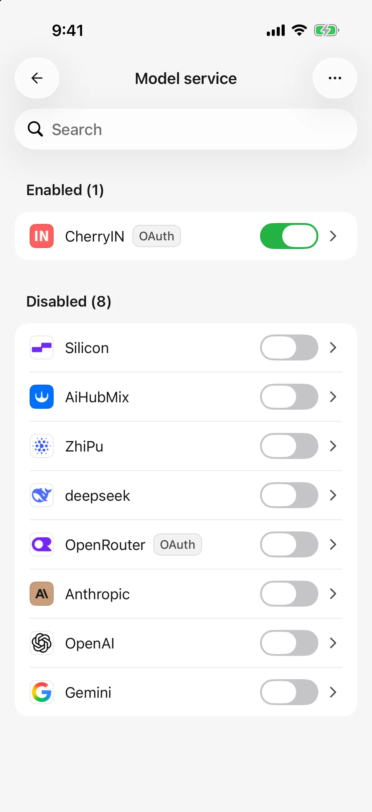
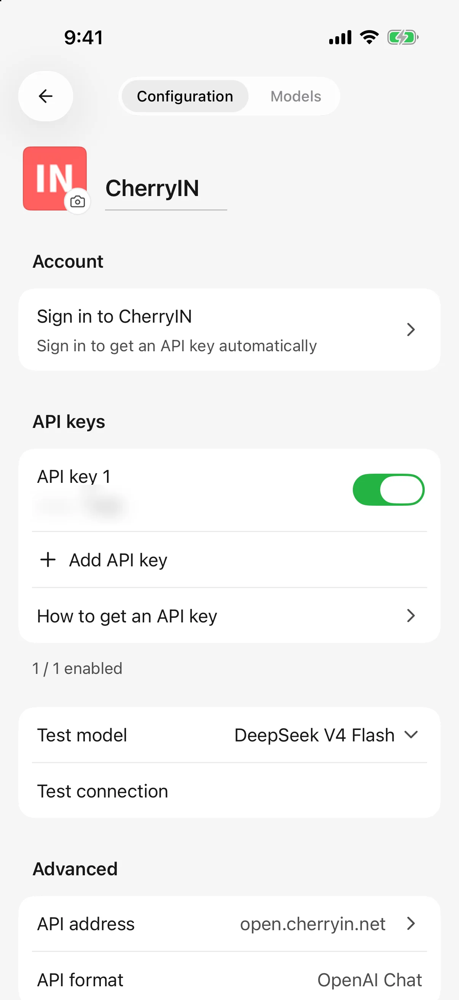
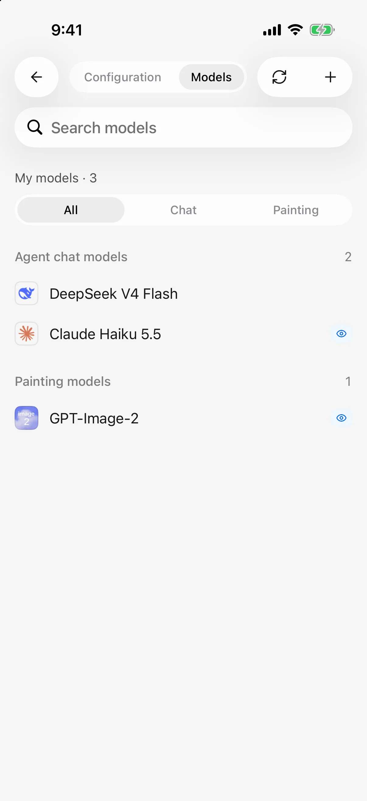

# Providers and models

A provider supplies an AI service; a model is the particular AI you use through it. The same model can be offered by several platforms, each with its own credentials. This guide describes Mobile **0.3.0**.

Start with an **API key**, or an account sign-in method actually offered on the configuration page. Cherry Studio includes no model credits; supported models and charges depend on the provider.

## Add a built-in provider

1. Open **Settings → Model service** and tap add.
2. Search for a provider and tap **Add**.
3. Enter its key or sign in through the account section. Built-in addresses and API formats usually need no changes.
4. Continue to model setup: fetch and select models, or manually enter the platform's exact model ID.
5. Return to the provider list, confirm it is enabled, and select a model in chat.

Open an already added provider to edit it instead of creating a duplicate. New providers require completing the page's continue/create action; existing providers save as described below.

<figure data-mobile-shot="phone"><figcaption>
<strong>iPhone</strong> · Model services: enabled providers are listed first
</figcaption></figure>
<figure data-mobile-shot="phone"><figcaption>
<strong>iPhone</strong> · Provider settings: sign-in, keys, connection test, and API address (key blurred)
</figcaption></figure>

## Add a custom provider

1. Choose **Custom provider** and enter a name.
2. Select the API format documented by the platform. OpenAI, Anthropic, and Gemini describe connection formats, not interchangeable model names.
3. Enter its **Base URL** and required credentials.
4. Check the address and API, continue creation, and fetch or manually add models.
5. Confirm the provider is enabled and check a model's connection.

### Which address goes in Base URL?

Use the provider's base address, such as `https://api.example.com/v1`, not a login/dashboard page. Do not duplicate complete request paths such as `/chat/completions` in the base address.

Some platforms require no automatically appended API version. If instructed, add `#`, for example `https://api.example.com#`; otherwise omit it. Providers supporting multiple APIs can have separate addresses and a default API. Changing the default may affect models that follow it, so read the confirmation.

A phone must be able to reach an HTTP service running on your computer. On the phone, `localhost` and `127.0.0.1` refer to the phone itself. Importing configuration does not make those addresses reachable. Keyless gateways work only where configuration explicitly supports them; do not invent a dummy key to bypass setup. See [desktop import](desktop-sync.md).

## Edit a provider and manage keys

**Existing providers save configuration directly; there is no page-wide Save button.** Names, addresses, and key switches save through their respective actions. Resolve reported errors before leaving.

* Add one key per entry. Enable, disable, or remove keys separately; do not paste several into one field.
* A key-editing sheet still has its own **Save** action for the key and label. This differs from the provider page's automatic saving.
* Labels identify a key's purpose; they do not change permissions or credits.
* Key-based authentication needs a valid enabled key. Account authentication and explicitly keyless connections follow their own requirements.

Some chat requests can try another enabled key after authentication or rate-limit errors. This does not increase account credits or guarantee recovery for every request.

## Sign in with an account

If configuration offers sign-in, follow its authorization page and return to Cherry Studio to confirm. Not every catalog provider supports account login, and a consumer chat subscription is not necessarily usable as API credits.

The account section can show the identity, balance, or refresh actions supplied by the platform. Signing out and revoking a model key are not always the same operation; inspect the key list when disabling credentials. Changing devices or restoring a backup may require signing in again.

## Check the connection

Select a text model in provider configuration and run the connection check. Finish any key-editing sheet and resolve saving errors first.

Success applies to this configuration and model, not every model. A check does not enable the provider. Model discovery and chat use different APIs; if discovery fails, manually add a model and check it.

## Choose models and defaults

The conversation model picker changes the current agent's model. Search or use filters such as **All**, **Free**, and **Vision**. If a model is missing, clear filters and check provider/model enablement.

Vision and Free reflect catalog information. Actual capabilities and credits depend on the platform; editing a capability flag cannot give a model a capability it lacks.

**Settings → Default model** offers default text, drawing, and translation models. Existing agents keep their own selections. For translation fallback rules, see [Reply and skill-document translation](translation.md).

<figure data-mobile-shot="phone"><figcaption>
<strong>iPhone</strong> · Provider models: sync or add manually; vision models are labeled
</figcaption></figure>

## Related guides

* [Add, edit, and manage models](model-management.md): capabilities, limits, prices, and deletion.
* [Model information and list updates](model-updates.md): catalog updates versus manual synchronization.
* [Import configuration from desktop](desktop-sync.md): reuse providers.
* [Troubleshooting](troubleshooting.md): connection errors and recovery.
