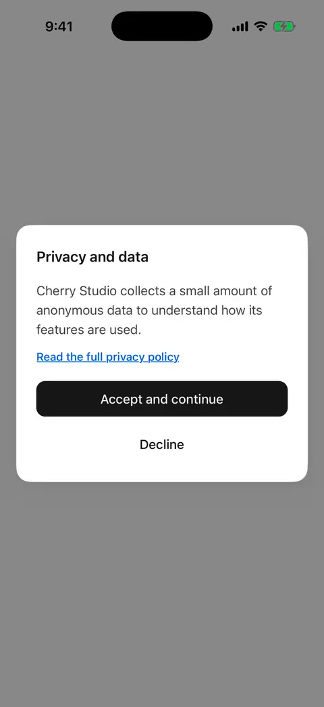
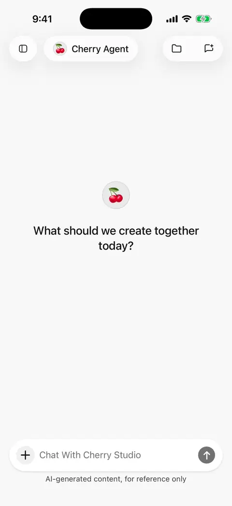

# Quick start

Get one model responding to a simple message first, then add other features as needed.

## 1. Choose how to configure

* **Already use Cherry Studio Desktop?** [Import configuration from your computer](desktop-sync.md) and choose a model. After successful import, continue to step 4 below.
* **Set up on mobile:** choose a provider during onboarding, or open **Settings → Model service → Add provider** and follow steps 2–3.

Built-in providers include common connection settings. Use a custom provider if your platform is absent.

<figure data-mobile-shot="phone"><figcaption>
<strong>iPhone walkthrough</strong> · First launch: choose a provider, add a key, pick a model, and start chatting (key blurred)
</figcaption></figure>

## 2. Enter and save a key

Enter the platform's **API key**, or use the account sign-in offered on its configuration page. Custom providers also need the base address and API format.

For a new provider, continue through creation. Existing providers save automatically, while a key-editing sheet has its own Save action. A login password is not an API key; a consumer chat subscription may not include API credits.

## 3. Add a model and enable the provider

Fetch the model list and select a text model. If discovery fails, copy the exact model ID from the platform and add it manually.

Model information may take time to download on first use. Ensure the provider is enabled, open the agent editor from the top of the conversation, and select an enabled model. See [providers and models](providers-and-models.md) for details.

## 4. Send a first message

Use the initial Cherry agent, select your model, and ask “In three sentences, describe what you can help me do.” A reply confirms the basic setup is working.

An agent is a reusable configuration containing a name, instructions, and model. You can start separate conversations with the same agent for different topics.

If nothing arrives, try a short message without attachments and follow [troubleshooting](troubleshooting.md).

<figure data-mobile-shot="phone"><figcaption>
<strong>iPhone walkthrough</strong> · Send a first message and get a reply
</figcaption></figure>

## What next?

| Task | Guide |
| --- | --- |
| Understand a photo or summarize a document | [Chat and files](chat-and-files.md) |
| Install and reuse a task method | [Skills](skills.md) |
| Share project material across chats or restore files | [File library and shared workspaces](file-library.md) |
| Save different instructions for writing or translation | [Agents and tools](agents-and-tools.md) |
| Search the web and inspect sources | [Web search and page reading](web-search.md) |
| Connect Feishu, Notion, or other accounts | [Plugins and external tools](plugins.md) |
| Generate and revise pictures | [Image generation](image-generation.md) |
| Share selected answers as images or documents | [Sharing and export](sharing-and-export.md) |
