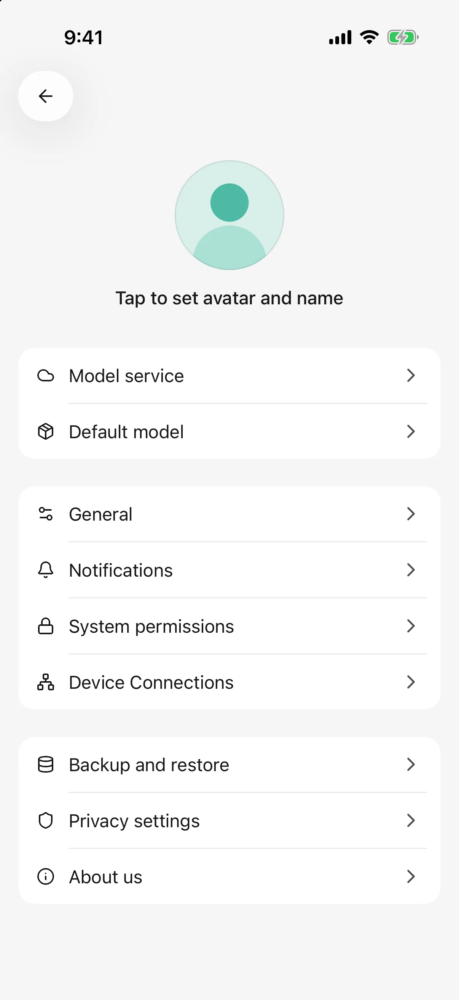
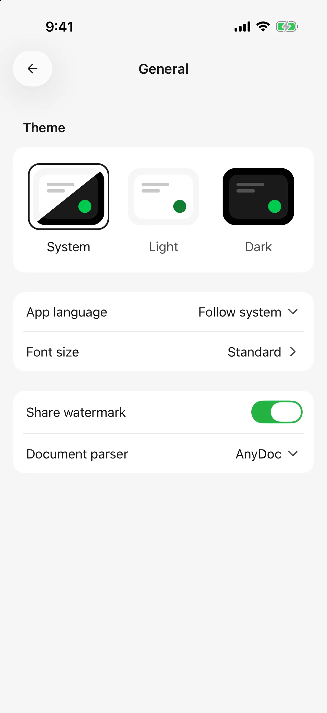
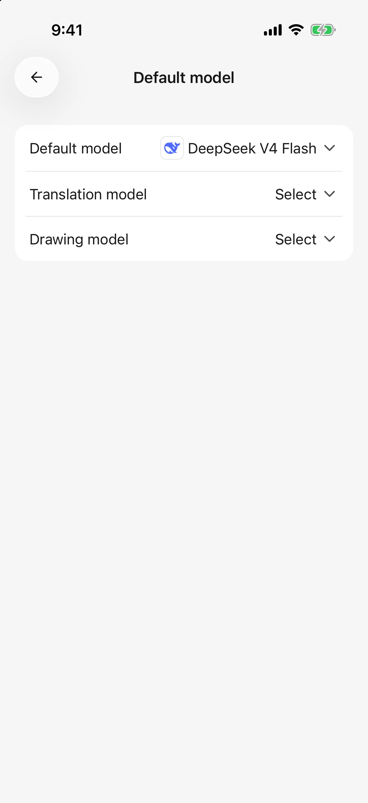
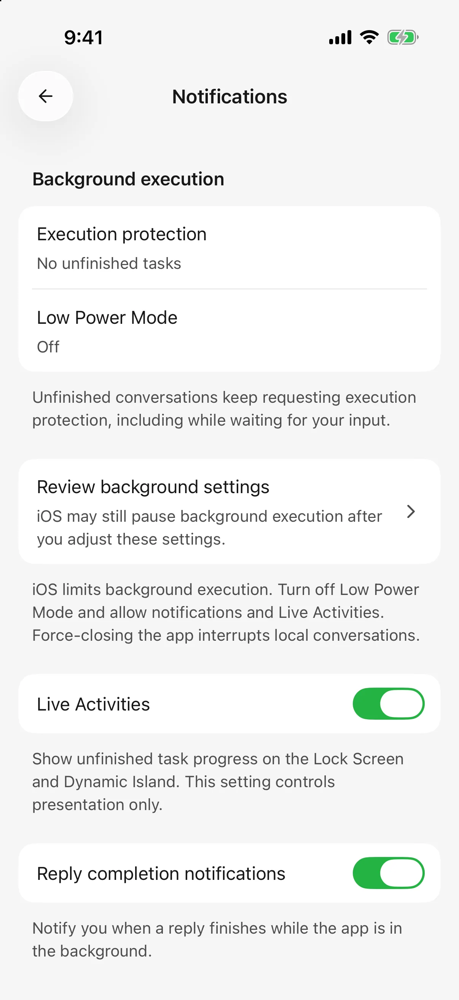

# Settings, usage, and background replies

Open Settings from the sidebar to change reading preferences, defaults, and background behavior.

## Theme, language, and text size

In **Settings → General**:

* Choose light, dark, or system theme.
* Choose the app language. App and documentation languages are selected separately.
* Open font size and use its preview to choose a comfortable size.
* Enable/disable the share watermark for future exports.

Changes save directly. Retry any failed save before leaving.

<figure data-mobile-shot="phone"><figcaption>
<strong>iPhone</strong> · Settings home
</figcaption></figure>
<figure data-mobile-shot="phone"><figcaption>
<strong>iPhone</strong> · General: theme, language, text size, watermark, and document parser
</figcaption></figure>

## Default and drawing models

In **Settings → Default model**:

* **Default model** supplies the initial text-model choice for new agents.
* **Drawing model** supplies default drawing and the image-generation tool used by text agents.
* **Translation model** handles replies and skill documents; when unset it uses the default text model. See [Translation](translation.md).

Selecting or clearing saves immediately. Existing agents keep their own models; change them in their editor or conversation picker.

If the list is empty, add available models and enable their provider first. See [model management](model-management.md) for capabilities, limits, and pricing.

<figure data-mobile-shot="phone"><figcaption>
<strong>iPhone</strong> · Default, translation, and drawing models are set separately
</figcaption></figure>

## Understand usage

Open Home from the sidebar and inspect **AI usage**. Its detail view groups recorded activity by date, model, or provider.

A response also has usage details for its model, input/output, request count, elapsed time, and cost. A **token** is a model's unit of content, not a word count. History, thinking, and repeated tool calls may also consume tokens.

* Provider-reported charges and estimates based on configured prices have different sources; inspect the labels.
* Missing prices can mean partial cost coverage, not free usage.
* Answering again and tool work can create additional requests. Deleting chat does not refund credits or remove recorded usage.
* These figures describe usage recorded by this app, not the provider account's complete balance or official bill.

Check the provider account for actual billing and remaining credits.

## Continue after leaving the app

Open **Settings → Notifications**.

| Option | Purpose |
| --- | --- |
| iPhone/iPad: Live Activity | Shows task status on supported lock screens or Dynamic Island after leaving the app |
| Android: Background replies | Attempts to continue generation and show status in notifications |
| Reply completion notifications | Attempts to notify you when a reply finishes while the app is in the background |

Progress display and completion alerts are separate options. System notification permission is also required; an enabled app switch cannot override denied permission. Tap a task notification to return to its content.

Completion while you are already viewing the task is generally quiet. Live Activities mainly appear after leaving the app, so not seeing one in the foreground does not necessarily indicate a problem.

<figure data-mobile-shot="phone"><figcaption>
<strong>iPhone</strong> · Notifications: background status, Live Activities, and completion alerts
</figcaption></figure>

## Why did locking the screen interrupt generation?

Background support is not a guarantee of continuous execution. Battery policies, operating-system limits, network loss, or process termination can stop work. Keep lengthy tasks in the foreground where possible.

A dropped model connection may trigger an automatic retry with visible status; pending message queues can also recover after reopening. If the OS ends the process, only saved data is reliable. Inspect the reply, retry state, and queue before sending again. Check painting records before repeating generation.

iOS background execution is time-limited. Live Activity displays status without guaranteeing continuous execution. A remote desktop task does not automatically stop when the phone disconnects; see [Remote chat](remote-chat.md).

A task can also pause for tool approval; return to the app and respond. Task state remains available in the app even if a notification is not delivered.

## Parsing, backups, and feedback

* **Settings → General → Document parser** controls subsequent document extraction; see [Chat and files](chat-and-files.md).
* **Settings → Backup and restore** exports a full archive or replaces data from one; see [Backup](backup-and-restore.md).
* **Settings → About** shows the version, feedback, and feedback history. Copy a report ID and check its progress after submission. Shake feedback must be enabled first, and screenshot inclusion is chosen per submission.

## Privacy and permissions

**Settings → Privacy** has separate anonymous-usage and error-report controls. **Settings → System permissions** manages camera, photos, calendar, and other device access. One does not replace the other.

See [data, privacy, and permissions](data-privacy.md).
